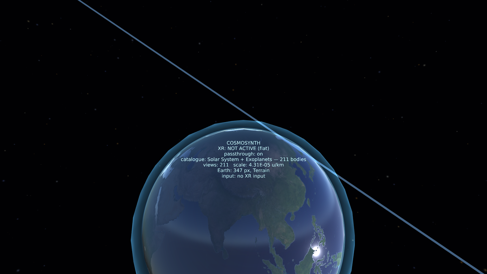
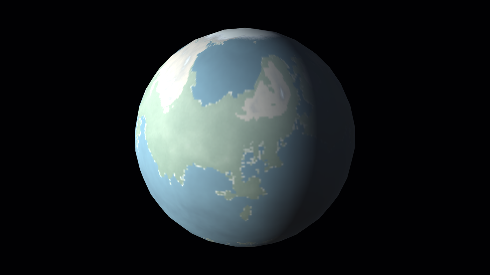
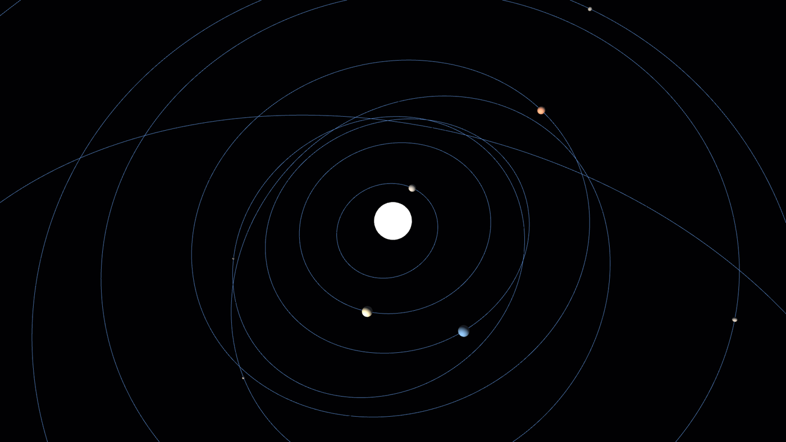

<h1 align="center">CosmoSynth</h1>
<p align="center"><em>An n-body integrator you can hold, and verify.</em></p>
<p align="center">   </p>

<p align="center">
  
</p>

A solar-system laboratory: gravity you can reach into, with the physics checked against real ephemerides rather than trusted by eye.

Built and shipped through the [ClaudeAI-UnityMCP-APK pipeline](https://github.com/ajinkyagorad/ClaudeAI-UnityMCP-APK-pipeline) — a headless Unity build server driven by Claude Code, serving APKs straight to the headset.

## What is here

| | |
|---|---|
| Unity | `6000.5.5f1` |
| Product | CosmoSynth |
| Package | `com.triton.cosmosynth` |
| Scenes | SolarSystemLab |

## Scenes

|   |   |   |
|:--:|:--:|:--:|
| <br><sub>Procedural surface</sub> | <br><sub>Solar system</sub> |   |

## AI

Built with Claude Code. The .NET test host under `tests/` exists so the integrator can be verified outside Unity, which is what makes the NASA comparison practical at all.

## Notes

- **Validated against NASA JPL Horizons** — 260 real state vectors are committed as fixtures. `./run-tests.sh Horizons` prints the accuracy tables.
- The Unity project is nested under `unity/`; the solver is a plain netstandard library so it can be tested without the editor.

## Build

```bash
# open once so Unity restores Packages/ and regenerates Library/
Unity -projectPath unity

# or headless, for Quest
Unity -batchmode -projectPath unity \
      -executeMethod ServerBuild.BuildAndroid -logFile build.log
```

Needs **Unity 6000.5.5f1** with the Android module. The first open takes a few minutes while `Library/` is rebuilt from what is committed here.

**Do not build with `-nographics`** — the APK comes out black instead of passthrough and the build still reports success.

## Related

- [AI-XR](https://github.com/ajinkyagorad/AI-XR) — passthrough · on-device inference
- [MRI Holo Viewer](https://github.com/ajinkyagorad/MRI-Holo-Viewer) — passthrough · medical imaging
- [PlanetGolf](https://github.com/ajinkyagorad/PlanetGolf) — mixed reality · orbital mechanics
- [Planetary Vitals](https://github.com/ajinkyagorad/PlanetaryVitals) — mixed reality · real measurements
- [PRISM](https://github.com/ajinkyagorad/Prism) — mixed reality · entirely procedural
- [Holo Idea Tests](https://github.com/ajinkyagorad/holo-idea-tests) — mixed reality · 26 sketches
- [ToolBench XR](https://github.com/ajinkyagorad/toolbench-xr) — mixed reality · tool bench

---

<sub>Captures are real renders from the headset build, composited onto passthrough black so they read the same in GitHub's light and dark themes. `Library/`, `Temp/`, `obj/` and build output are regenerated and not committed.</sub>
