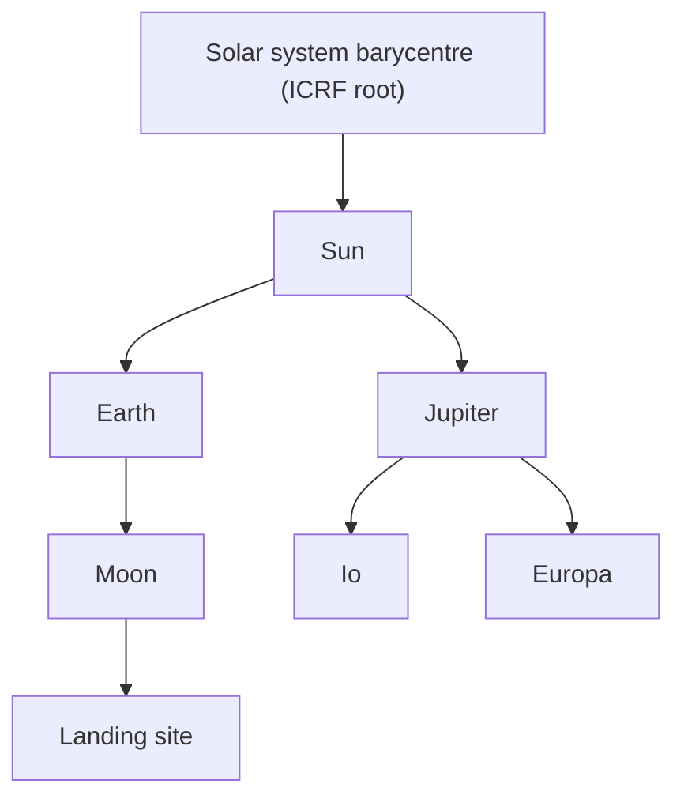
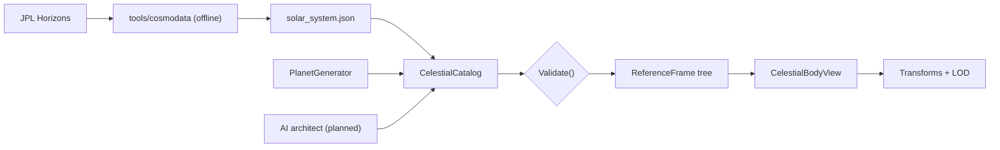

# Architecture

How CosmoSynth is put together, and why each decision went the way it did. Where a choice was
between two reasonable options, the rejected one is named too — a design document that only
lists what was chosen is impossible to revisit later.

---

## The central constraint

Unity's `Transform` stores position as three 32-bit floats. A float carries about seven
significant decimal digits, which means:

| Distance from origin | Gap between representable positions |
|---|---|
| 10 km | ~1 mm |
| 1 000 km | ~6 cm |
| 1 AU (1.5e8 km) | ~10 km |
| Neptune (4.5e9 km) | ~300 km |

A solar system cannot be placed in float world space at all. Everything below follows from
that.

**The answer is three layers acting together:**

1. **Double-precision absolute coordinates** (`Double3`, kilometres) as the authoritative
   representation. A double gives 0.45 mm at Neptune's orbit and 4 m at the nearest star.
2. **A nested reference-frame tree**, so numbers stay small before precision is even at issue.
   A lander near Enceladus is stored relative to Enceladus (~100 km), not to the barycentre
   (~1.4e9 km).
3. **A floating origin**, which keeps the rendered scene near Unity's zero by moving the
   universe instead of the viewer.

Only after all three have done their work is anything converted to float.

---

## Layers

```
┌──────────────────────────────────────────────────────────────┐
│ Editor/     scene generation, catalogue validation           │
├──────────────────────────────────────────────────────────────┤
│ Runtime/    MonoBehaviours: views, clock, origin, input, HUD │
│             ─ the only layer that knows Unity exists ─       │
├──────────────────────────────────────────────────────────────┤
│ Core/       orbits, time, frames, scale, catalogue,          │
│             procedural generation, JSON                      │
│             ─ zero UnityEngine references, fully tested ─    │
└──────────────────────────────────────────────────────────────┘
```

### Why the Core/Runtime split is absolute

Unity code is painful to test: it needs an editor, a licence, a graphics device and play mode,
and a single test run costs minutes. So the physics is kept entirely out of it. `Core` compiles
against a bare .NET runtime, which means the whole numerical layer — every Kepler solver, every
frame transform, every conversion — runs as an ordinary console program in under a second.

That is not a stylistic preference. It is the reason the orbital mechanics could be validated
against 260 real NASA state vectors at all; the same verification through the Unity Test
Runner would have been slow enough that it would not have been done as thoroughly.

The rule is enforced structurally: `CosmoSynth.Core.asmdef` sets `noEngineReferences: true`, so
adding a `using UnityEngine` to Core is a compile error, not a code-review conversation.

---

## Core modules

| Module | Responsibility | Key decision |
|---|---|---|
| `Double3`, `Matrix3d`, `MathD` | Double-precision maths | Rotations as matrices, not quaternions: the frame definitions we ingest (IAU pole elements, obliquity, SPICE kernels) are published as axis-rotation sequences, so matrices make the code a transcription rather than a translation |
| `CosmicTime` | TDB seconds past J2000 | Matches SPICE's ET exactly, so kernels drop straight in. UTC is a display format only — it is discontinuous and useless as the independent variable of an equation of motion |
| `OrbitalElements` | Classical elements ↔ state vectors | Stores the **semi-latus rectum**, not the semi-major axis: `p` stays finite for a parabola where `a` is infinite |
| `KeplerSolver` | Kepler's equation | Danby's cubic iteration with a **bisection fallback**, because near `e → 1` with `M → 0` the derivative vanishes exactly where the root is and Newton methods stall |
| `UniversalKepler` | Conic-free propagation | Exists partly as a second, independent derivation to cross-validate the first. Also the right tool for spacecraft, whose orbit may pass through `e = 1` mid-burn where classical elements are singular |
| `ReferenceFrame` | Nested frame tree | **Translation only.** Body rotation lives in `BodyOrientation`, mirroring NAIF's SPK/PCK split. Folding rotation in would make a moon's orbit appear to precess with its planet's spin |
| `TrajectoryTable` | Sampled state vectors | **Uniform** spacing, so sample times are implied by an epoch and a step rather than stored — a third of the data. The cost is that one step has to serve a whole mission, so a gravity assist is cut across rather than followed; see `docs/accuracy.md`. Knows its own ends, and callers must ask: clamping past them would park a spacecraft at its last known position looking exactly like one still flying |
| `SurfaceFixedEphemeris` | Landers and rovers | A latitude and longitude rotated by the host's own IAU model, rather than a sampled path. Exact at any epoch, six numbers, and it cannot drift out of step with the planet's rotation because it *is* that rotation |
| `ScaleSpace` | LOD, bands, navigation | Selection is by **apparent pixels**, not distance, so one rule covers a 500 m asteroid and a gas giant and adapts to any display resolution automatically |
| `CelestialCatalog` | Bodies and hierarchy | Validates physical plausibility. The AI architect and the procedural generator go through the same gate as imported data |
| `Provenance` | Per-field data lineage | Per *field*, not per object. An object's orbit can be measured while its surface is invented |
| `CubeSphere` / `TileId` | Planet surface index | Six faces, not lat/long: a lat/long grid has a coordinate singularity at each pole that every algorithm then needs a special case for |
| `NoiseD` | Coherent noise | 3D only, sampled on the sphere's surface. A 2D field wrapped onto a globe pinches at the poles and tears along the antimeridian |
| `Hash` | Deterministic randomness | Pure integer hashing (SplitMix64), never `System.Random`, whose algorithm is not contractually stable across runtimes. The same coordinate must produce the same world on every machine, forever |

---

## Reference frames



Every frame is inertially oriented (parallel to ICRF) and differs from its parent only by a
translation. A query between two frames walks to their **nearest common ancestor**, not to the
root — so "Io relative to Europa" never forms the 7.8e8 km heliocentric coordinates it would
then have to subtract back off.

**Canonical frame: ICRF / J2000 equatorial.** That follows the data — SPICE, Gaia, SIMBAD, NED
and Horizons' default vector output all live there — so the common path involves no rotation at
all and therefore no chance of applying one twice or backwards. The ecliptic frame is for
presentation, because "everything is tilted 23.4°" is not useful to a viewer.

The sign of that rotation is worth calling out: tilting the *frame* by +ε transforms a vector's
*components* by −ε. Getting it backwards does not produce an obviously broken result — it
doubles the tilt to 46.9°, which still looks like a plausible solar system until you check an
inclination against a catalogue. There is a test that does exactly that.

---

## Units

**Kilometres and seconds** throughout Core. Angles in radians, times in TDB seconds past J2000.

This matches what SPICE and Horizons emit natively, so imported data needs no unit conversion
and cannot acquire a conversion bug. Metres were the alternative; kilometres won because every
published gravitational parameter is in km³/s² and every ephemeris is in km.

Degrees appear only at the JSON boundary and in the UI, where humans read them.

---

## Scale rendering

No single camera pass can span metres to light years — a frustum reaching from a handrail to a
nebula has a depth ratio around 1e13, and no depth buffer survives that.

`ScaleSpace.DefaultBands` divides the universe into overlapping bands, each with its own world
compression and its own near/far planes, each keeping its depth ratio near 1e4–1e5. The current
build renders one band and derives its clip planes each frame from what is actually visible;
the multi-pass compositor is designed for but not yet built.

Representation is chosen by apparent size:

| Apparent diameter | Representation |
|---|---|
| < 1.5 px | Point / star-field contribution |
| < 12 px | Impostor billboard |
| < 180 px | Sphere with albedo and atmosphere shell |
| < 4000 px | Adaptive cube-sphere terrain |
| ≥ 4000 px | Streamed surface tiles |
| inside | Local detail |

---

## Data flow



Note where the generators enter: **the same validation gate as real data.** A language model
asked for "a habitable moon" will happily return one denser than a neutron star or orbiting
inside its primary, and the generator itself can produce a system whose planets are too closely
spaced to be stable. Both go through `CelestialCatalog.Validate()`, which checks densities
against material limits, orbits against Hill spheres and primary radii, and parent chains
against cycles.

Horizons is queried **offline only**. The running app never touches the network — data is
fetched once, shipped locally, and interpolated in-engine. That is what makes it work on a
headset, in a classroom, and on a plane.

---

## Floating origin

The camera is anchored to the origin: `UniverseNavigator` sets `FloatingOrigin.OriginKm` to the
viewer's absolute position every frame, so the rendered camera sits at (or very near) zero and
never accumulates float error no matter how far it has travelled.

When a rebase does occur, only **root-level** transforms are shifted — a child's world position
follows its parent, so shifting both would move it twice. Anything holding baked world-space
positions (line renderers, trails, world-space particles) implements
`IFloatingOriginListener` and is told about the shift, because the transform move does not
reach their vertex data. Orbit lines are the concrete case: without it, an orbit would tear
away from its planet the first time the camera travelled far enough to trigger a rebase.

---

## Testing strategy

| Layer | How it is verified |
|---|---|
| Core physics | 87 headless tests, < 1 s, no editor |
| Against reality | 260 committed JPL state vectors; elements matched to < 1 mas |
| Independence | Classical vs universal-variable propagation cross-checked |
| Published references | Vallado's worked example 2-6 reproduced to 6 digits |
| The shipped artefact | The real catalogue file, loaded by the real parser, checked against known periods, distances, densities and day lengths |
| Unity layer | Compiled against the editor's own assemblies; behaviour still needs the editor |

Two habits are worth stating because they changed what the tests caught:

**Test the property, not the number.** The Hermite interpolator's error was asserted by
*convergence order* — halving the step must cut the error by ~16× — rather than by an absolute
magnitude. A magnitude check passes with a subtly wrong basis; an order check does not.

**Let the physics set the tolerance.** Neptune's eccentricity disagreed with JPL by 2.4e-11,
which sounds alarming and means the orbit's focus is displaced by a hundred metres across four
and a half billion kilometres. Asserting on `a·e` tests the thing that matters. The
alternative — loosening a tolerance until it passes — would have hidden a real bug just as
effectively as it hid this non-bug.

---

## Deliberately deferred

Named so they are visible decisions rather than oversights:

- **N-body propagation.** Two-body Kepler is adequate for a viewer and is not adequate for
  mission planning. `SampledEphemeris` already exists, is the cheaper correct fix, and is now
  fed real JPL data for the spacecraft — the planets have simply not been converted yet.
- **Articulated spacecraft.** Models are baked to a single static mesh: node hierarchies are
  flattened at import. A solar array that tracks the Sun would need the hierarchy kept, and
  nothing currently animates one.
- **Multi-pass band compositor.** One pass with adaptive clip planes is sufficient for a single
  system.
- **Real terrain data.** The cube-sphere quadtree and LOD selection are built and tested; only
  the mesh generation and the USGS import remain.
- **Sector offsets for intergalactic coordinates.** A single double loses kilometre precision
  past ~1e17 km. Nothing currently rendered goes there.
- **Light-time correction.** Positions are geometric — where a body *is*, not where it
  *appears*. Correct for a spatial simulator, wrong for reproducing an observation.
