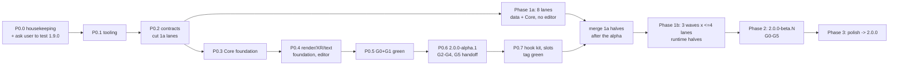

# Section D: process, lanes and gates for CosmoSynth 2.0

2026-09-11 · design phase (no code changed, no editor launched) · slug `D-process`

**Authority and scope.** This section covers *how* the 2.0 work is split, merged, built, verified and
published. The rules come from the orchestrator's binding decisions 1-9, from `CLAUDE.md`, and from the
eight research reports of 2026-09-11 (`docs/research/2026-09-11-*.md`). On process, this section wins.
On rendering, distance, axes, catalogue and XR settings, the **Foundation** section wins. On formats,
importers and licences, the **Data/Core** section wins. On the layer contract, LayerState schema and panel,
the **Runtime/UI** section wins. The section letters A/B/C for those three are INFERRED from the brief.
`docs/CONTRACT.md` supersedes all sections once it is assembled; `docs/feedback.md` already points to it.

**Tags.** **VERIFIED** means I read the file or ran the command on 2026-09-11 (evidence in §D10).
**INFERRED** means reasoned from verified facts, or general Unity/git knowledge not tested here.

---

## D0. The process on one screen

1. **One integrator, one editor, one tree with a Library.** Main is `~/projects/CosmoSynth` on `master`.
   The integrator agent is the only one who opens Unity, builds, publishes, or edits project settings.
   Every Unity invocation goes through `tools/common.sh:editor_lock` (a `flock`). The Xvfb band is
   461-490, which no other script on the box claims (VERIFIED in the build-pipeline report §6).
2. **Lanes are Library-less git worktrees** at `~/projects/CosmoSynth-wt/<lane>`, on branch `lane/<lane>`,
   at about 13 MB each. They compile and test with `./run-tests.sh`, which uses main's
   `unity/Library/ScriptAssemblies` read-only. They never render. They get screenshots through a queue
   that the integrator serves.
3. **Every file has exactly one owner.** Shared registration points carry pre-seeded
   `lane:<name> BEGIN/END` slots, and a lane may edit only inside its own slot. Git 2.43.0 merges edits in
   adjacent slots cleanly (VERIFIED by probe, §D2.1). `tools/lane.sh check` enforces ownership mechanically.
4. **Phases.**
   - **Phase 0**, in main: tooling, then contracts, then the render/XR/scale/axis/catalogue/text
     foundation, then **2.0.0-alpha.1**.
   - **Phase 1a** starts the same day. Eight vertical lanes do data and Core work only, which needs no
     editor.
   - **Phase 1b** begins after the alpha is published. The same lanes add their runtime halves, and
     `ui` and `lines` join. At most 4 lanes run at once.
   - **Phase 2**: beta build, full gates, headset.
   - **Phase 3**: polish, audio, and store readiness if the user wants it.
5. **Gates.**
   - G0, static, any tree, seconds, every gate self-tested.
   - G1, editor and play mode in main, with fatal assertions.
   - G2, IL2CPP build.
   - G3, artefact verification against the 1.9.0 xr-block baseline, with the recovered 1.9.0 APK as the
     negative control.
   - G4, publish traced to one commit.
   - G5, headset. G5 is the only proof for the 1.7.0 grid bug class. Nothing on this box can reproduce
     that class of bug (render-xr-audit §7).
6. **Nothing is ever overwritten.** The version gate fails closed. Builds land in a staging directory
   outside `~/builds`. An APK moves to the page only after G3 passes. Every published APK gets notes, a
   shot from the same commit, a git tag and a headset handoff.



---

## D1. Phased schedule

### D1.1 Phases at a glance

| Phase | Where | Editor? | Starts when | Ends when | Output |
|---|---|---|---|---|---|
| 0 | main (integrator), plus up to 2 helper lanes | yes, from P0.4 | now | `green` tag on `phase0-done`, alpha published | 2.0.0-alpha.1 (code 17) |
| 1a | 8 lane worktrees | **never** | the `phase0-contracts` commit (P0.2), which needs no editor | each lane's report says `READY-1A` | data files, Core parsers + tests |
| 1a merge | main | one import run per batch | alpha published (P0.6) and P0.7 done | all 1a halves merged, `green` | master carries all data |
| 1b | same lanes, plus `ui` and `lines` | never in lanes | its wave opens (§D1.4) | `READY-1B` and merged | runtime layers, UI, navigation |
| 2 | main | yes | all 1b merged | G5 on beta reports no blocker | 2.0.0-beta.N |
| 3 | main plus small lanes | yes | after Phase 2 | the user accepts 2.0.0 | 2.0.0, audio, tuning, docs |

**Rule: the alpha is the foundation only.** No Phase 1a data merges into master before 2.0.0-alpha.1 is
published. The user's first headset look is an A/B between 1.9.0 (Built-in, two cameras) and the alpha
(URP, one camera). Changing the star catalogue or the exoplanet file at the same time would confound it.

### D1.2 Phase 0, step by step (integrator unless stated)

| Step | What | Editor | Done when | INFERRED effort |
|---|---|---|---|---|
| **P0.0** | Housekeeping: (a) commit the pending `docs/feedback.md` (it already holds the 1.7.0 grid report verbatim, see §D6.3) together with `docs/research/` and `docs/design/`; (b) confirm `~/builds/cosmosynth/recovered/CosmoSynth-release.apk.KEEP` exists (it does, VERIFIED); (c) move `v1.7.2__01-msaa-reverted-plus-render-readout.png` (a byte-copy of v1.7.0's shot), the 9 untagged PNGs and the 5 `.report.txt` from `~/builds/shots/cosmosynth/` to `~/builds/cosmosynth/diagnostics/pre-2.0/`, with a `README.txt` line saying why; (d) `.gitignore` gets `unity/.utmp/`, then `git rm -r --cached unity/.utmp`; (e) write the **P** handoff (§D6.7) asking the user to test the recovered 1.9.0; (f) retire `~/server-setup/*-cosmosynth.sh` (§D3.12) | no | one commit, gallery holds only the 4 tagged shots minus v1.7.2, handoff written | 1 h |
| **P0.1** | Tooling port, all of §D3 except the ServerBuild and PlayModeShot changes (they need the editor). Then run every gate's `--self-test`, then a probe: `tools/lane.sh add probe`, `./run-tests.sh` inside it (must print 142 passed, 0 failed), `tools/lane.sh rm probe` | no | self-tests pass; the worktree probe passes; `tools/gates/known-red.txt` lists `G0c G0d` (expected red until P0.5) | 4 h |
| **P0.2** | Contracts: (a) `tools/lanes.txt` and `tools/phase.txt` (value `1a`); (b) doc slots in `docs/data-sources.md` (§D2.2); (c) `tools/cosmodata/cosmoio.py` (atomic write, download sniffing, provenance record, range assertion helpers), which every importer lane shares; (d) every Core type that Data/Core names as shared by two or more lanes, as a stub with a test (INFERRED list: point-population binary parser, grid/volume header, sidecar reader); (e) the `StandardFrames.EquatorialToGalactic` test (0 references today; three lanes depend on it); (f) commit, tag `phase0-contracts`, then `tools/lane.sh add` for the 8 Phase 1a lanes and the optional helpers `p0-core` and `p0-shaders` | no | tag exists, worktrees listed, preamble (§D7) handed to each lane agent | 3 h |
| **P0.3** | Core foundation. The optional helper `p0-core` does this in its worktree: the Foundation's distance mapping (per-group similarity transform plus sky at infinity) with tests; `UnityAxes` (the single ICRF→Unity mapping) with tests; one merged catalogue load (`CelestialCatalog` merges three texts, and `SetCatalog` is then called once); `HostStarOf` (B2); namespaced generated ids (B14); raised scale ceilings (architecture-map §5.13) | no | `./run-tests.sh` green, merged into main | 0.5-1 d |
| **P0.4a** | `XrSetup` extensions: create the URP asset **in code** (MSAA 4, HDR off, depth and opaque textures off, SRP batcher on, render scale 1) and assign it to GraphicsSettings and the Android quality level; Linear colour space; OpenXR Android depth submission None, symmetric projection on, latency PrioritizeInputPolling, SRP foveation on (remove it from `DisabledAndroidFeatures`), Optimize Buffer Discards on; `XrSetup.Run` prints `XRSETUP_OK` on success; disable `…input.handtracking`; Swappy off; stop creating orphan `XRManagerSettings`; delete `Assets/XR 1..3` and `Assets/XR/Settings 1..3`; headless import of TMP Essentials (`AssetDatabase.ImportPackage` of ugui's `TMP Essential Resources.unitypackage`); add the URP, RP-Core and TextMeshPro `<Reference>`s to `Runtime.Compile.csproj` | yes | G1a green; the settings YAML shows every value | 0.5 d |
| **P0.4b** | Shaders. The optional helper `p0-shaders` writes the URP HLSL: port `CosmoAtmosphere` and `CosmoRim`, and add `CosmoSynth/Planet`, `/Unlit`, `/UnlitTransparent`, `/Points`, `/Line`, `/Panel` and a shared `CosmoCommon.hlsl`. The integrator rewrites `CosmoShaders.All` to these names plus TMP's `TextMeshPro/Mobile/Distance Field`, and replaces every built-in `Shader.Find` | yes, for the compile | G0b green; G1b has no shader errors | 0.5-1 d |
| **P0.4c** | One camera: delete `DepthBands.cs` and every reference (render-xr-audit §6.3 P0.1). Scaled space through the Foundation mapping (CelestialBodyView, decorations, orbit lines). Sky layer at infinity, eye-anchored and drawn first; the star shell moves to `Runtime/Layers/PointLayer` with `CosmoSynth/Points`. The axis mapping lives only in `FloatingOrigin`; delete the swaps in `CelestialBodyView.ToUnity*`, `SkyAndRings:220`, `XrLocomotion:150`, `UniverseNavigator:144,186`. **Delete `SceneShot.cs`.** Update the `PlayModeShot` compositing and assertions (§D3.10) in the same commit | yes | G0d green; G1c green with the new assertions | 1-1.5 d |
| **P0.4d** | A single `SetCatalog` at startup, so `OnCatalogLoaded` runs once (B3); star light through `HostStarOf` (B2); `ProvenanceHud` not added while XR is active (B16); `CosmoText`/`CosmoPanel` backed by world-space TextMeshPro, with the font from `TMP_Settings.defaultFontAsset` and a legacy-TextMesh warning sign on a null font; the MR/VR mode switch in `XrRig.SetPassthrough` (clear α 0 against opaque black); extend the `render:` line (render-xr-audit V6) | yes | G1c text and glyph assertions green | 0.5 d |
| **P0.4e** | `ServerBuild`: pin the target group, env signing with a debug fallback, `Diagnostics()` with asserting dump, staging output, version 2.0.0-alpha.1 / 17 (§D3.9) | yes | G1b `DIAGNOSTICS_OK` | 0.25 d |
| **P0.5** | Empty `known-red.txt`; full G0 and G1a-G1d green on master | yes | all green | 0.5 d |
| **P0.6** | `tools/build.sh "foundation"` builds 2.0.0-alpha.1 (G2), verifies it (G3) and publishes it (G4), then write the G5 handoff (§D6.7) | yes | `RESULT=OK`, handoff written | 0.5 d |
| **P0.7** | Hook kit for 1b: seed the code slots (§D2.2); the LayerTable and layer interface skeleton exactly as Runtime/UI specifies, including the `SelfCheck()` hook that §D3.10 needs; the generic `XrInput` claim API (fixes B10 and O6); set `tools/phase.txt` to `1b`; tag `phase0-done` and move `green` there | yes (compile) | G0+G1b green; tags set | 0.5 d |

**Phase 0 total: about 4-6 days of wall clock** (INFERRED). Each Unity launch on this box takes minutes
under a load average of about 70 on 12 threads, and P0.4 needs 10-20 launches. Commit after every
sub-step so the history can be bisected. Commits inside P0.1-P0.4 may be red. `green` moves only at P0.5
and later.

**If P or alpha G5 reports a render failure** (grid, black, flat, one-eyed): 1b runtime merges freeze.
Lanes keep working, compile-only. The integrator and the Foundation owner diagnose from the `render:`
line.

### D1.3 Phase 1a (data + Core, no editor, starts at `phase0-contracts`)

Eight lanes. Each touches only `tools/cosmodata/`, `unity/Assets/StreamingAssets/CosmoSynth/`,
`unity/Assets/CosmoSynth/Core/`, `tests/CosmoSynth.Core.Tests/`, its own report, and its own
`data-sources.md` slot. When `tools/phase.txt` says `0` or `1a`, `lane.sh check` rejects anything else.

| Priority | Lane | Why it comes in this order |
|---|---|---|
| 1 | `stars` | the user's first rung past the Solar System; AT-HYG and constellations also feed `lines` |
| 1 | `cmb` | the end of the ladder; the numpy bake needs the bake lock early |
| 1 | `galaxies` | the Local Group and "beyond", which the user named explicitly |
| 1 | `milkyway` | the dust cube is the riskiest bake |
| 1 | `solar` | the biggest data lane (Moon, secular elements, SBDB, heliophysics, spacecraft) |
| 1 | `nav` | Core only: `TravelPlan`, destinations, calendar range |
| 2 | `exoplanets` | small |
| 2 | `fiction` | the content is on the laptop and on triton `~/projects/CosmicAtlasXR`; copying it takes time, not CPU |

**Concurrency cap: 6 lane agents plus the integrator** (INFERRED from the box load, not from disk: eight
worktrees cost under 0.5 GB). Priority-2 lanes start when a priority-1 lane reaches `READY-1A`.
**1a merges wait for P0.7** and then go FIFO by `READY-1A` time (§D5).

**Additive rule for 1a merges.** A 1a merge must not remove, or change the format of, any file the current
runtime reads. Replacing a format happens in the lane's 1b half, together with its reader. The `stars` lane
may swap `sky/stars.csstars` for AT-HYG because the `CSS1` layout is unchanged. The `exoplanets` lane keeps
`catalog/exoplanets.json` until its 1b loader ships.

### D1.4 Phase 1b (runtime), in three waves of at most 4 lanes

| Wave | Lanes | Opens when | Why |
|---|---|---|---|
| A | `nav`, `ui`, `stars`, `lines` | P0.7 done and the 1a halves of `stars`/`nav` merged | They touch the most shared input/UI files and set the look of the base experience. `lines` needs the constellation data from `stars`' 1a half. |
| B | `cmb`, `galaxies`, `milkyway`, `solar` | two wave-A lanes merged | The ladder: CMB, then Local Group and beyond, then the Galaxy, then the Solar System decorations. |
| C | `exoplanets`, `fiction` | two wave-B lanes merged | Lowest coupling. |
| Phase 3 | `audio` | after Phase 2 | sonification |

**Why the cap is 4** (INFERRED): every 1b lane needs captures through the single editor queue (one Unity
launch per commit, 5-10 min each on this box). Every 1b merge also costs one G1b and one G1c editor run. The
integrator serves about 20-30 editor runs a day. More than 4 lanes would queue more captures than that.

### D1.5 Phase 2 (integration build)

1. Merge the last 1b lane. Full G0 and G1.
2. Bump to `2.0.0-beta.1` (next code), then run `tools/build.sh "<caption>"`.
3. G5 handoff with the complete checklist (§D6.7).
4. Fix blockers on master, or in a short-lived lane, then build `2.0.0-beta.N`.
5. When G5 reports no blocker: bump to `2.0.0`, build, publish, `.KEEP` it, and move the xr baseline if it
   changed (§D4, G3).

### D1.6 Phase 3 (polish)

Each item is its own small lane or an integrator task:

- **Frame budget.** Needs a device measurement: the user's `adb logcat | grep VrApi` line, or OVR Metrics
  (quest-rendering §12).
- **Re-tuning.** The StarLook, galaxy and dust looks under Linear colour.
- **`audio`.** The sonification lane.
- **Docs.** Rewrite CLAUDE.md for tools/, the band and URP; README; `docs/architecture.md`.
- **Slot collapse.** Remove the markers once no lanes remain.
- **Store readiness, only if the user asks.** Release keystore (the user's decision, build-pipeline §4),
  targetSdk 34, `STORE=1 verify-apk.sh`.

### D1.7 Capacity plan (snapshot: VERIFIED `df`/`free` 2026-09-11 about 19:10; the rest INFERRED)

| Resource | Today | CosmoSynth's use | Guard |
|---|---|---|---|
| Disk `/` | **9.3 GB free (98 %)** | worktrees about 15-50 MB each (source plus obj/bin); raw downloads peak at about 0.3 GB, deleted after baking; StreamingAssets grows by +20-35 MB per tree that holds it; one APK is 55-80 MB, staged and then moved (no copy); Library growth after URP about 0.5-2 GB; IL2CPP transient 1-3 GB | editor runs need ≥ 5 GB free; builds need ≥ 8 GB; downloads over 50 MB need ≥ 6 GB. **If a guard refuses, stop and report. Never delete other projects' files.** |
| RAM | 62 GB, 40 GB available now (19 GB earlier), **swap 7/7 GB** | editor 0.7-4 GB; IL2CPP peak unmeasured (INFERRED 4-8 GB); dotnet test builds up to 1.5 GB each; numpy bakes up to 1 GB | editor runs need MemAvailable ≥ 6 GB; builds ≥ 10 GB; **one numpy bake at a time** (`flock /tmp/cosmosynth-bake.lock`). The first build logs its peak RSS and the thresholds are then tuned (§D3.3). |
| Unity editors | about 10 others on the box | **exactly 1 for CosmoSynth** | `editor_lock` plus a `pgrep` foreign-editor check |
| CPU | load about 70 on 12 threads | dotnet and python under `nice -n 10` | none; slow is acceptable |

**Effort, INFERRED agent-days per lane half (1a / 1b):**

| Lane | 1a | 1b |
|---|---|---|
| `stars` | 1.0 | 2.0 |
| `milkyway` | 1.5 | 2.5 |
| `galaxies` | 1.5 | 2.0 |
| `cmb` | 1.0 | 1.0 |
| `solar` | 2.0 | 2.5 |
| `exoplanets` | 0.5 | 1.0 |
| `fiction` | 1.5 | 3.0 |
| `nav` | 0.5 | 2.5 |
| `ui` | – | 3.0 |
| `lines` | – | 1.5 |
| `audio` | 1.5, in Phase 3 | |

That is about 36 agent-days. Wall clock is INFERRED at about 3 weeks: Phase 0 takes 4-6 days with 1a in
parallel, Phase 1b takes 8-10 days in three waves, and Phase 2 takes 1-2 days plus the user's headset
latency.

---

## D2. Lanes, ownership and hook lines

### D2.1 Ownership rules

1. **Every tracked path has exactly one owner:** the integrator (the default for anything not claimed
   below) or one lane. `tools/lanes.txt` holds the claims (§D2.15).
2. **Non-owners may edit a file only inside their own seeded slot.** A slot is a
   `lane:<name> BEGIN` / `lane:<name> END` marker pair on its own lines:
   - C#: `// lane:stars BEGIN`
   - Markdown: `<!-- lane:stars BEGIN -->`
   - Python: `# lane:stars BEGIN`

   The lane inserts or edits lines strictly between its own two markers. It never edits, moves or deletes
   a marker line, and never touches another lane's slot.
3. **Only the integrator creates slots.** It seeds one pair per lane per registration point, in
   `lanes.txt` order, with each END and the next BEGIN on consecutive lines. A lane that needs a new
   registration point asks for it in its report; the integrator seeds it on master and moves `green`.
4. **Slot position carries no meaning.** Render order, menu order and binding priority come from explicit
   fields, such as a LayerTable render-order column, never from where a line sits. One statement or row per
   line, with trailing commas in C# initializers (legal in C#).
5. **Never create `.meta` files.** The integrator's editor generates them at merge time, and they are
   committed in the merge commit (§D5).
6. **Integrator-only files:**
   - `unity/ProjectSettings/**`, `unity/Packages/**`, `unity/Assets/XR/**`, `unity/Assets/TextMesh Pro/**`
   - every `.meta`, every `*.csproj`, `tests/**/TestHarness.cs`, `run-tests.sh`
   - `tools/*.sh`, `tools/gates/**`, `tools/lanes.txt`, `tools/phase.txt`, `tools/xr-baseline.txt`,
     `tools/cosmodata/cosmoio.py`
   - `CLAUDE.md`, `README.md`, `docs/*.md` except `accuracy.md` (owned by `solar`) and the
     `data-sources.md` slots
   - `docs/design/**`, `docs/CONTRACT.md`, `docs/feedback.md`
   - `unity/Assets/CosmoSynth/Editor/**`
   - the foundation runtime files named in §D2.3

   Lanes put requested changes to these in their report.

**The slot protocol, VERIFIED on triton's git 2.43.0** (probe in `/tmp`, deleted afterwards, §D10):

- Three branches inserted lines into three adjacent `lane:*` slots of one C# array.
- All three `git merge --no-ff` runs were **CLEAN**, and the result held every insertion in its own slot.
- The control case, two branches inserting after the same line, **CONFLICTED** as expected.
- A single unchanged line between two insertions also merged cleanly, so the BEGIN/END pair has a margin
  of one line.

### D2.2 Registration points (seeded slots)

| File | Owner | Slot content | Lanes with a slot | Seeded at |
|---|---|---|---|---|
| `docs/data-sources.md` (one slot per lane, placed after the existing text) | integrator | source rows: URL, licence, attribution text, `droppable: yes/no`, output files, bytes | stars, milkyway, galaxies, cmb, solar, exoplanets, fiction, audio | P0.2 |
| `Runtime/Rendering/CosmoShaders.cs`, the `All` array | integrator | one shader name per line | stars, milkyway, galaxies, cmb, solar, exoplanets, fiction, lines, ui | P0.7 |
| `Runtime/CosmoSynthBootstrap.cs`, `BuildLayers()` | integrator | one `AddLayer<T>()` (or equivalent) line per component; the bootstrap hands references, with no `FindAnyObjectByType` | all runtime lanes | P0.7 |
| LayerTable file (Runtime/UI section decides the path; INFERRED `Core/Layers/LayerTable.cs`), `Layers` and `Rungs` | integrator | LayerState rows; scale-ladder rungs | stars, milkyway, galaxies, cmb, solar, exoplanets, fiction, lines | P0.7 |
| `Runtime/XR/XrInput.cs`, `Bindings` | `nav` (from 1b) | binding rows | ui, fiction, audio (`nav` edits its own file freely) | P0.7 |
| `Runtime/UI/CosmoTheme.cs` | `ui` (from 1b) | colour tokens for that lane's layer | stars, milkyway, galaxies, cmb, solar, exoplanets, fiction, lines, nav, audio | P0.7 |
| `Runtime/Rendering/SkyAndRings.cs`, ring table | `stars` (from 1b) | ring rows | solar | P0.7 |
| `Editor/SceneBuilder.cs` | integrator | **none**: the bootstrap builds everything in code, and textures and volumes are created at runtime from StreamingAssets bytes, so no lane needs an editor asset. A lane that thinks otherwise files a request. | – | – |
| `PlayModeShot` views | integrator | **none needed**: views are data-driven (`rung:<id>`, `dest:<id>`, `layer:<id>`, §D3.10) | – | – |
| test projects | integrator | **none needed**: `CosmoSynth.Core.Tests.csproj` compiles `Core/**/*.cs` and `tests/…/*.cs` by glob (VERIFIED), so new Core files and new test files join automatically | – | – |

Destinations and label candidates are **not** shared tables. Each layer publishes them through the layer
interface (for example `Destinations()`, `LabelCandidates()`), which is a requirement on the Runtime/UI
contract (§D9).

### D2.3 Integrator (main)

- **Tree.** `~/projects/CosmoSynth`, branch `master`. Report: `docs/reports/integrator.md`, an append-only
  log of each merge, gate result, revert, editor-run duration and peak RSS.
- **Owns:** everything not claimed by a lane. In particular:
  - Runtime: `CosmoSynthBootstrap.cs`; `Universe/{UniverseSimulation,CelestialBodyView,FloatingOrigin}.cs`;
    `Rendering/{CosmoShaders,CosmoSphere,ViewportInfo,RenderDiagnostics,ScaleRenderer}.cs`;
    `Rendering/SkyAndRings.cs` until P0.7; `Runtime/Shaders/**`; `Runtime/Layers/*.cs` (top level only:
    the shared layer kit, `PointLayer`, the layer interface); `XR/XrRig.cs`
  - `Editor/**`
  - Core: `Math`, `Physics`, `Serialization`, `Scale`, `Layers`, `Procedural`; `Catalog/**` except
    `ExoplanetTable.cs`; `Frames/**` except `BodyOrientation.cs`
  - tests: `CoreSystemsTests.cs`, `MathTests.cs`, `ProceduralTests.cs`, `SurfaceTests.cs`,
    `TerrainMeshTests.cs`, `Foundation*Tests.cs`
- **Does:** Phase 0; every merge (§D5); every Unity run; the capture queue; builds, publishing, feedback
  records, handoffs; `~/DATA-INVENTORY.md` rows for new StreamingAssets directories (Phase 2).
- **Never:** develops lane features on master outside Phase 0 and integration fixes.

### D2.4 Optional Phase-0 helpers (worktrees, deleted after merge)

| Helper | Owns (Phase 0 only; ownership returns to the integrator after merge) | Output | Tests/gates |
|---|---|---|---|
| `p0-core` | `Core/Scale/**`, `Core/Frames/{StandardFrames,UnityAxes}.cs`, `Core/Catalog/CelestialCatalog.cs`, `Core/Procedural/PlanetGenerator.cs`, `tests/CosmoSynth.Core.Tests/Foundation*Tests.cs`, `docs/reports/p0-core.md` | P0.3 | Foundation mapping tests (identity inside the near zone, monotonic, C¹ at the knee, angular size `R'/f = R/d` to 1e-12, group order preserved, bound); axis tests (a known ICRF vector maps to its stated Unity vector; handedness; inverse round trip); single-merge test (three texts, one catalogue, duplicate ids refused loudly); `HostStarOf` for Sun, moons and exoplanets; namespaced generated ids |
| `p0-shaders` | `unity/Assets/CosmoSynth/Runtime/Shaders/**`, `docs/reports/p0-shaders.md` | P0.4b shader files | G0b stereo/blend gate. The integrator's editor compiles them (G1b). |

### D2.5 Lane card format

Every card below gives: branch and worktree, phases, what it **owns** (in addition to its report
`docs/reports/<lane>.md` and its `data-sources.md` slot), **slots**, **inputs**, **1a scope → outputs**,
**1b scope → outputs**, **tests (minimum)**, **gates and captures**, **G5 items**, **research to read**. Exact
formats, constants and schemas come from the Data/Core, Foundation and Runtime/UI sections. The cards fix
scope and ownership, not algorithms.

Abbreviations: `U` = `unity/Assets/CosmoSynth`, `SA` = `unity/Assets/StreamingAssets/CosmoSynth`,
`T` = `tests/CosmoSynth.Core.Tests`, `TC` = `tools/cosmodata`.

### D2.6 `stars`: real stars from the Sun out to about 1 kpc

- **Branch** `lane/stars` · worktree `~/projects/CosmoSynth-wt/stars` · phases 1a → 1b (wave A).
- **Owns:**
  - data and Core: `TC/build_starfield.py`, `SA/sky/**`, `U/Core/Sky/**`
  - tests: `T/StarCatalogTests.cs`, `T/StarSystemFactoryTests.cs`, `T/Stars*Tests.cs`
  - runtime: `U/Runtime/Layers/Stars/**`, `U/Runtime/Rendering/{StarLook,StarSprite,StarPointBillboard}.cs`
  - from 1b: `U/Runtime/Rendering/SkyAndRings.cs`, `U/Runtime/Universe/NearbyStarSystems.cs`
- **Slots:** data-sources, CosmoShaders, bootstrap, LayerTable (layer and rung "Local stars"), CosmoTheme.
- **Inputs:** `phase0-contracts`. For 1b: the Foundation sky-layer and group-transform rules and the
  `PointLayer` kit (P0.7).
- **1a:**
  - AT-HYG v4.0 HYGLike as a drop-in source in `build_starfield.py`. Expect distance-unknown to fall from
    10,224 to about 146 (data-beyond §7.2, INFERRED until run).
  - Keep `CSS1`, unless Data/Core defines a v2.
  - Keep HIP and constellation per star.
  - `SA/sky/constellations.json` from Stellarium `skycultures/modern` (CC BY-SA 4.0), with csstars indices.
  - Regenerate `stars_named.json` for the new order.
  - Optional: the Reylé 10 pc census.
  - Core: a version check in `StarCatalog.Parse` (the parser never reads `version` today); `Photometry.cs`;
    `Constellations.cs`; `StarQuery.cs` (ray pick and nearest, over the whole catalogue); the B9 fix
    (`TemperatureFromSpectrum` provenance).
- **1b:**
  - `StarFieldLayer` plus its shader: a 3D cloud of 4 vertices per star, eye-anchored at infinity inside
    the Solar System, per the Foundation rule; model-flux and observed-sky modes; magnitude budget.
  - Remove the old star-shell code from `SkyAndRings`.
  - B13: `NearbyStarSystems` uses `StarQuery` over the full catalogue, not the 9,000 loaded.
  - De-duplicate stars that are also catalogue bodies.
  - Label candidates from `stars_named`.
- **Tests:**
  - Sirius −1.44 at 2.64 pc.
  - Counts at m ≤ 6.5 match the file.
  - Version refusal.
  - 88 figures; every index valid; no figure touches a `DistanceUnknown` star.
  - Photometry round trips.
  - A `StarQuery` hit and miss.
- **Captures:** `default`, `rung:local-stars`, `dest:sirius`, `layer:stars`.
- **G5:** stars are round points, not squares; the sky does not shift when walking 2 m; named stars are
  where the user expects them.
- **Read:** milkyway-atlas-port §4.3-4.4, §4.9-4.10, §7; data-beyond §7; quest-rendering §4 and §11.4;
  architecture-map §4.

### D2.7 `milkyway`: the Galaxy's structure, dust and clusters

- **Branch** `lane/milkyway` · phases 1a → 1b (wave B) · **numpy exception: yes** (FITS cube resample).
- **Owns:** `TC/build_milkyway.py`, `SA/milkyway/**`, `U/Core/MilkyWay/**`, `T/MilkyWay*Tests.cs`,
  `U/Runtime/Layers/MilkyWay/**`.
- **Slots:** data-sources, CosmoShaders, bootstrap, LayerTable (layers; rung "Milky Way"), CosmoTheme.
- **1a:**
  - Vergely+2022 dust cube (CDS `J/A+A/664/A174`, the 050pc product, 40 MB, fetched then deleted) → a log
    uint8 cube at 20 or 40 pc, per Data/Core.
  - Reid+2019 arm table as Core constants.
  - Skowron+2019 Cepheids: **droppable**, no licence.
  - Globulars from LVDB `gc_harris` and `gc_mw_new` (CC0).
  - Landmarks and nebula positions, **each with a reference**.
  - Never reuse the Atlas's GPL `dust.bin`.
  - Core: `DustCube` (parse, trilinear sample, extinction line integral), `SpiralArms`, landmark records.
- **1b:**
  - Dust volume layer: step-budget raymarch (quest-rendering §5). In MR, emission only, with no alpha
    written, unless Foundation decides otherwise.
  - Arms and landmark markers.
  - Cepheid and globular points through the shared `PointLayer`.
  - Procedural nebula close-ups at measured positions (fictional-and-phenomena §4.3).
- **Tests:**
  - A known voxel decodes.
  - Zero outside the box.
  - Line-integral additivity.
  - A header/size mismatch is refused.
  - Arm pitch values.
  - The globular count.
  - Drop test passes without the Cepheid file.
- **Captures:** `rung:milky-way`, `dest:galactic-centre`, `layer:dust`.
- **G5:** dust does not darken the room; frame rate holds inside the cube.
- **Read:** milkyway-atlas-port §4.2, §4.5-4.6, §4.8, §7-§9; data-beyond §6; quest-rendering §5.

### D2.8 `galaxies`: the Local Group, the Local Volume and beyond

- **Branch** `lane/galaxies` · phases 1a → 1b (wave B) · numpy: only if Data/Core declares it for the CF4
  grids.
- **Owns:** `TC/build_galaxies.py`, `SA/galaxies/**`, `U/Core/Extragalactic/**`, `T/Galaxies*Tests.cs`,
  `U/Runtime/Layers/Galaxies/**`.
- **Slots:** data-sources, CosmoShaders, bootstrap, LayerTable (layers; rungs "Local Group",
  "Local Volume", "2MRS"), CosmoTheme.
- **1a:**
  - LVDB `dwarf_all` (CC0, pinned release) plus UNGC giant hosts (M31, M33, M81 …).
  - 2MRS VizieR `J/ApJS/199/26/table3`.
  - CF4 groups `J/ApJ/944/94/table3`.
  - CF4 watershed labels BoA/BoR and the 64³ δ grid: **droppable**, no licence.
  - SDSS DR18 subsample (SHOULD).
  - Named structures with references.
  - H₀ stated in every provenance string.
  - Core: galaxy catalogue parser (or the shared point stub); `GalaxyOrientation` (Hubble inclination,
    q₀ = 0.2, PA east of north); a supergalactic frame; `Basins`; `Cosmology` (cz → d with a visible H₀).
- **1b:**
  - Galaxy layer: oriented disc impostors, a point below 3 px (quest-rendering §7).
  - Basin shells and labels.
  - Destinations for M31, M33, the Magellanic Clouds and the Local Group barycentre.
- **Tests:**
  - M31 inclination 78° ± 2°.
  - M31 at about 783 kpc.
  - PA 0 points north.
  - Label 1 = Laniakea at the attractor coordinates (data-beyond §4.2).
  - Row counts after parse.
  - Drop test passes without the CF4 files.
- **Captures:** `rung:local-group`, `rung:2mrs`, `dest:m31`.
- **G5:** galaxies read as tilted discs, not squares; the Local Group scale feels navigable.
- **Read:** data-beyond §4-5, §9, §10; milkyway-atlas-port §4.7; quest-rendering §7.

### D2.9 `cmb`: the cosmic microwave background

- **Branch** `lane/cmb` · phases 1a → 1b (wave B) · **numpy exception: yes**.
- **Owns:** `TC/build_cmb.py`, `TC/healpix_nest.py` (port of `docs/research/scripts/healpix_nest.py`, with
  its self-check), `SA/cmb/**`, `U/Core/Cmb/**`, `T/Cmb*Tests.cs`, `U/Runtime/Layers/Cmb/**`.
- **Slots:** data-sources, CosmoShaders, bootstrap, LayerTable (layer; rung "Observable universe"),
  CosmoTheme.
- **1a:**
  - Planck PR3 SMICA-noSZ, column `I_STOKES_INP`. **It is already in µK, although `TUNIT` says K_CMB.**
    Assert an rms of 30-300 µK and refuse anything else.
  - Inpainting mask.
  - WMAP 9-yr ILC as the licence-clean fallback, **behind the one data-profile switch** (decision 7).
  - Texture format per Foundation and Data/Core (equirect or EAC cubemap).
  - Sidecar: scale/offset, frame, provenance, licence.
  - Core: `CmbSky` (sidecar parse, texel ↔ µK) and `Dipole` (3362.08 µK toward (l, b) =
    (264.021°, 48.253°), plus the LG and GC frames).
- **1b:**
  - CMB sky layer: first in the sky layer, with a LUT colour map and a dipole toggle.
  - An object-form sphere at the top rung, labelled observer-centred. The sky form and the object form
    must never draw together.
- **Tests:**
  - The dipole direction in ICRS.
  - Sidecar refusal on a bad header.
  - The bake's rms assertion rejects a map scaled by the header (the known trap).
  - HEALPix self-check.
  - Drop test passes with the WMAP profile.
- **Captures:** `rung:observable-universe`, `layer:cmb`, `mode:vr`.
- **G5:** the CMB appears at the end of the ladder and never hides the room in MR unless VR mode is on.
- **Read:** data-beyond §2-3, §11, Appendices A-B; quest-rendering §6.

### D2.10 `solar`: a better Solar System, its small bodies and the heliosphere

- **Branch** `lane/solar` · phases 1a → 1b (wave B).
- **Owns:**
  - importers: `TC/{build_solar_system,horizons,bodies,fetch_validation_fixture,build_spacecraft,spacecraft,gltf,meshpack,fetch_surface_maps,build_small_bodies,build_heliophysics}.py`
  - data: `SA/catalog/solar_system.json`, `SA/catalog/spacecraft.json`, `SA/models/**`, `SA/surfaces/**`,
    `SA/smallbodies/**`, `SA/helio/**`
  - Core: `U/Core/Orbits/**`, `U/Core/Frames/BodyOrientation.cs`, `U/Core/Solar/**`
  - tests: `T/{ShippedCatalog,Spacecraft,HorizonsValidation,Orbit,Kepler}Tests.cs`, `T/Solar*Tests.cs`,
    `T/fixtures/**`
  - runtime (1b): `U/Runtime/Layers/Solar/**`,
    `U/Runtime/Rendering/{RingSystem,AtmosphereShell,PlanetTextureBaker,SpacecraftModelLoader,CsMesh}.cs`
  - docs: `docs/accuracy.md`
- **Slots:** data-sources, CosmoShaders, bootstrap, LayerTable (layers belts and heliosphere; rung
  "Heliosphere"), CosmoTheme, SkyAndRings ring table.
- **1a:**
  - Core: a corrected Moon series. The research measured 313 km median against CosmoSynth's Kepler Moon
    drift of about 85,000 km (solar-heliosphere §4.1).
  - Core: Standish secular elements, valid 1800-2050, validated against the committed Horizons fixture.
  - The moons and TNOs the research lists (§7.12).
  - SBDB small bodies for measured belts.
  - A heliophysics snapshot (monthly sunspots and F10.7, "space weather as of <UTC>").
  - Heliosphere radii from the Voyager crossings, verified against sources before they go into Core.
  - Spacecraft: New Horizons, BepiColombo, Artemis I.
  - `docs/accuracy.md` updated.
- **1b:**
  - Belt layer: a GPU Kepler point cloud.
  - Heliosphere shells: single-sided when the viewer is inside, one shell at a time.
  - Comet tails.
  - B6: `RingSystem` checks `IsGeometryDrawn`.
  - B7: textures re-applied from `view.HasSurfaceTexture`.
- **Tests:**
  - Moon against the Horizons fixture: median under 1,000 km, bound justified.
  - Secular elements against the fixture.
  - Every new body passes `CelestialCatalog.Validate`.
  - SBDB parse counts.
  - Ceres phase (V2 was 64° off).
- **Captures:** `rung:solar-system`, `dest:saturn`, `layer:belts`.
- **G5:** rings and atmospheres never float in empty sky; belts read as belts.
- **Read:** solar-heliosphere-port §4-§7, Appendix A; architecture-map §6.1 (B6, B7).

### D2.11 `exoplanets`: every known exoplanet system

- **Branch** `lane/exoplanets` · phases 1a → 1b (wave C).
- **Owns:** `TC/build_exoplanets.py`, `SA/catalog/exoplanets.json`, `SA/exoplanets/**`,
  `U/Core/Catalog/ExoplanetTable.cs`, `T/ExoplanetCatalogTests.cs`, `T/Exoplanet*Tests.cs`,
  `U/Runtime/Layers/Exoplanets/**`.
- **Slots:** data-sources, CosmoShaders, bootstrap, LayerTable, CosmoTheme.
- **1a:**
  - All 6,360 `pscomppars` rows as a compact table. Lift `--max-systems`, and fix the misleading
    "within 40 pc" claim.
  - Keep `catalog/exoplanets.json` (additive rule).
  - Core: `ExoplanetTable` (parse, and expand one system into `CelestialBody` records with per-field
    provenance).
- **1b:**
  - Host-star marker layer.
  - A system expander: `AddBodies` on approach or select, `RemoveBodies` on leaving. **Never
    `SetCatalog`.**
  - B17: orbit lines on focus, through `lines`' API.
  - Retire the old JSON once the new loader ships.
- **Tests:** row count; expand round trip; TRAPPIST-1 has 7 planets; every expanded body validates; the
  NASA acknowledgement string is present.
- **Captures:** `dest:trappist-1`, `layer:exo-hosts`.
- **Read:** data-beyond §7.5; architecture-map §4.5, §5.12.

### D2.12 `fiction`: fictional systems and phenomena exhibits

- **Branch** `lane/fiction` · phases 1a → 1b (wave C).
- **Owns:** `TC/build_fiction.py` (if needed), `SA/fiction/**`, `SA/phenomena/**`,
  `U/Core/{Fiction,Phenomena}/**`, `T/{Fiction,Phenomena}*Tests.cs`, `U/Runtime/{Fiction,Phenomena}/**`.
- **Slots:** data-sources, CosmoShaders, bootstrap, LayerTable, CosmoTheme, XrInput.Bindings (exhibit
  timeline scrub).
- **Inputs:**
  - The laptop's `webxr-examples` (holographic star map variants) and triton's `~/projects/CosmicAtlasXR`.
  - The user wrote the exhibit texts, so they are reused verbatim.
  - Rename the Marvel-flavoured names (fictional-and-phenomena §7.4).
- **1a:**
  - `SA/fiction/holosystem.json`: a Fictional catalogue that passes `Validate`.
  - `SA/phenomena/exhibits.json`: the texts.
  - The N-body capture asset.
  - Core: the eight exhibit formulas (lens equation, Schwarzschild ratios, Alfvén speed …).
- **1b:**
  - The Fictional tabletop hologram, in its own root, with no ICRF placement.
  - Skin shaders (filament, beam).
  - The nine exhibits as a panel list, spawned in front of the user, with local time.
  - Context entries on the Sun and Sgr A*.
- **Tests:**
  - **No field reachable from the real catalogue is Fictional, and a fictional catalogue holds nothing but
    Fictional fields.**
  - A known value for each formula.
  - N-body asset checksum and range.
- **Captures:** `dest:holosystem`, one per exhibit.
- **G5:** fictional content is unmistakable (the projector skin and the `?` glyph).
- **Read:** fictional-and-phenomena-port §3-§8.

### D2.13 `nav`: travel, time and locomotion

- **Branch** `lane/nav` · phases 1a (Core only) → 1b (wave A).
- **Owns:**
  - Core: `U/Core/Nav/**`, `U/Core/Time/**`
  - tests: `T/Nav*Tests.cs`, `T/TimeTests.cs`
  - runtime: `U/Runtime/Nav/**`
  - from 1b:
    `U/Runtime/XR/{XrInput,XrHandInput,XrLocomotion,TabletopManipulator,UniverseNavigator,DesktopInputSource}.cs`,
    `U/Runtime/Simulation/SimulationClock.cs`
- **Slots:** bootstrap, CosmoTheme. It owns `XrInput.cs` and so edits Bindings directly.
- **1a:**
  - `TravelPlan`: yaw solve, smootherstep, log-scale interpolation of position and scale together.
  - `Destination` record: label, absolute km, framing radius, provenance.
  - B15: calendar range and int-year overflow.
- **1b:**
  - `TravelController`, used by the panel, the selector and the harness.
  - Go-to, follow and free modes.
  - Date jump, reverse warp and "Now".
  - Mission playback over the real trajectories.
  - A proximity service ("nearest of any layer" drives flight speed).
  - B4: hand points go through `Universe.InverseTransformPoint`.
  - B5: the sticky scale target is cleared.
  - B12: the desktop camera's world/local fix.
  - Scale ceilings wired through to about 5e23 km.
- **Tests:**
  - `TravelPlan` endpoints are exact.
  - Zero velocity at u = 0 and u = 1.
  - Yaw is complete by u = 0.35.
  - The target stays on the anchor line.
  - Calendar round trip at the limits; refusal beyond them.
- **Captures:** `dest:<a few>`; the harness's `FlyTo` uses `TravelController`.
- **G5:** grab and scale do not drift under snap turn; go-to reaches M31 and returns to Earth.
- **Read:** architecture-map §2.7, §5.11, §6.1; milkyway-atlas-port §4.16, §4.19; solar-heliosphere §7.2-7.3.

### D2.14 `ui`, `lines`, `audio`

**`ui`** (1b wave A)

- **Owns:** `U/Runtime/UI/**` (CosmoTheme, CosmoText, CosmoPanel, WristDashboard, SpatialPanel,
  BodyLabelLayer, ProvenanceHud, new `Atlas/**`), `U/Runtime/XR/{BodySelector,AnchorBeacon}.cs`.
- **Slots:** CosmoShaders, bootstrap, XrInput.Bindings.
- **Scope:**
  - `AtlasPanel`, successor to WristDashboard: VIEW/LAYERS/TOOLS tabs, rungs and destinations from the
    layers, LayerState toggles and SOLO, the MR/VR toggle.
  - B11: reachable with hands only.
  - B10: trigger arbitration through the P0.7 claim API.
  - O2: rebuild only on change.
  - Live numbers in `SpatialPanel` (distance, light-time, speed, phase).
  - B8.
  - A catalogue label layer that takes candidates from every layer.
  - "Not to scale" shown in the headset.
  - A measure tool.
- **Tests:** Core-side only, for any layout maths it moves to Core.
- **Gates:** G1c glyph assertions; captures `ui:atlas`, `ui:spatial`.
- **G5:** panel readable at wrist distance, reachable with hands only, never blank.

**`lines`** (1b wave A)

- **Owns:** `U/Runtime/Layers/Lines/**`, `U/Runtime/Rendering/OrbitLineRenderer.cs`, `U/Core/Grids/**`,
  `T/Lines*Tests.cs`.
- **Slots:** CosmoShaders, bootstrap, LayerTable, CosmoTheme.
- **Scope:**
  - A screen-space-width ribbon shader with analytic AA, which writes no alpha.
  - Orbits as ribbons under the Foundation group transform.
  - Distance grids ("pristine grid").
  - Light-time rings up the ladder.
  - Constellation lines from `stars`' Core data.
  - Galactic and supergalactic grids.
  - The Sun's orbit ring at 8.2 kpc, not the Atlas's 26 kpc.
- **Captures:** `rung:solar-system`, `layer:grids`.
- **G5:** no hairlines, no stair-stepping, lines readable at every rung.

**`audio`** (Phase 3)

- **Owns:** `U/Core/Audio/**`, `T/Audio*Tests.cs`, `U/Runtime/Audio/**`.
- **Slots:** bootstrap, XrInput.Bindings, CosmoTheme, data-sources (pulsar table).
- **Scope:**
  - DSP in Core. Tests: pink noise at about −3 dB/octave, a monotonic chirp, no LFO excursion to 0.
  - One `OnAudioFilterRead` source.
  - Crab pulsar at 29.6 Hz.
  - A bed that can be muted.
  - **No RECORD_AUDIO permission** (G3 fails it).

### D2.15 `tools/lanes.txt` (the machine-readable claims; `own_gate.py` reads it)

```
# lane        phases   owned globs (repo-relative; ** recursive). Everything unclaimed belongs to the integrator.
p0-core       0        unity/Assets/CosmoSynth/Core/Scale/** unity/Assets/CosmoSynth/Core/Frames/StandardFrames.cs unity/Assets/CosmoSynth/Core/Frames/UnityAxes.cs unity/Assets/CosmoSynth/Core/Catalog/CelestialCatalog.cs unity/Assets/CosmoSynth/Core/Procedural/PlanetGenerator.cs tests/CosmoSynth.Core.Tests/Foundation*Tests.cs
p0-shaders    0        unity/Assets/CosmoSynth/Runtime/Shaders/**
stars         1a,1b    tools/cosmodata/build_starfield.py unity/Assets/StreamingAssets/CosmoSynth/sky/** unity/Assets/CosmoSynth/Core/Sky/** tests/CosmoSynth.Core.Tests/StarCatalogTests.cs tests/CosmoSynth.Core.Tests/StarSystemFactoryTests.cs tests/CosmoSynth.Core.Tests/Stars*Tests.cs unity/Assets/CosmoSynth/Runtime/Layers/Stars/** unity/Assets/CosmoSynth/Runtime/Rendering/StarLook.cs unity/Assets/CosmoSynth/Runtime/Rendering/StarSprite.cs unity/Assets/CosmoSynth/Runtime/Rendering/StarPointBillboard.cs 1b:unity/Assets/CosmoSynth/Runtime/Rendering/SkyAndRings.cs 1b:unity/Assets/CosmoSynth/Runtime/Universe/NearbyStarSystems.cs
milkyway      1a,1b    tools/cosmodata/build_milkyway.py unity/Assets/StreamingAssets/CosmoSynth/milkyway/** unity/Assets/CosmoSynth/Core/MilkyWay/** tests/CosmoSynth.Core.Tests/MilkyWay*Tests.cs unity/Assets/CosmoSynth/Runtime/Layers/MilkyWay/**
galaxies      1a,1b    tools/cosmodata/build_galaxies.py unity/Assets/StreamingAssets/CosmoSynth/galaxies/** unity/Assets/CosmoSynth/Core/Extragalactic/** tests/CosmoSynth.Core.Tests/Galaxies*Tests.cs unity/Assets/CosmoSynth/Runtime/Layers/Galaxies/**
cmb           1a,1b    tools/cosmodata/build_cmb.py tools/cosmodata/healpix_nest.py unity/Assets/StreamingAssets/CosmoSynth/cmb/** unity/Assets/CosmoSynth/Core/Cmb/** tests/CosmoSynth.Core.Tests/Cmb*Tests.cs unity/Assets/CosmoSynth/Runtime/Layers/Cmb/**
solar         1a,1b    tools/cosmodata/build_solar_system.py tools/cosmodata/horizons.py tools/cosmodata/bodies.py tools/cosmodata/fetch_validation_fixture.py tools/cosmodata/build_spacecraft.py tools/cosmodata/spacecraft.py tools/cosmodata/gltf.py tools/cosmodata/meshpack.py tools/cosmodata/fetch_surface_maps.py tools/cosmodata/build_small_bodies.py tools/cosmodata/build_heliophysics.py unity/Assets/StreamingAssets/CosmoSynth/catalog/solar_system.json unity/Assets/StreamingAssets/CosmoSynth/catalog/spacecraft.json unity/Assets/StreamingAssets/CosmoSynth/models/** unity/Assets/StreamingAssets/CosmoSynth/surfaces/** unity/Assets/StreamingAssets/CosmoSynth/smallbodies/** unity/Assets/StreamingAssets/CosmoSynth/helio/** unity/Assets/CosmoSynth/Core/Orbits/** unity/Assets/CosmoSynth/Core/Frames/BodyOrientation.cs unity/Assets/CosmoSynth/Core/Solar/** tests/CosmoSynth.Core.Tests/ShippedCatalogTests.cs tests/CosmoSynth.Core.Tests/SpacecraftTests.cs tests/CosmoSynth.Core.Tests/HorizonsValidationTests.cs tests/CosmoSynth.Core.Tests/OrbitTests.cs tests/CosmoSynth.Core.Tests/KeplerTests.cs tests/CosmoSynth.Core.Tests/Solar*Tests.cs tests/CosmoSynth.Core.Tests/fixtures/** docs/accuracy.md unity/Assets/CosmoSynth/Runtime/Layers/Solar/** 1b:unity/Assets/CosmoSynth/Runtime/Rendering/RingSystem.cs 1b:unity/Assets/CosmoSynth/Runtime/Rendering/AtmosphereShell.cs 1b:unity/Assets/CosmoSynth/Runtime/Rendering/PlanetTextureBaker.cs 1b:unity/Assets/CosmoSynth/Runtime/Rendering/SpacecraftModelLoader.cs 1b:unity/Assets/CosmoSynth/Runtime/Rendering/CsMesh.cs
exoplanets    1a,1b    tools/cosmodata/build_exoplanets.py unity/Assets/StreamingAssets/CosmoSynth/catalog/exoplanets.json unity/Assets/StreamingAssets/CosmoSynth/exoplanets/** unity/Assets/CosmoSynth/Core/Catalog/ExoplanetTable.cs tests/CosmoSynth.Core.Tests/ExoplanetCatalogTests.cs tests/CosmoSynth.Core.Tests/Exoplanet*Tests.cs unity/Assets/CosmoSynth/Runtime/Layers/Exoplanets/**
fiction       1a,1b    tools/cosmodata/build_fiction.py unity/Assets/StreamingAssets/CosmoSynth/fiction/** unity/Assets/StreamingAssets/CosmoSynth/phenomena/** unity/Assets/CosmoSynth/Core/Fiction/** unity/Assets/CosmoSynth/Core/Phenomena/** tests/CosmoSynth.Core.Tests/Fiction*Tests.cs tests/CosmoSynth.Core.Tests/Phenomena*Tests.cs unity/Assets/CosmoSynth/Runtime/Fiction/** unity/Assets/CosmoSynth/Runtime/Phenomena/**
nav           1a,1b    unity/Assets/CosmoSynth/Core/Nav/** unity/Assets/CosmoSynth/Core/Time/** tests/CosmoSynth.Core.Tests/Nav*Tests.cs tests/CosmoSynth.Core.Tests/TimeTests.cs unity/Assets/CosmoSynth/Runtime/Nav/** 1b:unity/Assets/CosmoSynth/Runtime/XR/XrInput.cs 1b:unity/Assets/CosmoSynth/Runtime/XR/XrHandInput.cs 1b:unity/Assets/CosmoSynth/Runtime/XR/XrLocomotion.cs 1b:unity/Assets/CosmoSynth/Runtime/XR/TabletopManipulator.cs 1b:unity/Assets/CosmoSynth/Runtime/XR/UniverseNavigator.cs 1b:unity/Assets/CosmoSynth/Runtime/XR/DesktopInputSource.cs 1b:unity/Assets/CosmoSynth/Runtime/Simulation/SimulationClock.cs
ui            1b       unity/Assets/CosmoSynth/Runtime/UI/** unity/Assets/CosmoSynth/Runtime/XR/BodySelector.cs unity/Assets/CosmoSynth/Runtime/XR/AnchorBeacon.cs
lines         1b       unity/Assets/CosmoSynth/Runtime/Layers/Lines/** unity/Assets/CosmoSynth/Runtime/Rendering/OrbitLineRenderer.cs unity/Assets/CosmoSynth/Core/Grids/** tests/CosmoSynth.Core.Tests/Lines*Tests.cs
audio         3        unity/Assets/CosmoSynth/Core/Audio/** tests/CosmoSynth.Core.Tests/Audio*Tests.cs unity/Assets/CosmoSynth/Runtime/Audio/**
# every lane also owns docs/reports/<lane>.md implicitly. A "1b:" glob is owned only while tools/phase.txt is 1b or later.
# While phase.txt is 0 or 1a, own_gate additionally restricts every lane whose phases include 1a to tools/cosmodata/**,
# the StreamingAssets tree, Core/**, tests/**, and its own report and data-sources slot. Phase-0 helpers (phases "0") are
# held to their explicit globs only, and own_gate refuses them once phase.txt is past 1a.
```

---

## D3. Tooling port spec

**Everything lives in `~/projects/CosmoSynth/tools/`, versioned in git.**

- **Sources.** The Worldfall originals (read in full, VERIFIED): `common.sh` 27 lines, `build.sh` 97,
  `editor-method.sh` 21, `verify-apk.sh` 171, `shot.sh` 23, `integrate.sh` 76; Mechanarium's
  `verify-store-apk.sh` 79. **Do not copy** Worldfall's rsync `lane.sh`, `integrate.sh`'s copy step,
  Mechanarium's band-blind `reap-xvfb.py`, or the stray literal `\n` at Worldfall `shot.sh:18`.
- **Script conventions.** `set -uo pipefail`. Count matches with `grep -c`, never `grep -q` (the SIGPIPE
  trap documented in Worldfall's `verify-apk.sh:7-12`). Every Unity call gets `-buildTarget Android` and
  **never `-nographics`**.

### D3.0 Exit codes (shared by all tools)

| Code | Meaning |
|---|---|
| 0 | OK |
| 1 | generic failure: no free display, or Unity exited 1 |
| 3 | expected artefact missing (APK or PNG) |
| 4 | editor lock busy for longer than `LOCK_WAIT`, or a foreign editor holds the project |
| 6 | resource guard refused (disk or RAM) |
| 7 | version gate refused (code ≤ max published, or a filename collision) |
| 8 | not main, not on `master`, or dirty tree |
| 9 | timeout (from `timeout` 124 or 137) |
| 10 | G0 red |
| 12 | G1a/G1b red (XrSetup, Diagnostics, editor compile) |
| 13 | G3 red |
| 14 | G1c red (play-mode assertions) |
| 15 | publish refused (shot commit ≠ HEAD, or the name is rejected by `shot_version`) |

`PlayModeShot` itself exits 0 OK, 1 no scene, 2 exception, 3 capture failed, or **4 assertion failed
(new)**.

### D3.1 `tools/common.sh` (sourced)

```bash
REPO=/home/triton/projects/CosmoSynth            # main: the only tree with a Library
PROJECT=$REPO/unity
UNITY=/home/triton/Unity/Hub/Editor/6000.5.5f1/Editor/Unity
OUTDIR=/home/triton/builds/cosmosynth            # published; the build page reads it on every load
STAGE=/home/triton/.cache/cosmosynth/staging     # OUTSIDE ~/builds: serve.py find_apks() walks every dir there, hidden ones included (VERIFIED)
DIAG=/home/triton/builds/cosmosynth/diagnostics  # working captures worth keeping (not scanned as shots)
RAW=/home/triton/.cache/cosmosynth/raw           # importer downloads, deleted after bake
LOCK=/tmp/cosmosynth-editor.lock
BAND_LO=461; BAND_HI=490                         # claimed by no other script on the box (build-pipeline §6)
FONT_ASSET="LiberationSans SDF"                  # what G3 looks for; change only with the Runtime/UI section
SDK=$HOME/Unity/Hub/Editor/6000.5.5f1/Editor/Data/PlaybackEngines/AndroidPlayer/SDK
BT=$(ls -d "$SDK"/build-tools/* | sort -V | tail -1)
```

Functions:

- **`start_xvfb`**: Worldfall's loop over `seq $BAND_LO $BAND_HI`: take the first display whose lock file is
  absent, keep it only if `kill -0` succeeds after 3 s, and kill it on EXIT through a trap.
- **`editor_lock`**:
  - If `COSMOSYNTH_LOCK_HELD` is set, return at once. A child such as `shot.sh` run by `build.sh` must not
    reopen the lock file: `flock` locks belong to the open file description, so a fresh `exec 9>` in the
    child would deadlock against its own parent.
  - Otherwise `exec 9>"$LOCK"; flock -w "${LOCK_WAIT:-3600}" 9 || exit 4; export COSMOSYNTH_LOCK_HELD=$$`.
  - Then refuse (exit 4) if `pgrep -f "Editor/Unit[y].*projectPath $PROJECT( |$)"` finds an editor that
    these tools did not start.
  - Then **reap the band**: while holding the only CosmoSynth editor lock, every Xvfb on 461-490 is by
    definition stale, so kill those PIDs (read from `/tmp/.X<n>-lock`) and remove their lock files. This is
    safe because no other script uses the band (VERIFIED); it is not a pattern pkill.
  - The lock is held until the script exits, so a single `build.sh` holds it across all its Unity launches.
- **`guard_resources DISK_GB MEM_GB`**:
  - Reads `df --output=avail -BG /` and `MemAvailable`, prints both, and exits 6 below either threshold.
  - Editor methods and shots use `guard_resources 5 6`; builds use `guard_resources 8 10`.
  - Mark in the file: `# ponytail: thresholds are guesses; tune from the first measured IL2CPP peak (build.sh logs it)`.
- **`require_main_clean`**: exit 8 unless `git -C $REPO symbolic-ref --short -q HEAD` is `master` and
  `git -C $REPO status --porcelain` is empty.
- **`unity_run TAG TIMEOUT METHOD [args…]`**:
  - Runs `timeout -k 60 "$TIMEOUT" "$UNITY" -batchmode $([ "${NOQUIT:-0}" = 1 ] || echo -quit) -buildTarget Android -projectPath "$PROJECT" -executeMethod "$METHOD" -logFile "$PROJECT/Logs/$TAG-$(date +%Y%m%d-%H%M%S).log" "$@"`.
    `shot.sh` sets `NOQUIT=1`, because PlayModeShot enters play mode and exits by itself.
  - Maps 124 and 137 to 9.
  - Greps the log for `^\[[A-Za-z][A-Za-z0-9]*\]|_OK|_FAIL|ASSERT_FAIL|error CS|Exception`, printing the
    last 60 lines.
  - `unity/Logs/` is already gitignored (VERIFIED).

### D3.2 `tools/editor-method.sh METHOD [unity args…]`

Sources `common.sh`, then `editor_lock`, `guard_resources 5 6`, `start_xvfb`, and
`unity_run method ${METHOD_TIMEOUT:-1200} "$METHOD" "$@"`. It exits with the Unity code.

This is the only way lanes' code reaches the editor, and only the integrator runs it.

### D3.3 `tools/build.sh "<caption>"` (G0 → G1 → G2 → G3 → G4)

Steps, each stopping on failure with the listed exit code:

1. **Where and what** (exit 8):
   - `require_main_clean`.
   - Refuse unless `git rev-parse --show-toplevel` equals `$REPO` (no worktrees).
   - Read `VER` and `CODE` from `ServerBuild.cs` with build-pipeline §9.3's `sed`.
2. **Version gate** (exit 7): `CODE` must exceed the max `versionCode` read by `aapt2 dump badging` from
   every APK under `$OUTDIR` and `$STAGE` (today 16, from the recovered file). Neither
   `$OUTDIR/CosmoSynth-$VER.apk` nor `$STAGE/CosmoSynth-$VER.apk` may exist. The gate reads artefacts, not
   names.
3. **G0** (exit 10): refuse if `tools/gates/known-red.txt` is non-empty, because a build never runs with
   excused gates. Then `tools/gates/g0.sh --full`, with its output saved for the notes.
4. `editor_lock`, `guard_resources 8 10`, `start_xvfb`. Log `MemAvailable` and `df`.
5. **G1a** (exit 12): `unity_run xrsetup 1200 CosmoSynth.EditorTools.XrSetup.Run`. It must print
   `XRSETUP_OK` and `exactly 1 MetaQuestFeature`.
6. **G1b** (exit 12): `unity_run diag 1200 CosmoSynth.EditorTools.ServerBuild.Diagnostics`. It must print
   `DIAGNOSTICS_OK`, with zero `DIAGNOSTICS_FAIL` and zero `error CS`.
7. **G1c** (exit 14): `tools/shot.sh --views release --out "$STAGE/shots-$VER"`, with the lock already
   held. It must print `PLAYSHOT_OK`, and the report's `commit` must equal `HEAD` with `dirty 0`.
8. **G2** (exit 9 on timeout, 3 on no APK):
   ```bash
   COSMOSYNTH_OUTDIR="$STAGE" /usr/bin/time -v timeout -k 60 3600 "$UNITY" … \
     -executeMethod CosmoSynth.EditorTools.ServerBuild.BuildAndroid -logFile …
   ```
   It must print `BUILD_OK`. Record `Maximum resident set size` and the BuildPlayer time. The APK must be
   exactly `$STAGE/CosmoSynth-$VER.apk` (no `ls -t` guessing).
9. **G3** (exit 13): `tools/verify-apk.sh "$STAGE/CosmoSynth-$VER.apk"`, output saved.
10. **G4 publish** (exit 15):
    - `python3 tools/shotname.py "v$VER__01-<caption-slug>"` must return `(VER, caption)` (§D3.11).
    - `mv -n` the APK into `$OUTDIR`, then check that it arrived and that the stage copy is gone.
    - Copy the default-view PNG to `$OUTDIR/CosmoSynth-$VER.apk.png` and
      `~/builds/shots/cosmosynth/v$VER__01-<caption-slug>.png`. Other release views become `__02…`, capped
      at 4.
    - Write `CosmoSynth-$VER.apk.notes.txt` (template in §D6.2).
    - `git tag -a v$VER -m "CosmoSynth $VER (code $CODE)"`.
    - Write `docs/reports/handoff-$VER.md` and commit it together with the tag.
    - Print `RESULT=OK CosmoSynth-$VER.apk`.

**No skip flags.** A gate that can be skipped is how bad builds ship. The signing environment follows
Worldfall `build.sh:13-22`: if `~/projects/CosmoSynth_secrets/{cosmosynth.keystore,keystore.pass}` exist,
export `COSMOSYNTH_KEYSTORE`, `…_PASS`, `…_KEY_ALIAS` and `…_KEY_ALIAS_PASS`; otherwise print
`SIGNING=debug (sideload only)`. **Today no CosmoSynth keystore exists** (VERIFIED, build-pipeline §4).
Creating one is the user's decision.

### D3.4 `tools/verify-apk.sh <apk>` and `STORE=1` (G3)

Worldfall's structure is kept: `has()` counts matches, `pass`/`bad`/`warn`, the xmltree VR category, the
orientation parse and the self-test. The CosmoSynth checks:

| Check | Verdict |
|---|---|
| package `com.triton.cosmosynth`; `versionName` equals the filename's `<ver>`; not debuggable | FAIL |
| boot.config: `xrsdk-pre-init-library=UnityOpenXR`, ≥ 10 `xr-*` entries, `xr-use-vulkan-offscreen-swapchain` | FAIL |
| **xr-block MD5** (`grep -i 'xr-' \| md5sum`) must be listed in `tools/xr-baseline.txt`. Today that means `2e1fc6ccd7f09d6cbe013eb1c74e9e02` (1.9.0 = Mechanarium-1.0.1 = Microverse-0.1.6, VERIFIED). If the Foundation turns MVPVV on, the expected block is `9dd8284e0dd84f1eb53cd40c80cd145d` (Worldfall 0.1.14/0.1.15, which differs only in `xr-mvpvv-enabled=2`, VERIFIED), and it is not headset-confirmed here. On a mismatch, print the line diff against the baseline block | FAIL |
| libs `libUnityARFoundationMeta.so libUnityOpenXR.so libopenxr_loader.so libUnityOpenXRHands.so`; arm64 only, 0 armeabi-v7a | FAIL |
| manifest: `com.oculus.intent.category.VR`, `com.oculus.feature.PASSTHROUGH`, headtracking, `HAND_TRACKING`, `OPENXR` | FAIL |
| manifest has none of EYE_TRACKING, USE_SCENE, USE_ANCHOR_API, RECORD_AUDIO, android.permission.CAMERA, IOT_MAP_DATA | FAIL |
| INTERNET, BOUNDARY_VISIBILITY, missing passthrough pre-splash, targetSdk > 34, debug signature, `libswappywrapper.so` present | warn (**FAIL with `STORE=1`**) |
| **data**: every file under `SA/**` in the tree (excluding `.meta`, minus any list ServerBuild wrote as excluded by the active data profile) is present at `assets/CosmoSynth/<rel>` with the same size. The list is derived from the tree, never hand-kept | FAIL |
| **shaders**: every name parsed from `CosmoShaders.All` in the source occurs in `strings assets/bin/Data/*` (catches the magenta-after-stripping trap) | FAIL (see promotion rule) |
| **font**: `"$FONT_ASSET"` count > 0 and `TMP_SDF-Mobile` count > 0 in `strings assets/bin/Data/*` (memory `unity-headless-text-fonts`) | FAIL |
| **URP**: the Foundation's URP asset name (for example `CosmoSynth_URP`) or `UniversalRenderPipelineAsset` occurs in the data | FAIL (see promotion rule) |
| **baked MSAA scan**: `tools/gates/qsettings_scan.py <apk> <QualitySettings.asset>` (render-xr-audit Appendix B). FAIL if its SELF-CHECK fails. FAIL if G0d counted more than one camera while any Android level has AA > 1. Otherwise print the values | FAIL / info |
| signing DN printed | info |

- **Promotion rule for new checks.** A check whose pattern is INFERRED (the shader and URP strings) lands as
  `warn` on its first build. It is promoted to FAIL, a one-line change noted in the build notes, once it has
  been seen passing on a build whose G1b dump confirms the property. A guard that cannot pass is as broken as
  one that cannot fail (memory `verification-gap-pattern`).
- **`--self-test` (proof harness).** First Worldfall's `has()` test. Then run the whole verifier on the
  **recovered 1.9.0** (`.KEEP`, stable) and compare each named verdict with a table in the script:

  | Check on 1.9.0 | Expected verdict | What it proves |
  |---|---|---|
  | xr MD5 | pass | the baseline comparison can pass |
  | VR category, libs | pass | – |
  | `versionName` against the filename `CosmoSynth-release` | **FAIL** | the name check can fail |
  | font count | **FAIL** (legacy TextMesh in 1.9.0) | the font check can fail |
  | URP string | **FAIL** (Built-in) | the URP check can fail |
  | `CosmoSynth/Planet` shader string | **FAIL** | the shader check can fail |
  | Swappy | warn | – |
  | qsettings scan with `git show bcb2886:unity/ProjectSettings/QualitySettings.asset` | SELF-CHECK PASS, L2 AA 0 | the scan decodes |

  Every expected FAIL proves a check *can* fail. Any deviation prints `SELF-TEST FAIL` and exits 1.

### D3.5 `tools/shot.sh` (G1c and lane captures)

```
tools/shot.sh [--views v1,v2|release] [--out DIR] [--hide PATTERNS] [--profile clean]   # current main HEAD
tools/shot.sh --rev <commit> [same options]    # detached checkout of <commit>, restored by trap
tools/shot.sh --queue                          # serve /tmp/cosmosynth-shotq/*.req, oldest first
```

- **Default output:** `/tmp/cosmosynth-shots/<sha7>/<view>.png` plus `<view>.report.txt`. `--out` refuses
  any path under `~/builds/shots` (exit 1). **Never the gallery**: only build.sh's G4 step writes there.
- **Unity call:** `editor_lock` (skipped if already held by build.sh), `guard_resources 5 6`, `start_xvfb`,
  then `unity_run shot 1800 CosmoSynth.EditorTools.PlayModeShot.Run -shotViews <list> -shotOut <dir> -shotCommit <sha> -shotDirty <0|1> -shotHide "<patterns>" -shotProfile <profile>`.
  Note: no `-quit`, like today's `playshot-cosmosynth.sh`; the harness exits itself.
- **`--rev`:**
  - `require_main_clean`.
  - `git -C $REPO switch --detach <commit>`, with
    `trap 'git -C $REPO switch master && git -C $REPO clean -fdq -- unity/Assets' EXIT`.
  - The `clean` is safe: `require_main_clean` guaranteed no untracked files before the switch. What it
    removes are only the `.meta` files and assets the import of a lane commit left behind.
  - Write the sentinel `/tmp/cosmosynth-main-detached` (commit, pid), removed by the trap.
  - Every tool that edits or builds main refuses while the sentinel exists.
  - The next editor run on master recompiles: that is the cost of not having a second Library.
- **Queue:**
  - A request file `/tmp/cosmosynth-shotq/<lane>-<epoch>.req` holds `lane=`, `commit=` (must be a
    commit on `lane/<lane>` or master), `views=`, `hide=`, `profile=`.
  - The integrator runs `--queue` at merge boundaries, one Unity launch per request.
  - Results go to `/tmp/cosmosynth-shots/<lane>/<sha7>/`, and `<epoch>.done` or `<epoch>.failed` holding
    the exit code and the last 40 log lines.
  - **Lanes never run shot.sh.**

### D3.6 `tools/lane.sh`

```
tools/lane.sh add <name>     # integrator: refuses unless <name> is in lanes.txt
                             # git worktree add -b lane/<name> ~/projects/CosmoSynth-wt/<name> green (phase0-contracts before green exists)
                             # prints the worktree path and "hand the lane agent §D7 plus card §D2.x"
tools/lane.sh check <name>   # anyone: G0h ownership gate (own_gate.py) on master...lane/<name>
tools/lane.sh merge <name>   # integrator: the protocol of §D5, steps 1-9
tools/lane.sh rm <name>      # integrator: refuses unless lane/<name> is merged into master
                             # (git branch --merged master); worktree remove; branch -d
tools/lane.sh list           # git worktree list + each report's Status line
```

`own_gate.py <lane>`:

1. Compute `git merge-base master lane/<lane>` and diff the branch against it
   (`git diff --name-status <base> lane/<lane>`).
2. Every changed path must match one of the lane's globs, respecting `1b:` and the Phase-1a restriction
   (`tools/phase.txt`).
3. Otherwise the file must contain the lane's markers at the base, and every hunk of
   `git diff -U0 <base> lane/<lane> -- <file>` must lie strictly between that lane's BEGIN and END lines.
4. Any `*.meta` change fails. Any change to marker lines fails.
5. `--self-test` builds a throwaway repo in `mktemp -d` (as my probe did) and asserts that an in-slot edit
   passes and that an out-of-slot edit, a marker edit, a `.meta` addition and an unowned file each fail.

### D3.7 `tools/gates/` (G0; every script supports `--self-test`)

| Script | Id | Scope and rule | Self-test |
|---|---|---|---|
| `g0.sh [--full]` | G0 | Runs the self-tests, then G0a-G0g (and G0h on a `lane/*` branch). Prints `G0x PASS\|FAIL\|KNOWN-RED`. A gate listed in `known-red.txt` is printed but does not set the exit code. Exit 0 or 10 | – |
| `../run-tests.sh` | G0a | See §D3.8. Passes when the suite's `N passed, 0 failed` has N ≥ `tools/gates/test-floor.txt` (142 today). The integrator raises the floor after each merge, so a deleted test cannot pass silently | – |
| `stereo_gate.sh` | G0b | Every `*.shader` and `*.hlsl` under `unity/Assets/CosmoSynth/**`, plus `unity/Assets/TextMesh Pro/Shaders/TMP_SDF-Mobile.shader`. Files with `#pragma vertex` must contain `multi_compile_instancing`, `UNITY_VERTEX_INPUT_INSTANCE_ID`, `UNITY_VERTEX_OUTPUT_STEREO`, `UNITY_SETUP_INSTANCE_ID`, `UNITY_INITIALIZE_VERTEX_OUTPUT_STEREO`, `UNITY_SETUP_STEREO_EYE_INDEX_POST_VERTEX`. CosmoSynth shaders must also have: name `CosmoSynth/…`; tag `"RenderPipeline"="UniversalPipeline"`; no `multi_compile`/`shader_feature` other than instancing unless `// variant-justified:`; no `ZTest Always` unless `// ztest-justified:`; any additive `Blend One One` must be exactly `Blend One One, Zero One` (regex anchored at line end, so `Zero OneMinusSrcAlpha` does not satisfy it by prefix) or come with `ColorMask RGB` in the same pass | fixtures `fixtures/shader/good.shader` and one mutant per rule; good passes, each mutant fails |
| `settings_gate.py` | G0c | Stdlib regex over YAML. Asserts: `GraphicsSettings.m_CustomRenderPipeline` is set, and the referenced URP asset has MSAA 4, HDR off, depth and opaque textures off, SRP batcher on, render scale 1 (**derive the field names from Microverse's or Worldfall's URP asset, never from memory**); the Android default quality level's RP is empty or the same asset; `m_ActiveColorSpace: 1`; OpenXR Android `m_renderMode 1`, `m_depthSubmissionMode 0`, `m_latencyOptimization 1`, `m_symmetricProjection 1`, `m_optimizeBufferDiscards 1`, SRP foveation API with the FoveatedRendering feature on; exactly one `MetaQuestFeature` document (script guid `f647cc05…`); `…input.handtracking` off; no `Assets/XR [0-9]*` or `Assets/XR/Settings [0-9]*`; one "Android Providers" manager. **Cross-check:** FAIL if Optimize Buffer Discards is on while G0d counts more than one camera | negative control: `git show c450708:` (the 1.7.2 tree) must FAIL on pipeline, colour space, depth submission, latency and symmetric projection, each by name. The positive control is the committed settings after P0.5 |
| `code_gate.sh` | G0d | Over `U/Runtime/**/*.cs`: exactly **1** `AddComponent<Camera>` / `AddComponent(typeof(Camera))`; **0** of `CopyFrom(`, `CameraClearFlags.Depth`, `CameraClearFlags.Nothing`, `targetTexture\s*=`, `Graphics.DrawMesh`, `Graphics.RenderMesh`, `Graphics.Blit`, `CommandBuffer`, `OnRenderImage`, `\bGL\.`, `Camera.current`; `Shader.Find(` only in `CosmoShaders.cs`; axis-swap shapes (`\.x\s*,[^,;]*\.z\s*,[^,;]*\.y`) only in `FloatingOrigin.cs`; `SetCatalog(` at most once outside its own definition; `new Color(` / `Color\.[a-z]` outside `CosmoTheme.cs` (except `Color.clear` for the passthrough clear); any file reading `RenderedRadius` must also reference `IsGeometryDrawn`. A hit is allowed only with a same-line `// gate-justified: <reason>`, and is still counted. Writes the camera count to `$TMPDIR/cosmosynth-g0d.cameras` for G0c and G3 | fixture `.cs` files, one per rule, each flagged; a justified fixture passes |
| `class_gate.sh` | G0e | Worldfall `integrate.sh:53-65` over `U/**/*.cs`: each file declares a type named after the file; at most one `MonoBehaviour` per file; a MonoBehaviour's class name equals the file name. **Warnings are failures** | fixtures: two MBs in one file; wrong name |
| `data_gate.py` + `drop_test.sh` | G0f | Every file under `SA/**` is named in `docs/data-sources.md` with a licence. StreamingAssets total must stay ≤ `tools/gates/data-budget.txt` MB (initial 80, INFERRED from data-beyond §11). The drop test runs `git archive HEAD` into `mktemp -d`, deletes every file whose row says `droppable: yes`, and runs the Core suite there with `-p:UnityScriptAssemblies=<main>`. It must pass, which proves "drop without code changes" for Core (decision 7) | a scratch doc missing one file must fail; a fake droppable file whose test does not skip must fail |
| `binding_gate.py` | G0g | Parses the rows of `XrInput.Bindings`. Each (control, mode) pair appears once. The regex is adapted to the actual row syntax, which is INFERRED here | fixture with a duplicate row |
| `own_gate.py` | G0h | §D3.6 | §D3.6 |
| `qsettings_scan.py` | (G3) | render-xr-audit Appendix B, verbatim | its own YAML self-check |
| `known-red.txt`, `test-floor.txt`, `data-budget.txt`, `log-allowlist.txt` | – | integrator-owned control files | – |

### D3.8 `run-tests.sh` (edit)

Replace lines 50-59 with build-pipeline §9.2's version, and add three things:

1. **ScriptAssemblies fallback.** `SA=$REPO_ROOT/unity/Library/ScriptAssemblies`, falling back to
   `/home/triton/projects/CosmoSynth/unity/Library/ScriptAssemblies`. Print the date of
   `Unity.XR.Hands.dll`, and pass `-p:UnityScriptAssemblies="$SA"`. This fixes the 16 CS errors of a
   Library-less tree (VERIFIED by the build-pipeline probe).
2. **Private log.** `LOG=$(mktemp /tmp/cosmosynth-runtime-build.XXXXXX.log)`. The shared fixed path is
   clobbered by concurrent trees (VERIFIED).
3. **Per-tree lock.** `exec 8>/tmp/cosmosynth-tests-$(printf %s "$REPO_ROOT" | md5sum | cut -c1-8).lock; flock 8`.
   Two concurrent builds in one tree are a race in principle.

Also run `nice -n 10` for the dotnet calls, build `tests/CosmoSynth.Editor.Compile` when it exists, and
correct the false "clean checkout builds" comment in `Runtime.Compile.csproj:32-36`.

**`tests/CosmoSynth.Editor.Compile` (feasible, time-boxed to 2 h, else drop and say so in the P0 report):**

- A netstandard2.1 project compiling `Core/**`, `Runtime/**` and `Editor/**` against:
  - `$(UnityManaged)` modules plus `UnityEditor.CoreModule.dll`, which exists in `Managed/UnityEngine/`
    (build-pipeline §2.5);
  - the package Editor DLLs from ScriptAssemblies: `Unity.XR.OpenXR.Editor`,
    `Unity.XR.Management.Editor`, `Unity.XR.OpenXR.Features.MetaQuestSupport(.Editor)`,
    `Unity.RenderPipelines.Universal.Editor/Runtime`, `Unity.TextMeshPro(.Editor)`, all present (VERIFIED
    listing).
- Worth it because `ServerBuild`, `XrSetup` and `PlayModeShot` are compiled by nothing outside Unity today.

### D3.9 `ServerBuild.cs` (edit, integrator, P0.4e)

- **Pin the target.** `EditorUserBuildSettings.selectedBuildTargetGroup = BuildTargetGroup.Android` in
  `BuildAndroid` and `Diagnostics` (Worldfall `WorldfallBuild.cs:104-107`). Call `SwitchActiveBuildTarget`
  if the active target is not Android.
- **Output.** `OutputDirectory` is `COSMOSYNTH_OUTDIR`, defaulting to
  `/home/triton/.cache/cosmosynth/staging`. **It never writes `~/builds`.**
- **Scene.** Remove the duplicate `EnsureScene`. If the committed scene is missing, fail with a message
  naming `SceneBuilder`.
- **Signing.** `ApplySigning()` copied from Worldfall `WorldfallBuild.cs:176-197` with `COSMOSYNTH_*`
  names, falling back to `~/.android/debug.keystore` (cert SHA-256 `e39a7703…4a17`, the same key as 1.9.0,
  so 2.0 installs over 1.9.0 without an uninstall).
- **Version.** `Version` and `VersionCode` stay hand-set constants, which build.sh reads and gates. The
  first 2.0 values are `"2.0.0-alpha.1"` and `17`.
- **`Diagnostics()` asserts, it does not just dump.** It prints one `[ServerBuild]` line each for:
  - Unity version, product, bundle id, version/code, min/target SDK, arch, backend, APIs, colour space;
  - quality level, RP asset name, and the URP MSAA, HDR, depth texture, opaque texture, SRP batcher and
    render scale;
  - OpenXR Android renderMode, depthSubmissionMode, latencyOptimization, symmetricProjection,
    optimizeBufferDiscards, foveation API, and the enabled feature ids;
  - the MetaQuestFeature count, the Always Included shader names, the scenes, and the LayerTable rows.

  It then prints `DIAGNOSTICS_FAIL <what>` for every deviation from binding decisions 1-2, and exits 1 if
  there are any, otherwise `DIAGNOSTICS_OK` and exit 0.

  G0c reads the YAML and G1b reads the API: two independent sources, which agree only when both are right.
- **Data profile.** When the active data profile excludes files, write
  `$OUTDIR/CosmoSynth-<ver>.excluded.txt` for G3.

### D3.10 `PlayModeShot.cs` (edit, integrator, P0.4c)

**Arguments:**

- `-shotViews` is a comma list, all captured in one play session after one settle. This amortises editor
  start on this loaded box.
- View grammar: `default`, `wide`, `mode:vr`, `rung:<id>`, `dest:<id>` (flight through
  `TravelController` once `nav` lands, `FlyToStar` until then), `layer:<id>` (solo), `star:<n>` (legacy),
  `ui:<panel>`.
- `release` expands to `default,wide,mode:vr` plus every rung in the LayerTable. It is derived, not a
  hand-kept list.
- `-shotCommit`, `-shotDirty`, `-shotHide` (as `COSMOSYNTH_HIDE`), `-shotProfile`.

**Report:** first line `commit <sha> dirty <0|1> unity <ver> profile <p> views <n>`.

**Fatal assertions:** each prints `ASSERT_FAIL <id>: <detail>`, and any failure means exit 4. Success
prints `PLAYSHOT_OK`.

| Id | Assertion |
|---|---|
| `catalog` | `CatalogLoaded` raised exactly once; view count equals the merged catalogue's body count (derived, not 235) |
| `camera` | before the harness touches anything: exactly 1 enabled camera with `targetTexture == null`; its clear is SolidColor with α 0 while passthrough is requested, and opaque in `mode:vr` |
| `far` | no drawn renderer beyond 0.9 × the far plane from the eye, except the sky layer, which must sit at its declared radius, centred on the eye within 1e-4 m, and render first |
| `group` | for every group in the Foundation mapping, every member's rendered position is `E + s_G·(p − E)` and its radius `s_G·r`, to 1e-6 relative (angular size exact); intra-group depth order equals true order; near-zone groups have `s_G = 1` |
| `stereo` | placement reads only the centre-eye pose (a synthetic ±32 mm pair of view matrices changes no transform); disparity of a near test object matches `0.063/d` within 10 %; far groups are sub-pixel |
| `alpha` | clear α 0; for each additive layer in the LayerTable, destination-alpha coverage with the layer hidden equals coverage with it shown (Δ = 0 px). This is the CLAUDE.md probe, automated per layer |
| `text` | every visible label has a non-null font and `characterCount > 0`; `font.HasCharacters(<test string with Greek, °, ′, ″ and the symbols Runtime/UI names>)` reports no missing characters |
| `shaders` | no renderer uses `Hidden/InternalErrorShader`; every material's shader name is in `CosmoShaders.All` |
| `layers` | every layer's `SelfCheck()` returns no strings (a requirement on the layer contract) |
| `log` | zero Error or Exception log entries after settle, apart from `tools/gates/log-allowlist.txt` entries, each with a justification |

Informational, never fatal (the editor on llvmpipe is not the device): draw calls, triangles, vertices per
layer, and the `render:` line.

Delete the `DepthBands` compositing (`PlayModeShot.cs:391-394,552-553,764-765,811-812`). Keep
`ProbeDestinationAlpha` and `COSMOSYNTH_HIDE`.

### D3.11 `tools/shotname.py NAME` (screenshot names come from the real parser, read-only)

This script never edits and never imports `serve.py`, because importing it would execute its module-level
code. It extracts only `SHOT_VERSION` and `shot_version` with `ast` and evaluates them:

```python
import ast, re, sys
src = open('/home/triton/control-panel/serve.py').read()
keep = [n for n in ast.parse(src).body
        if (isinstance(n, ast.Assign) and any(getattr(t, 'id', '') == 'SHOT_VERSION' for t in n.targets))
        or (isinstance(n, ast.FunctionDef) and n.name == 'shot_version')]
ns = {'re': re}; exec(compile(ast.Module(keep, []), 'serve.py', 'exec'), ns)
if sys.argv[1] == '--self-test':
    assert ns['shot_version']('v1.3__01-attach-camera') == ('1.3', 'attach camera'); print('ok'); sys.exit()
print(*ns['shot_version'](sys.argv[1]), sep='\t')
```

`build.sh` requires the printed version to equal `VER` and the caption to be non-empty. The regex
(`serve.py:2252`) accepts `2.0.0-alpha.1`.

### D3.12 Retire `~/server-setup/*-cosmosynth.sh`

Insert this as line 2 of each of the four scripts:
`echo "retired 2026-09: use ~/projects/CosmoSynth/tools/ (see CLAUDE.md)" >&2; exit 2`. Keep the rest for
history; `never-delete.txt` protects the directory.

Reason: `build-cosmosynth.sh` would build ungated with the 141-180 band, and `playshot-`/`shot-cosmosynth.sh`
write into the published gallery by default (VERIFIED, build-pipeline §2.1). `SceneShot.cs` is deleted in
P0.4c, so `shot-cosmosynth.sh` is dead anyway.

---

## D4. Gates G0-G5 (plus P)

| Gate | Command (who, where) | Pass criterion | Proves | Cannot prove |
|---|---|---|---|---|
| **P** (now) | user installs `/dl/cosmosynth/recovered/CosmoSynth-release.apk` (1.9.0, code 16) | the user answers the three P questions (§D6.7); answer recorded verbatim | whether the 1.7.1 MSAA revert already removed the grid; the A/B baseline for the alpha | anything about 2.0 |
| **G0** | `tools/gates/g0.sh [--full]`; lanes in their tree, the integrator in main (build.sh uses `--full`) | exit 0; every `G0x` PASS or KNOWN-RED (known-red only during Phase 0) | source invariants: Core math and data tests; shaders carry the stereo macros and never write alpha additively; settings YAML holds the decided values; one camera and none of the banned render calls; no axis swaps outside FloatingOrigin; one SetCatalog site; MonoScript names; data documented and droppable; unique bindings; ownership | that Unity imports or compiles anything; that settings are applied at build time; any rendering |
| **G0-main** | inside `build.sh`: version gate plus `require_main_clean` | versionCode greater than every published APK's; no filename collision; clean `master` | no overwrite; the APK traces to a commit | – |
| **G1a** | `tools/editor-method.sh CosmoSynth.EditorTools.XrSetup.Run` (integrator) | exit 0, `XRSETUP_OK`, exactly 1 MetaQuestFeature | the XR, URP and colour configuration is (re)applied through the official APIs | that the device honours it |
| **G1b** | `tools/editor-method.sh CosmoSynth.EditorTools.ServerBuild.Diagnostics` | `DIAGNOSTICS_OK`; 0 `DIAGNOSTICS_FAIL`; 0 `error CS` | the whole project compiles in Unity, including the Editor code; the API-level state matches decisions 1-2 (independent of G0c's YAML read) | player-only compile paths (IL2CPP stripping), runtime behaviour |
| **G1c** | `tools/shot.sh --views release` (integrator; lanes through `--queue`) | `PLAYSHOT_OK`; 0 `ASSERT_FAIL`; report commit = HEAD, dirty 0 | the real bootstrap runs; one camera; passthrough clear; angular size and group order preserved; placement uses the centre eye; additive layers leak no alpha; text has glyphs; no magenta; no error logs | **multiview/Vulkan/MSAA/foveation/tile-memory behaviour, the compositor, hand tracking, performance, the 1.7.0 bug class.** The harness runs flat on llvmpipe (render-xr-audit §7) |
| **G1d** | the integrator scp's each G1c PNG and **reads it**, writing one line per view into the notes and the log | every view described; anything unexpected blocks G2 | a human-level check that the numbers correspond to a sane picture | the same limits as G1c |
| **G1e** (conditional: any `droppable` data changed) | `tools/shot.sh --profile clean --views default` | `PLAYSHOT_OK` | the app runs without the non-redistributable sources (decision 7) | – |
| **G2** | `tools/build.sh "<caption>"`, build stage | `BUILD_OK`, exit 0, `$STAGE/CosmoSynth-$VER.apk` exists; peak RSS logged | IL2CPP and Gradle succeed with a graphics device, never `-nographics` | anything at runtime |
| **G3** | `tools/verify-apk.sh <apk>` (`STORE=1` for store) | `VERIFY OK`; self-test ok | the artefact carries OpenXR boot wiring identical to a known-good build, immersive launch, passthrough, libs, ABI, version, every data file, every shader, the font and the URP asset; no forbidden permissions | behaviour; that the right *values* are inside the files |
| **G4** | `tools/build.sh`, publish stage | `RESULT=OK`; APK in `$OUTDIR`; notes, `<apk>.png`, gallery shot(s), tag `v$VER`, handoff file | traceability: APK ↔ commit ↔ shots ↔ notes | quality |
| **G5** | the user on the Quest 3, following `docs/reports/handoff-$VER.md` | the checklist has no blocker; the answer is recorded verbatim (§D6.3) | the real thing: stereo, passthrough, MSAA, comfort, hands | a second device, a long session |

**Never trust a gate that has not failed once.** Every G0 script and `verify-apk.sh` carry negative
controls that run every time (§D3.4, §D3.7). A new G1c assertion lands together with a harness run on a
deliberately broken input: for example, `COSMOSYNTH_FORCE_SECOND_CAMERA=1` must trip `camera`, and a debug
additive shader writing alpha must trip `alpha`. The integrator records that run in its log before relying
on the assertion.

---

## D5. Integration protocol

**Who runs the editor:** only the integrator, in main, always through `editor_lock`. No MCP editor is used
for CosmoSynth. Lanes never launch Unity in any mode.

**`tools/lane.sh merge <lane>`, one lane at a time:**

1. `require_main_clean`. No `/tmp/cosmosynth-main-detached` sentinel. The lane report says `READY-1A` or
   `READY-1B` with a head commit equal to `lane/<lane>`. `lane.sh check <lane>` passes.
2. `git merge --no-ff --no-commit lane/<lane>`.
   - Conflict **only inside slots**: the integrator resolves it by keeping every lane's slot content, then
     continues. This is not expected to happen (§D2.1 probe).
   - **Any other conflict:** `git merge --abort`. The lane must `git merge green`, resolve in its own tree,
     rerun G0 and re-signal READY.
3. `tools/gates/g0.sh --full` on the merge result. Red means `git merge --abort`.
4. If the lane changed anything under `unity/Assets`: G1b (`Diagnostics`). This also imports the new files,
   so the editor writes their `.meta`. Red means `git merge --abort`, then delete only the untracked `.meta`
   files the import created: `git ls-files -z --others --exclude-standard -- 'unity/Assets/*.meta' | xargs -0r rm`.
   A plain git pathspec `*` also matches `/`, so this one pattern is recursive.
5. `git add -A unity/Assets` (for the `.meta` files), then
   `git commit -m "Merge lane/<lane> (<phase>): <one line>"`.
6. For 1b merges, or any runtime-visible change: G1c with `--views release`, plus the lane's views. Red
   means `git revert -m 1 HEAD --no-edit`, and the log excerpt goes to the orchestrator for the lane.
7. G1d: look at the images.
8. Green: `git tag -f green`; raise `tools/gates/test-floor.txt` to the new pass count; append a
   `docs/reports/integrator.md` entry (lane, merge sha, gates, editor minutes) and commit it.
9. Batch rule: Phase-1a merges may be taken in a batch of up to 3, with steps 3-4 once for the batch. If the
   batch is red, bisect by reverting the batch merges one at a time.

**Merge order:**

- **Phase 0:** `p0-core`, then `p0-shaders`, then the integrator's own P0.4 commits.
- **1a halves (after P0.7), FIFO by READY time**, suggested `stars`, `nav`, `cmb`, `galaxies`, `milkyway`,
  `solar`, `exoplanets`, `fiction`.
- **1b:** wave A in the order `nav`, then `ui` (it uses nav's claim API and TravelController), then `stars`,
  then `lines`. Wave B in the order `cmb`, `galaxies`, `milkyway`, `solar`. Wave C: `exoplanets`, `fiction`.
- **Rationale:** input and UI foundations first; then the sky base, which other layers sit on; then
  independent layers.

**Hook-line conflicts:** see §D2.1.

- Semantic collisions that git cannot see are caught by gates:
  - two lanes binding one control: `binding_gate`;
  - two layers claiming the same render order where the contract forbids it: a LayerTable unit test that
    the Runtime/UI section specifies.
- A lane that needs a slot, a csproj reference, a package, a setting or a doc change files it under
  "Requests to the integrator".
- The integrator does it on master and moves `green`. The lane merges `green`.

**When main is red:** red means any `g0.sh --full` failure, G1b or G1c failure on master HEAD.

1. Merging stops. `green` does not move, so lanes keep merging the last `green` and keep working.
2. The integrator either fixes it within **30 minutes** with a commit `Fix integration: <what>` on master,
   or reverts the offending merge with `git revert -m 1 <merge-sha>` and logs why.
3. **Never** `reset --hard` published history. Never force anything. Never edit a lane's branch; lanes fix
   their own branches.
4. Red during Phase 0 (P0.1-P0.4) is expected and is not an incident. `green` first appears at P0.5.

**Lanes staying current:** `git merge green` only, never `master` directly and never a rebase. Merge
`green` before declaring READY, so the integrator's merge is trivial.

---

## D6. Versioning, notes, feedback, `.KEEP`, screenshots, publishing, handoff

### D6.1 Versions

| Build | versionName | versionCode | Tag |
|---|---|---|---|
| recovered 1.9.0 (kept, `.KEEP`) | 1.9.0 | 16 | – (tree `bcb2886`) |
| Phase-0 alpha | `2.0.0-alpha.1` | 17 | `v2.0.0-alpha.1` |
| later alphas | `2.0.0-alpha.N` | 16 + N | `v2.0.0-alpha.N` |
| Phase-2 betas | `2.0.0-beta.N` | next | `v2.0.0-beta.N` |
| release | `2.0.0` | next | `v2.0.0` |

- **Bump rule.** The integrator bumps `ServerBuild.Version` and `VersionCode` in a commit titled
  `Release <ver> (code <n>)` before `build.sh`. The version gate refuses any code at or below the published
  maximum, and any existing filename.
- **Never overwrite, never rename a published APK, never publish `latest.apk`** (memory
  `triton-build-page-conventions`). One file per version: `CosmoSynth-<ver>.apk`.

### D6.2 `<apk>.notes.txt` (written by build.sh; rendered verbatim in the build's row)

```
CosmoSynth <ver> (code <n>) — built <date CEST> on triton WITH a graphics device (Xvfb :<n>)
Unity 6000.5.5f1 · URP 17.5 · OpenXR 1.17.1 + Meta OpenXR 2.5.0 · signing: <debug (sideload only) | release DN>
Commit <sha> on master (clean) · tag v<ver>
Changes since v<previous tag>:
  <git log --oneline v<prev>..HEAD | head -15>

-- gates, read back from their own output (not promises) --
G0  <final line; one line per sub-gate>
G1a <XRSETUP line> · G1b <DIAGNOSTICS_OK + rp / msaa / colour space / depth submission / symmetric / latency / foveation>
G1c PLAYSHOT_OK · <n> views · <n> assertions · render: <line>
G1d <one line per view: what the image shows>
G2  BUILD_OK · <MB> · BuildPlayer <s> · peak RSS <GB> · MemAvailable <before>/<after> GB
G3  VERIFY OK · xr-block <md5> (<baseline label>) · <n> data files · <n> shaders · "<font>" ×<count>

-- what is in THIS apk --
layers: <LayerTable rows from the G1b dump>
data:   <total MB; one line per StreamingAssets directory>
shots:  v<ver>__01-… (default view), …

Nothing above is a promise about behaviour on the headset. Awaiting field test.

--- USER FEEDBACK ---
(none yet)
```

### D6.3 Feedback records (integrator only)

- **Every statement the user makes about a build** goes, verbatim in a blockquote with date, time and time
  zone, build (version and file), device, and a line "led to: …", into all three of:
  1. `docs/feedback.md`;
  2. `~/builds/cosmosynth/CosmoSynth-<ver>.apk.feedback.md`, which the page renders under "Feedback from
     testing" (`~/projects/README.md` §3b, VERIFIED);
  3. that APK's `notes.txt`, under `--- USER FEEDBACK ---` (memory `triton-build-page-conventions`).
- **Classify each item.** A *blocker* must be fixed before the next build and named in its notes. A
  *major* goes to `docs/feedback.md` and the next wave. A *minor* is fixed opportunistically.
- **The 1.7.0 grid report.** As of 2026-09-11 18:14 it **is** in `docs/feedback.md`, but uncommitted
  (VERIFIED via `git diff`). The report is quoted verbatim, from 2026-07-31 16:47 UTC, about 1.7.0:
  > "current apk renders like 100 plus isntances of earth , issue with something aI see everyghin so manh times repeated ona grid flat"

  The same diff records the 1.9.0 remarks and the 2026-09-11 revival request verbatim. **P0.0 commits
  it.** If the working copy has lost it, restore exactly this text under the heading
  `## 1.7.0 — the grid report (recorded 2026-09-11; missing from this log until then)`.
- Lanes never write feedback. They receive it through the integrator.

### D6.4 `.KEEP`

- `~/builds/cosmosynth/recovered/CosmoSynth-release.apk.KEEP` **exists** (VERIFIED, 176 B, 2026-09-11
  18:13). Its text: *"Only surviving 1.9.0 binary (versionCode 16, debug-signed). Kept as the A/B reference
  for the 1.7.0 grid-of-Earths regression until 2.0.0 is confirmed on a headset."* It is also
  `verify-apk.sh`'s negative control, so **releasing it is the user's call**, even after 2.0.0 is
  confirmed. If released, the self-test needs a new negative control first.
- Add `<apk>.KEEP` to: every build the user rates good on G5, with a one-line reason and date; and
  `CosmoSynth-2.0.0.apk`.
- Prune superseded, non-KEEP alphas and betas with `python3 ~/tools/prune-apks.py`. It is a dry run by
  default (`--delete` applies it, VERIFIED), and it moves each build's `<apk>.png` into the shots gallery
  under its version tag before deleting (`~/README.md` line 1198). Keep at most 3 non-KEEP CosmoSynth APKs
  on the page.

### D6.5 Screenshots

- **Gallery.** `~/builds/shots/cosmosynth/v<ver>__NN-<caption>.png`, **only** from G4, **only** after
  `VERIFY OK`, **only** from the G1c capture of the same commit. build.sh checks that the report's commit
  equals the notes' commit.
- **Naming.** The name is validated by `tools/shotname.py`, which evaluates `serve.py`'s own
  `shot_version()` read-only:
  - version is the text between `v` and `__`;
  - a leading `NN-` is stripped;
  - `-` and `_` become spaces.

  `<apk>.png` beside the APK is the same `__01` image.
- **Working captures never go into `~/builds/shots/`.** Anything under `shots/` is published, or lands in
  "Unmatched screenshots". Use `/tmp/cosmosynth-shots/…` or `~/builds/cosmosynth/diagnostics/`.
- Never fabricate a version-tagged shot by copying. The `v1.7.2__…` copy (md5-identical to v1.7.0's) is
  the precedent to avoid, and P0.0 moves it out.

### D6.6 Publish rules

- Only `tools/build.sh` publishes, by `mv -n` from `$STAGE` after G3.
- Nothing is copied into `~/builds` by hand.
- Worktrees never publish, because `ServerBuild` defaults to staging and `build.sh` refuses outside main.
- Every publish ends with a tag and a handoff file committed on master.
- The `mtime` of published files is the build time. That is load-bearing for the page's timeline (memory
  `triton-build-page-conventions`); `mv` preserves it.

### D6.7 Headset handoff (`docs/reports/handoff-<ver>.md`, relayed to the user by the orchestrator)

```
CosmoSynth <ver> is on the build page (INFERRED base URL from memory: https://85-10-235-242.sslip.io):
/dl/cosmosynth/CosmoSynth-<ver>.apk — <MB> MB, debug-signed, installs over 1.9.0 without uninstalling.
Please check, in this order, and answer yes/no plus anything odd (one sentence per problem is enough):
1. It opens with your room visible (passthrough), not as a flat window and not black.
2. Nothing repeats: one Earth, no grid of copies. Close each eye in turn: the same scene in both.
3. The status card's "render:" line reads roughly: <expected string from G1c, e.g. "URP · SinglePassInstanced
   · cams 1 · msaa 4 · linear · depth None · D24S8"> — please read it out or photograph it.
4. Planet edges are clean and orbit lines smooth (not stair-stepped).
5. Stars are round points, not squares; walking two steps does not drag the sky.
6. Every panel and label has readable text (none blank).
7. Grab and two-hand scale work with hands and with controllers.
8..n. <items from the lane cards merged since the last handoff>
```

The **P handoff (1.9.0, now)** asks items 1-3 of the list above only, against
`/dl/cosmosynth/recovered/CosmoSynth-release.apk`. The expected `render:` line on 1.9.0 is
`SinglePassInstanced W×H:2 msaa 0/1 cams 2 q2` (render-xr-audit V6).

When the answer arrives:

1. Record it per §D6.3.
2. If it is good: `.KEEP`, and if the xr MD5 moved deliberately, add it to `tools/xr-baseline.txt` with the
   APK name and feedback date as evidence. **A baseline moves only after a headset confirmation, never to
   turn a red check green.**
3. If it is bad: blockers freeze 1b runtime merges (§D1.2).

---

## D7. Standard lane preamble (paste verbatim; fill `<lane>`, `<phase>`, `<card>`)

```
You are the CosmoSynth lane agent for lane `<lane>`, phase <1a|1b|3>. Your lane card is §<card> of
~/projects/CosmoSynth/docs/design/2026-09-11-D-process.md (or its successor in docs/CONTRACT.md). The card
and tools/lanes.txt list the ONLY files you may change.

ENVIRONMENT (hard rules)
- Server: triton, Ubuntu 24.04, user `triton`, reached with `ssh triton@100.127.10.14 '<cmd>'`. It is
  shared with ~10 other projects' Unity editors; disk is ~98% full and swap is often exhausted. Treat it
  as fragile. If you run on the Windows laptop: no local servers, browsers, rendering or heavy
  processes; any ssh payload containing backticks, $, ! or apostrophes must be written to a local file
  (LF line endings), scp'd, and run with bash.
- Your tree: ~/projects/CosmoSynth-wt/<lane>, branch lane/<lane>. It has no Unity Library and must never
  get one. Never touch ~/projects/CosmoSynth (main) or any other worktree.
- Never: launch Unity in any mode; run tools/build.sh, tools/editor-method.sh or tools/shot.sh; write
  to ~/builds; `du` any Library; delete anything outside your tree; pkill by pattern; rebase, force-push
  or reset any branch; edit ~/control-panel, ~/server-setup, ~/README.md, ~/DATA-INVENTORY.md.
- Resources: run dotnet and python under `nice -n 10`. Before any download over 50 MB, check that
  `df -BG /` shows at least 6 GB free; otherwise stop and report BLOCKED. Raw downloads go to
  ~/.cache/cosmosynth/raw/<source>/ and are deleted after the bake unless your card says keep. Numpy
  bakes run under `flock /tmp/cosmosynth-bake.lock`. One download per remote host at a time.
- Tests: `./run-tests.sh` in your tree (it reads main's ScriptAssemblies read-only). Gates:
  `tools/gates/g0.sh`. Ownership: `tools/lane.sh check <lane>`.
- Captures (1b): you cannot render. Write /tmp/cosmosynth-shotq/<lane>-<epoch>.req with lines
  commit=<sha on your branch>, views=<list from your card>, hide=, profile=. Results appear in
  /tmp/cosmosynth-shots/<lane>/<sha7>/ after the integrator serves the queue. Copy the PNGs to your
  scratchpad (scp), Read them, and write what each one shows. At most 2 requests per day unless the
  integrator says otherwise.
- Staying current: `git merge green` (the integrator's last green master). Never merge master directly,
  never rebase. Commit small and often on lane/<lane>.

CODE RULES (binding)
 1. Core never references UnityEngine. Maths, parsing and anything testable live in Core, with tests.
 2. One MonoBehaviour per file, named after the file; every .cs declares a type named after its file.
 3. Colour only from CosmoTheme (your slot). UI sizes in dmm (angular). Containers sized from contents.
 4. Every controller or hand binding is a row in XrInput.Bindings. Nothing else reads a button.
 5. Anything that decorates, picks or measures a body checks IsGeometryDrawn every frame.
 6. Shaders are custom single-variant `CosmoSynth/*` URP HLSL with the six stereo macros (skeleton in
    the Foundation section). Additive passes never write alpha into passthrough: exactly
    `Blend One One, Zero One`, or `ColorMask RGB`. ZTest LEqual unless a `// ztest-justified:` comment.
    No multi_compile or shader_feature except multi_compile_instancing. Register the name in
    CosmoShaders.All inside your slot.
 7. Exactly one camera. Never add a Camera, CopyFrom, Depth/Nothing clears, targetTexture,
    Graphics.DrawMesh/RenderMesh/Blit, GL, CommandBuffer, OnRenderImage or Camera.current.
 8. Distances exactly as the Foundation section says: near content linear and depth-tested; far content
    through the per-GROUP similarity transform about the centre eye (never per-body scaling); the sky
    layer at infinity, eye-anchored and drawn first. The ICRF-to-Unity mapping exists only inside
    FloatingOrigin: never swap axes yourself.
 9. Populations (stars, galaxies, clusters, dust, CMB, grids, belts) are layer renderers (one mesh or a
    few) backed by an engine-free Core parser with tests. They are never CelestialBodyViews. Bodies
    added after startup use AddBodies/RemoveBodies. Never call SetCatalog.
10. The runtime never touches the network. Read StreamingAssets only through UniverseSimulation's
    reader (UnityWebRequest on Android). Degrade gracefully when an optional (droppable) file is
    absent.
11. Importers: stdlib Python plus tools/cosmodata/cosmoio.py (numpy only if your card says so). Write to
    a temp name, then os.replace. Per-field provenance. Assert physical ranges; never trust FITS TUNIT.
    Refuse zero-row parses and HTML-instead-of-data downloads. Record the source URL, licence,
    attribution and `droppable: yes/no` in your docs/data-sources.md slot. ESA archive data is
    CC BY-NC 3.0 IGO.
12. A numeric tolerance carries a comment saying what the measurement is worth. Every new test has
    been seen failing once on a deliberately wrong input.
13. Shared files: only between your `lane:<lane> BEGIN/END` markers. Never create .meta files. Never
    edit ProjectSettings, Packages, Assets/XR, any csproj, CLAUDE.md, README.md or docs/feedback.md;
    put what you need under "Requests to the integrator" in your report.
14. In every report and comment you write, each claim is VERIFIED (you ran or read it; say where) or
    INFERRED.

READ FIRST
- CLAUDE.md and README.md in your tree.
- docs/design/2026-09-11-D-process.md: §D0, §D2.1, your card, §D4-§D5, §D7-§D8.
- The Foundation section (camera, distance mapping, axis, shader skeleton, layer contract) and every
  other section your card names; docs/CONTRACT.md supersedes them once it exists.
- The research reports your card names (docs/research/2026-09-11-*.md).

DONE (for your phase)
- `tools/gates/g0.sh` exits 0 in your tree, and `tools/lane.sh check <lane>` exits 0.
- Every new Core file has tests; the Core suite count went up; nothing that passed before fails.
- 1b: every view your card names has been captured, read and described; your layer's SelfCheck()
  passes in the capture reports.
- docs/reports/<lane>.md is complete (format §D8) with Status READY-1A or READY-1B and the head sha.
- Everything is committed on lane/<lane>; `git status` is clean; you have merged the latest `green`.
Then stop and say READY. Do not merge into master yourself.
```

---

## D8. Lane report format (`docs/reports/<lane>.md`, owned by the lane)

```
# Lane <lane> — report
Status: WORKING | READY-1A | READY-1B | BLOCKED (<one line why>)
Branch: lane/<lane> · Head: <sha> · Last merged green: <sha> · Updated: <ISO datetime>

## Summary            (≤ 10 lines: what exists now that did not before)
## Files              (paste `git diff --stat $(git merge-base green HEAD) HEAD`)
## Gates              (tail of tools/gates/g0.sh; output of tools/lane.sh check <lane>)
## Tests added        (name → what it proves → the wrong input that made it fail once)
## Data               (per output file: source URL, licence, attribution, droppable, bytes, provenance
                       classes, range assertions, raw download deleted? y/n)
## Hook lines used    (file → slot → lines added)
## Captures           (request file, sha, view → one line: what the image shows)
## Requests to the integrator (csproj references, packages, settings, new slots, doc text for
                       CLAUDE.md/README/accuracy, capture requests, anything blocked)
## VERIFIED / INFERRED (every claim of consequence, tagged)
## Headset checks this lane needs (items for the next handoff checklist)
## Open questions
```

---

## D9. Cross-section dependencies (what this section needs the others to define)

| Needed from | Item | Used by |
|---|---|---|
| Foundation | the distance-mapping formula, its constants and group rules; the sky-layer radius and render order; the URP asset name; MVPVV on or off (which decides the expected xr MD5) | G1c `group`/`far`/`stereo`; G3 URP and xr checks; P0.3-P0.4 |
| Foundation | the URP HLSL stereo skeleton (the six macros) | G0b fixtures; p0-shaders |
| Data/Core | which Core types are shared by two or more lanes (P0.2 stubs); file formats; the data-profile switch mechanism and where ServerBuild reads it; the numpy exceptions list | P0.2; G0f drop test; G1e; §D3.9 excluded list |
| Runtime/UI | the LayerTable/LayerState schema and file path; the layer interface, including `SelfCheck()`, `Destinations()`, `LabelCandidates()` and a blend kind (additive or opaque) per layer; rung ids; the Bindings row syntax; the glyph test string; the TMP font asset | P0.7 hook kit; G1c `layers`/`alpha`/`text`; `release` view expansion; binding_gate |

**Open questions for the orchestrator or user** (none blocks Phase 0):

1. **Release keystore or stay debug-signed?** Recommendation: debug for all of 2.0 (sideload continuity
   with 1.9.0). The user decides before any Meta upload. A first debug upload locks the App ID (memory
   `meta-cert-locked-by-first-upload`).
2. **Should the P check (1.9.0 on the headset) block P0.4?** Recommendation: no. Proceed, and use the
   answer as the A/B reference.
3. **The headset page's base URL and auth** (INFERRED from memory) should be confirmed before the first
   handoff.
4. **Phase-0 helper lanes** `p0-core` and `p0-shaders` are optional. Using them saves about 1-1.5 days
   (INFERRED). The orchestrator decides.

---

## D10. What I ran for this section (read-only except one scratch probe)

- `scp` of the eight research reports, `CLAUDE.md`, `README.md`, `docs/{feedback,data-sources,roadmap-universe}.md`,
  and Worldfall's `tools/{common,build,editor-method,verify-apk,shot,integrate}.sh`, Mechanarium's
  `verify-store-apk.sh` and the head of `WorldfallBuild.cs` to the laptop scratchpad. All read in full, or
  in the sections cited.
- `git -C ~/projects/CosmoSynth log/status/diff docs/feedback.md/worktree list/branch -a`: master
  `cf93a25`, no worktrees, `docs/feedback.md` modified, `docs/research/` untracked, no `docs/design/` yet.
- `df -h /`: 9.3 GB free, 98 %. `free -g`: 40 GB available, swap 7/7.
- `ls unity/Library/ScriptAssemblies` (no `du`): `Unity.TextMeshPro.dll`, the URP runtime DLLs, and all
  XR/Input DLLs present.
- The csproj `Compile`/`Reference` lines (globs as stated). `.gitignore` (no `.utmp`). `run-tests.sh`
  (lines 50-59 as quoted).
- `serve.py` lines 1738-1755, 1860-1885 and 2245-2290 (read only): the by-build rewrite, `find_apks()`
  walking every directory, `shot_version()`.
- `~/projects/README.md` lines 60-160 and `~/README.md` lines 1195-1215: notes, feedback, `.KEEP`, pruner.
  `~/tools/prune-apks.py` grep (dry run, `--delete`).
- The `.KEEP` file text; `never-delete.txt` lines 15-30; the `~/builds/shots/cosmosynth` listing.
- xr-block MD5s (`unzip -p … boot.config | grep -i xr- | md5sum`) of Worldfall 0.1.15 and 0.1.14,
  Microverse 0.1.6 and the recovered 1.9.0.
- **Slot-merge probe** (`/tmp/cs-slotprobe.sh`, a throwaway repo in `mktemp -d`, then deleted):
  - case 1: 3 lanes × adjacent slots → CLEAN, CLEAN, CLEAN;
  - case 2: inserts separated by 1 unchanged line → CLEAN;
  - case 3: both insert after the same line → CONFLICT;
  - git 2.43.0.
- `WorldfallBuild.cs` lines 100-135 and 170-200: target-group pin and `ApplySigning`.
- **Probe 2** (`/tmp/cs-probe2.sh`, throwaway, deleted):
  - `git ls-files --others -- 'unity/Assets/*.meta'` listed the nested `a/b/y.meta` as well as `x.meta`, so
    the pathspec is recursive (§D5 step 4).
  - A child that re-opens a lock file held by its parent was **BLOCKED**, while a child using the inherited
    fd got the lock. That is why `editor_lock` is guarded by `COSMOSYNTH_LOCK_HELD` (§D3.1).
