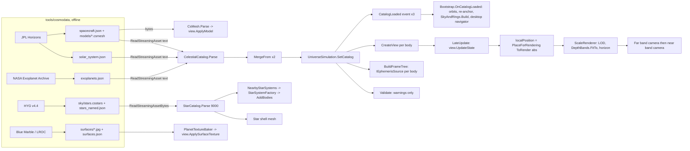

# CosmoSynth architecture map — the base for the unified universe app

- **Slug:** `architecture-map` · **Date:** 2026-09-11 · **Phase:** read-only research, nothing under `~/projects` modified except this file.
- **Tree read:** `~/projects/CosmoSynth` at git `cf93a25` (2026-09-06). Unity 6000.5.5f1 project in `unity/`.
- **Scope read in full or near full:** all of `Core/` (public API of every file, full text of Catalog, Frames/ReferenceFrame, Scale, Sky, Time, TrajectoryTable), all of `Runtime/` (every file), `Editor/` (SceneBuilder, ServerBuild in full; XrSetup, SceneShot, PlayModeShot entry points and actions), `tools/cosmodata/*.py` (headers, formats, key functions), `tests/` (projects, harness, per-file test counts, API reference counts), `CLAUDE.md`, `README.md`, `docs/*.md`, the previous session's memory notes, the shipped StreamingAssets data (parsed with python on the box), and the play-mode reports in `~/builds/shots/cosmosynth/*.report.txt`.
- **Not done, on purpose:** the test suite was **not run** — `run-tests.sh` writes `bin/`/`obj/` into `tests/`, which the read-only rule forbids. "142 tests" below is a static count of `[Test]` attributes. No editor, no build, no rendering.

**Legend.** **VERIFIED** = read in the code/data, or measured on the box today, with the location given. **INFERRED** = a consequence reasoned from verified code that has not been observed at runtime. Line numbers refer to the files as they are at `cf93a25`.

---

## 0. Headline findings (read these first)

| # | Finding | Status | Where |
|---|---|---|---|
| 1 | **Two axis conventions are live at once.** Body positions go ICRF→Unity with **no axis swap** (`x,y,z → x,y,z`, a mirror image, celestial pole along Unity +z), while body spin, the HYG star shell, XR stick flight and desktop flight all use the **swap** `x,y,z → x,z,y` (pole along Unity +y). `SceneShot` (the editor reconstruction) swaps positions too, so its stills never showed the runtime's convention. Every new layer must pick one; today the sky shell and the 3D bodies do not agree about where a star is. | VERIFIED (code); visual consequences INFERRED | `FloatingOrigin.cs:78-86` vs `CelestialBodyView.cs:898-917`, `SkyAndRings.cs:220`, `XrLocomotion.cs:150-151`, `UniverseNavigator.cs:144,186`, `SceneShot.cs:142-143` |
| 2 | **The Sun's point light is attached to 61 Virginis** once the exoplanets merge: `BuildStarLight` lights `Catalog.RootIds[0]`, `RootIds` is sorted ordinally, and after the merge the first root is `exo-61-vir` (not `sun`). | VERIFIED (code + catalogue ids); lighting consequence INFERRED | `SkyAndRings.cs:585`, `CelestialCatalog.cs:151` |
| 3 | `OnCatalogLoaded` fires **3×** at startup (solar system, spacecraft, exoplanets) and **each time resets scale and origin** to "Earth at 0.55 m", rebuilds the sky/rings/lights/atmospheres and all orbit lines. On Android the three loads are frames apart (UnityWebRequest), so anything the user or another component did in between is overwritten. | VERIFIED (code) | `CosmoSynthBootstrap.cs:193-275`, `UniverseSimulation.cs:267-321` |
| 4 | `TabletopManipulator` feeds **world-space** hand positions into `FloatingOrigin.ToAbsolute`, which expects **universe-local** render coordinates (the `localPosition`-vs-`position` rule, violated in the read direction). Grabs drift under any anchor yaw (the launch yaw, snap turns); the zoom-pivot test is offset by the anchor translation. Its scale target is also **sticky**: after one gesture it keeps pulling `UnitsPerKm` back, undoing dashboard rungs and re-anchoring. | VERIFIED (code); drift INFERRED | `TabletopManipulator.cs:131,138,152-153,173-174,191,206-229`; `XrHandInput.cs:282-288` |
| 5 | The desktop/editor path does **not** use UnityWebRequest (plain `File.Read*` when the path has no `://`), contradicting CLAUDE.md. So the Android branch — and its multi-frame timing — has never run anywhere but the headset. One consequence: `PlanetTextureBaker` keys finished work by body id and never re-applies textures to views rebuilt by a later merge (Earth's Blue Marble can be lost on device only). | VERIFIED (code); texture loss INFERRED | `UniverseSimulation.cs:104-151`; `PlanetTextureBaker.cs:53,165,332,357` |
| 6 | `RingSystem` ignores the `IsGeometryDrawn` rule. The Sirius capture shows Neptune's ring **enabled at the sky horizon** (`Rings_neptune apparent=0.02581 rad, world=30.97, d=1200`) while Neptune itself is pinned and not drawn. | VERIFIED (report + code) | `RingSystem.cs:26-37`; `~/builds/shots/cosmosynth/sirius.report.txt` |
| 7 | **Every scale ceiling stops short of the goal.** Band stack tops at 1e22 km (324 Mpc); grab-zoom floor 1e-20 units/km; flight speed clamp 1e14 km/s (158 years to cross 5e23 km); top dashboard rung 130 ly; far plane ≤ 5e8 render units. The CMB (~4.4e23 km) needs each of these moved (table in §5.15). | VERIFIED | `ScaleSpace.cs:159-168,246`; `TabletopManipulator.cs:45`; `WristDashboard.cs:101`; `DepthBands.cs:38-41,117-134` |
| 8 | **New populations must not be `CelestialBodyView`s.** Each view is 2–3 GameObjects plus its own material instance, and at least eight components walk every view every frame. 243 views today; 1 000 galaxies or 45 000 2MRS points as views is out of the question. | VERIFIED (code) | §6.4 O3 |
| 9 | **There is no 3D star field.** The 119 613 HYG stars are drawn as a fixed-radius direction-only shell (900 render units) around the room anchor, built once, from Sol's viewpoint. Flying to Sirius leaves the Sol sky on screen, and Sirius appears twice (the shell dot and the generated 3D star). Only mag ≤ 6.5 (the 9 000-star budget) is ever loaded, so `NearbyStarSystems` can never reach most nearby stars (Proxima is mag 11.1). | VERIFIED | `SkyAndRings.cs:26-29,311,342-369,407-447`; `NearbyStarSystems.cs:42,103-130` |
| 10 | The app has **never been exercised in XR by anything automated**. The play-mode harness runs flat (no XR device), where `UniverseNavigator` owns the origin instead of the XR movers, and uses file IO instead of UnityWebRequest. Headset feedback stops at 1.7.0 ("100 plus instances of earth … on a grid"); 1.8.0 and 1.9.0 have no recorded headset test. | VERIFIED | `docs/feedback.md`; `PlayModeShot.cs`; reports |

---

## 1. Module map

### 1.1 Assemblies and size (VERIFIED)

| Assembly | asmdef | References | Files / lines |
|---|---|---|---|
| `CosmoSynth.Core` | `Core/CosmoSynth.Core.asmdef` — `noEngineReferences: true` | none | 28 files, 7 635 lines |
| `CosmoSynth.Runtime` | `Runtime/CosmoSynth.Runtime.asmdef` | Core, XR.CoreUtils, XR.Management, XR.OpenXR, XR.Hands, **XR.Interaction.Toolkit**, XR.ARFoundation, InputSystem, **RenderPipelines.Universal.Runtime** | 40 files, 10 009 lines |
| `CosmoSynth.Editor` | `Editor/CosmoSynth.Editor.asmdef` (Editor only) | Core, Runtime, XR editor assemblies | 5 files, 2 001 lines |

The two bold references are unused: no `CosmoSynth` source mentions `UnityEngine.Rendering.Universal` or the XR Interaction Toolkit (grep, VERIFIED). The render pipeline is Built-in (`GraphicsSettings.asset: m_CustomRenderPipeline: {fileID: 0}`, VERIFIED), though the URP package is installed (`Packages/manifest.json`).

Shaders: two custom (`Runtime/Shaders/CosmoAtmosphere.shader`, `CosmoRim.shader`) plus built-ins; the single list is `CosmoShaders.All` (`CosmoShaders.cs:49-59`), mirrored into Always Included by `XrSetup.EnsureShadersIncluded` (`XrSetup.cs:343`). **Any new shader must be added there or it renders magenta on device** (memory note `cosmosynth-runtime-built-scenes-strip-shaders`).

### 1.2 Core (engine-free; km, s, rad, TDB seconds past J2000)

| Module | Files (lines) | Responsibility | Key types / public API | Tests |
|---|---|---|---|---|
| Math | `Double3.cs` (170), `MathD.cs` (72), `Matrix3d.cs` (163) | Double vectors, scalar helpers, row-major 3×3 rotations | `Double3` (+,−,×, `Dot`, `Cross`, `Angle` (atan2 form), `Rotate`, `Normalized`, `IsFinite`); `MathD` (`WrapTwoPi`, `SafeAcos`, `SmoothStep`, `SafeLog10`, `Approximately`); `Matrix3d` (`RotationX/Y/Z/Axis`, `Transposed`, `InverseRotation`, `Inverse`, `IsRotation`) | MathTests (9); Matrix3d only indirectly |
| Physics | `Constants.cs` (164) | CODATA/IAU constants, GMs, derived helpers | `G`, `SpeedOfLight`, `AstronomicalUnit`, `LightYear`, `Parsec`, `KiloParsec`, `MegaParsec`, `GM_*`, `SolarLuminosity`; `CircularSpeed`, `EscapeSpeed`, `SphereOfInfluence`, `HillRadius`, `EquilibriumTemperature`, `SurfaceGravity` | widely referenced |
| Time | `CosmicTime.cs` (373) | TDB instant; UTC as display/input only | `CosmicTime` (`SecondsPastJ2000`, `FromUtc`, `ToUtc`, `ToIso8601`, `JulianDateTdb`, `TdbMinusTt`, arithmetic); `CalendarDate`; `CalendarUtil` (Fliegel–Van Flandern JDN, `MinimumSupportedYear = −4700`); `LeapSecondTable` (1972–2017, 37 s) | TimeTests (9) |
| Orbits | `KeplerSolver.cs` (233), `OrbitalElements.cs` (419), `StateVector.cs` (61), `TrajectoryTable.cs` (154), `UniversalKepler.cs` (188) | Conics (stored by semi-latus rectum), Danby+bisection solver, universal variables, uniformly sampled tables | `OrbitalElements.FromStateVector/Propagate/PositionAt/SampleOrbitPath/PeriodSeconds/PeriapsisDirection`; `KeplerSolver.Solve*`; `UniversalKepler.Propagate/PropagateTo`; `TrajectoryTable(epoch, step, samples)`, `.Covers`, `.CreateEphemeris`, flat-array JSON | KeplerTests (8), OrbitTests (12), HorizonsValidationTests (5), SpacecraftTests (21) |
| Frames | `ReferenceFrame.cs` (346), `BodyOrientation.cs` (222), `StandardFrames.cs` (169) | Translation-only frame tree (SPK), IAU rotation (PCK), fixed frame rotations | `IEphemerisSource` + `FixedEphemeris`, `KeplerEphemeris`, `SampledEphemeris` (cubic Hermite, clamps at ends), `SurfaceFixedEphemeris`; `ReferenceFrame.CreateRoot/CreateChild/AbsoluteState` (single-entry memo per time)`/StateRelativeTo` (nearest common ancestor)`/Find` (recursive)`/InvalidateCache`; `BodyOrientation.BodyFixedToIcrf/PoleDirectionAt/SurfacePointCentric/TryGetPreset` (20 IAU presets, lines 163-182); `StandardFrames.EquatorialToEcliptic(obliquity)`, **`EquatorialToGalactic`** (lines 97-114, IAU pole 192.85948/27.12825, node 32.93192), `FromSpherical/ToSpherical`, `DistanceFromParallaxMas` | CoreSystemsTests (24) cover frames/orientation/ecliptic; **galactic, spherical and parallax helpers have 0 test references** |
| Scale | `ScaleSpace.cs` (304) | LOD by apparent pixels, band stack, render transform, navigation speed, presentation scaling | `RepresentationLevel` (Point <1.5 px, Impostor <12, Sphere <180, Terrain <4000, SurfaceTiles, LocalDetail); `AngularDiameterRad` (asin form); `ApparentDiameterPixels`; `SelectRepresentation`; `TransitionBlend`; `ScaleBand`, `DefaultBands`, `SelectBand`; `RenderTransform`; `ShouldRebase`; `NavigationSpeed(d, 4 s, 1e-6, 1e14)`; `LogarithmicSpeed`; `PresentationRadius`; `HologramUnitsPerKm`; `ScaleDecades` | CoreSystemsTests; `TransitionBlend` untested |
| Catalog | `CelestialBody.cs` (738), `CelestialCatalog.cs` (443), `Provenance.cs` (201), `ModelReference.cs` (63), `SurfaceSite.cs` (69) | The data model and its validation gate | `BodyType` (Star, Planet, DwarfPlanet, Moon, Asteroid, Comet, Barycenter, Spacecraft, **Ring, Nebula, Galaxy, StarCluster** — the last four are unused by the runtime); `CelestialBody` (nullable physicals, `Orbit?`, `PositionKm?`, `Trajectory`, `Site?`, `KnownFrom/Until`, `Orientation?`, star fields, `Atmosphere`, `Model?`, `DisplayColor`, `ProceduralSeed`, `Provenance`; derived `MeanRadiusKm`, `Flattening`, `DensityKgPerM3`, `KnownAt`, `Placement`, `DescribeCoverage`, `Validate`, `ToJson/FromJson`); `CelestialCatalog` (`Add`, `Remove`, `MergeFrom` (skips duplicate ids), `Get/TryGet/FindByName`, `Rebuild` (parent/child index, **roots sorted ordinally**), `Traverse`, `BuildFrameTree`, `Validate` (density, Hill sphere, periapsis vs ellipsoid, GM consistency, cycles, site host checks), `Parse/ToJson`); `ProvenanceClass` (Unknown/Measured/Inferred/Procedural/Fictional), `FieldProvenance`, `ProvenanceRecord.WeakestClass/Summary` | ShippedCatalogTests (11), ExoplanetCatalogTests (7), SpacecraftTests (21), CoreSystemsTests |
| Serialization | `Json.cs` (466) | Dependency-free RFC 8259 reader/writer | `JsonValue` (`Parse/TryParse`, indexers, `AsDouble/AsLong/AsString/AsVector`, `RequireDouble/RequireString`, `ToString(indented)`) | via catalogue tests |
| Sky | `StarCatalog.cs` (174), `StarSystemFactory.cs` (197) | The HYG binary, and a deterministic planetary system per real star | `CatalogStar` (`PositionParsecs`, `ApparentMagnitude`, `TemperatureK`, `Flags`, `Direction`, `DistanceParsecs?`); `StarFlags` (DistanceUnknown, TemperatureFromSpectrum, HasProperName); `StarCatalog.Parse(bytes, maximumStars)`, `CountBrighterThan`, `ColorFor`; `StarSystemFactory.SeedFor` (position quantised to 1 mpc → `Hash3`), `LuminositySolar`, `MassSolar` (bisection on the generator's own M–L relation), `Create(star, id, name, epoch)` | StarCatalogTests (5), StarSystemFactoryTests (6) |
| Procedural | `Hash.cs` (196), `NoiseD.cs` (245), `CubeSphere.cs` (360), `PlanetGenerator.cs` (456), `SurfacePainter.cs` (379), `TerrainField.cs` (357), `TerrainMesh.cs` (253) | Deterministic randomness, 3D noise, cube-sphere quadtree, whole-system generator, surface fields, tile meshes (Phase 3) | `Hash` (SplitMix64, `Hash1..4`, `HashString` FNV-1a, `Derive`, **`SeedForPosition`**), `DeterministicRandom`; `NoiseD.Fbm/Ridged/Billow/WarpedFbm/Worley/FbmGradient`; `CubeSphere`, `TileId` (`Children`, `GroundSizeKm`, `GeometricErrorKm`, `ShouldSubdivide`, `SelectVisible`); `PlanetGenerator.GenerateSystem(SystemSettings)`, `MainSequenceLuminosity/Radius`, `BlackBodyColor`, `HabitableZone`, `SnowLineAu`, `RocheLimitKm`; `SurfacePainter.Paint/WaterMask/HeightAt/TerrainFor`; `TerrainField.ElevationKm/SeaLevelKm/SurfaceNormal/TemperatureK/Moisture`; `TerrainMeshBuilder.Build(tile, field, …)` → tile-local float positions/normals/triangles + skirts | ProceduralTests (11), SurfaceTests (8), TerrainMeshTests (6); **nothing in Runtime references `CubeSphere`, `TileId` or `TerrainMeshBuilder`** |

### 1.3 Runtime (MonoBehaviours and engine glue)

| Area | File (lines) | Kind | Responsibility | Key API |
|---|---|---|---|---|
| Composition | `CosmoSynthBootstrap.cs` (431) | MB on the scene's only object | Builds the whole app in code; loads catalogues; frames the focus; recentres | `Simulation`, `Rig`, `UniverseAnchor`, `Recenter()` |
| Universe | `UniverseSimulation.cs` (527) | MB, order −50 | Owns catalogue, frame tree, views; StreamingAssets readers; per-frame state push | `ReadStreamingAsset`, `ReadStreamingAssetBytes`, `LoadCatalogFromJson`, `MergeCatalogFromJson`, `SetCatalog`, `AddBodies`, `RemoveBodies`, `SetFocus`, `DisplayRadiusKm`, `NearestBody`, `ViewerLocalPosition`, `StarPointHorizonUnits`, events `CatalogLoaded`, `FocusChanged` |
| | `CelestialBodyView.cs` (945) | MB per body | Double state → float local transform; sky pinning; min/max visible size; spacecraft model scale; surface texture adoption | `Initialise`, `Rebind`, `UpdateState`, `SetRepresentation`, `ApplyModel`, `ApplySurfaceTexture`, `AbsolutePositionKm`, `RenderedRadius`, `IsKnown`, `DrawnAsStarPoint`, `IsGeometryDrawn`, `IsMarkerDrawn`, `IsPointable`, `SizeExaggeration`, statics `ToUnityRotation/ToUnityDirection/ToIcrfDirection` |
| | `FloatingOrigin.cs` (167) | MB, order −100 | The absolute↔render mapping (origin km, units/km). Rebase machinery present but inert | `OriginKm`, `UnitsPerKm`, `ToRender`, `ToAbsolute`, `ScaleLength`, `SetUnitsPerKm`, `SetOrigin`, `Rebase`, `IFloatingOriginListener` |
| | `NearbyStarSystems.cs` (198) | MB | Generates the nearest HYG star's system within 1 pc, releases past 1.35 pc | `ActiveStarId`, `GeneratedBodyCount`, `StatusLine()` |
| Simulation | `SimulationClock.cs` (215) | MB | TDB clock, 15-step warp ladder | `Now`, `WarpRate`, `WarpIndex`, `FasterWarp/SlowerWarp/TogglePause`, `SetEpochUtc`, `SetEpochToNow`, `WarpLabel`, `TryParseIso8601` |
| Rendering | `ScaleRenderer.cs` (119) | MB on rig, order 50 | LOD per view, far-plane fit, horizon | `BodiesByApparentSize()` (unused) |
| | `DepthBands.cs` (157) | MB on camera | Two cameras sharing a pose: near 0.05→split, far split·0.9→far | `Attach`, `FitTo`, `SplitDistance`, `FarDistance`, `FarCamera` |
| | `SkyAndRings.cs` (803) | MB on anchor | Star shell (HYG or invented), rings (hard-coded table), point light, ambient fill, atmosphere shells | `Build(simulation, anchor)`, `Stars` |
| | `OrbitLineRenderer.cs` (350) | MB per orbit | Comet-tail orbit line, legibility cull, constant pixel width | `Initialise`, `Rebuild`, `Dim`, `Describe` |
| | `AtmosphereShell.cs` (142), `RingSystem.cs` (39) | MB per decoration | Track body's rendered radius; atmosphere shader params | `Track`, `Scatter` |
| | `PlanetTextureBaker.cs` (583) | MB | Measured maps (surfaces.json) + worker-thread procedural bakes, ≤48 textures | `Baked`, `Pending` |
| | `SpacecraftModelLoader.cs` (183), `CsMesh.cs` (199) | MB + static | Stream `.csmesh`, parse, apply per view | `CsMesh.Parse`, `StatusLine()` |
| | `StarLook.cs` (153), `StarSprite.cs` (153), `StarPointBillboard.cs` (134) | static, static, MB | One star appearance law (dmm sizes), Gaussian sprite, per-body sky billboard | `StarLook.QuadRadians/Colour/BrightnessFromMagnitude`, `StarSprite.CreateMaterial`, `StarPointBillboard.SetVisible/SetColour/SetRenderQueue` |
| | `CosmoShaders.cs` (91), `CosmoSphere.cs` (137), `ViewportInfo.cs` (48), `RenderDiagnostics.cs` (89) | static | Shader registry; subdivided sphere; true eye-buffer height; `render:` status line | `CosmoShaders.All/Material`, `CosmoSphere.Detailed`, `ViewportInfo.VerticalPixels/WorldPerPixel`, `RenderDiagnostics.OneLine` |
| UI | `CosmoTheme.cs` (277), `CosmoText.cs` (252), `CosmoPanel.cs` (264) | static, static, plain class | Tokens (dmm), TextMesh metrics, content-sized panel | §3 |
| | `WristDashboard.cs` (455), `SpatialPanel.cs` (145), `BodyLabelLayer.cs` (275), `ProvenanceHud.cs` (318) | MBs | Scale ladder/destinations; selection panel; labels; desktop IMGUI HUD | §3 |
| XR / input | `XrRig.cs` (206), `XrInput.cs` (297), `XrHandInput.cs` (305), `TabletopManipulator.cs` (272), `XrLocomotion.cs` (203), `BodySelector.cs` (331), `AnchorBeacon.cs` (227), `UniverseNavigator.cs` (206), `DesktopInputSource.cs` (113) | MBs | Rig + passthrough; binding table; hands/controllers→grab; universe grab/scale; stick flight; ray selection; status card; desktop flight | §3 |

File-per-class: every `MonoBehaviour` lives in a file named after it (VERIFIED by grep of all `class` declarations). Non-MB helpers share files (`HandPose` in `TabletopManipulator.cs:7`, `IFloatingOriginListener` in `FloatingOrigin.cs:13`, `Hand` in `XrInput.cs:8`), which is legal.

### 1.4 Editor (VERIFIED)

| File | Role |
|---|---|
| `SceneBuilder.cs` (105) | Menu: create `Assets/CosmoSynth/Scenes/SolarSystemLab.unity` containing one GameObject with `CosmoSynthBootstrap`; validate shipped catalogue |
| `ServerBuild.cs` (178) | Batch APK build; sets PlayerSettings (IL2CPP/ARM64, minSdk 32, Vulkan only, stripping Low); `Version = "1.9.0"`, `VersionCode = 16`; regenerates the scene if missing (duplicate of SceneBuilder) |
| `XrSetup.cs` (404) | OpenXR loader + Meta features (required list `XrSetup.cs:43-76`, optional 78, disabled 90), disables foveation, single-pass instanced + 16-bit depth submission (268-298), Active Input Handling "Both", Always Included shaders, logs the `MetaQuestFeature` asset count |
| `SceneShot.cs` (417) | Edit-mode reconstruction for stills. **Builds its own scene and swaps axes for positions** (`ToUnity` at 142-143) — it does not reproduce the runtime |
| `PlayModeShot.cs` (897) | Batch play mode of the real app (flat, no XR): waits for textures/models to settle, then actions `star<N>` (fly to Nth star with known distance, 0.5 AU off, `HologramUnitsPerKm(0.5 AU, 0.9 m)`) and `rung<N>` (dashboard rung); `COSMOSYNTH_HIDE` renderer bisection; destination-alpha probe; the text report |

### 1.5 tools/cosmodata (4 659 lines, stdlib except Draco via npx) (VERIFIED)

| Script | Output |
|---|---|
| `build_solar_system.py` (+`horizons.py`, `bodies.py`) | `catalog/solar_system.json` — 31 bodies (1 Star, 8 Planet, 15 Moon, 2 DwarfPlanet, 4 Asteroid, 1 Comet), 88 177 B, elements at 2026-01-01 TDB |
| `build_spacecraft.py` (+`spacecraft.py`, `gltf.py`, `meshpack.py`) | `catalog/spacecraft.json` — 24 Spacecraft, 978 886 B; `models/*.csmesh` ×24 (107 583 triangles total per the Sirius report) |
| `build_exoplanets.py` | `catalog/exoplanets.json` — 180 bodies (60 host Stars with `positionKm`, 120 Planets), 329 896 B; hosts 1.30–9.85 pc; seeds 31-bit FNV |
| `build_starfield.py` | `sky/stars.csstars` (2 870 728 B) + `sky/stars_named.json` (548 names with csstars index, constellation, designation) |
| `fetch_surface_maps.py` | `surfaces/surfaces.json` + `earth.jpg` (Blue Marble 2048×1024), `moon.jpg` (LROC 1024×512) |
| `fetch_validation_fixture.py` | `tests/.../fixtures/horizons_validation.json` (260 state vectors) |

### 1.6 tests (VERIFIED, static)

- `tests/CosmoSynth.Core.Tests` — net8.0 console exe, links `Core/**/*.cs` verbatim, zero-dependency runner (`TestHarness.cs`). **142 `[Test]` methods**: CoreSystems 24, Spacecraft 21, Orbit 12, ShippedCatalog 11, Procedural 11, Math 9, Time 9, Kepler 8, Surface 8, ExoplanetCatalog 7, StarSystemFactory 6, TerrainMesh 6, Horizons 5, StarCatalog 5. No `[NetworkTest]` is used although the harness supports it.
- `tests/CosmoSynth.Runtime.Compile` — netstandard2.1 library compiling Core+Runtime against the editor's `UnityEngine` DLLs (and `Library/ScriptAssemblies` when present). Compile-only.

### 1.7 The object graph the bootstrap builds (VERIFIED, `CosmoSynthBootstrap.cs:79-191`, `XrRig.cs:51-98`)

```
CosmoSynth                          CosmoSynthBootstrap           (the only object in the scene file)
XR Rig                              XrRig, ScaleRenderer
└─ XR Origin                        XROrigin (Floor mode, fallback eye height 1.6 m)
   └─ Camera Offset                 (= CameraFloorOffsetObject = "tracking space")
      ├─ Main Camera                Camera(near 0.05), AudioListener, DepthBands, TrackedPoseDriver
      │  │                          [flat only: UniverseNavigator, DesktopInputSource] [XR: ARCameraManager]
      │  └─ Far Band Camera         Camera (CopyFrom main, depth −1)
      ├─ Left/Right Hand Anchor     (created, never used)
      ├─ Universe Anchor            AnchorBeacon, SkyAndRings      (placed by Recenter, yawed to light the focus)
      │  ├─ Beacon, Status Card     (marker bars, CosmoPanel)
      │  ├─ Star Field              one mesh, radius 900 units      (SkyAndRings)
      │  ├─ Ambient Fill            directional 0.05, ForceVertex
      │  └─ Universe                SimulationClock, FloatingOrigin, UniverseSimulation, XrInput,
      │     │                       TabletopManipulator, XrHandInput, XrLocomotion, BodySelector,
      │     │                       PlanetTextureBaker, SpacecraftModelLoader, NearbyStarSystems, ProvenanceHud
      │     ├─ <Body>               CelestialBodyView
      │     │  ├─ Visual            primitive sphere (collider removed), own material instance
      │     │  ├─ Star Point        StarPointBillboard (own material)
      │     │  ├─ [Rings_x]         RingSystem              [Atmosphere_x] AtmosphereShell
      │     │  └─ [Star Point Light] (on RootIds[0] only)
      │     ├─ Orbit_<id>           OrbitLineRenderer + LineRenderer (non-exoplanet bodies with an Orbit)
      │     ├─ Body Labels          BodyLabelLayer (pool of 14 TextMesh)
      │     ├─ Pointer Ray, Selection Highlight (BodySelector)
      └─ Wrist Dashboard            WristDashboard
   AR Session                       (XR only)
Spatial Panel                       SpatialPanel (root object, created by BodySelector.Awake)
```

### 1.8 Data flow: StreamingAssets → CelestialCatalog → UniverseSimulation → CelestialBodyView → screen



Step by step (all VERIFIED):

1. **Scene start.** `CosmoSynthBootstrap.Awake` → `BuildRig()` then `BuildSimulation()` (`CosmoSynthBootstrap.cs:73-191`), which adds the components above and starts `LoadCatalogRoutine` (or `SetCatalog(PlanetGenerator.GenerateSystem(...))` when `_proceduralSeed != 0`).
2. **Load.** `LoadCatalogRoutine` (`:193-231`) reads `CosmoSynth/catalog/solar_system.json` via `UniverseSimulation.ReadStreamingAsset` (`UniverseSimulation.cs:104-151`: `File.ReadAllText` when the path has no `://`, `UnityWebRequest` otherwise), then `LoadCatalogFromJson` → `CelestialCatalog.Parse` → per entry `CelestialBody.FromJson` (`CelestialBody.cs:643-736`; `_orientationPreset` resolved from `BodyOrientation` presets) → `Add` → `Rebuild`.
3. **Adopt.** `SetCatalog` (`UniverseSimulation.cs:296-321`): log `Validate()` problems (never refuses), `ClearViews()` (destroys every view), `BuildFrameTree()` (`CelestialCatalog.cs:194-251`: per body, ephemeris priority **Trajectory > Site (needs host orientation) > Orbit > Fixed(PositionKm or 0)**), `CreateView` per body in `Traverse()` order (`:397-405`, `Find` per body), raise `CatalogLoaded`, default focus.
4. **Merge** spacecraft then exoplanets: `MergeCatalogFromJson` (`:267-293`) → `Catalog.MergeFrom` (skips duplicate ids, renames catalogue) → **`SetCatalog(Catalog)` again** (full destroy/recreate, event again). Generated star systems use `AddBodies/RemoveBodies` (`:334-379`) instead, which keep existing views, rebuild the frame tree and `Rebind` each view, and do not raise the event.
5. **React.** `OnCatalogLoaded` (`CosmoSynthBootstrap.cs:233-275`): recreate orbit lines (skipping ids starting `exo-`), set focus (`earth`), **`SetUnitsPerKm(HologramUnitsPerKm(R, 0.55 m))` and `SetOrigin(focus.AbsolutePositionKm)`**, `SkyAndRings.Build` (star field, star catalogue request once, rings, star light, atmospheres), and on flat runs add `UniverseNavigator` + `DesktopInputSource`.
6. **Every frame** (see 1.9): the clock advances; input moves `FloatingOrigin`; `UniverseSimulation.LateUpdate` computes `ViewerLocalPosition` and calls `view.UpdateState(now)`, which checks `KnownAt`, reads `Frame.AbsoluteState(now)`, writes `transform.localPosition = PlaceForRendering(origin.ToRender(abs))`, `localRotation = ToUnityRotation(IAU)`, then sizes the visual (`CelestialBodyView.cs:140-294`).
7. **Screen.** `ScaleRenderer.LateUpdate` assigns a `RepresentationLevel` per view from apparent pixels and fits `DepthBands` to the farthest *drawn* distance, returning the next frame's horizon. The far-band camera clears (alpha 0 under passthrough), the near band clears depth only (`DepthBands.cs:59-107`).

### 1.9 Per-frame order (VERIFIED from `[DefaultExecutionOrder]`)

`Update`: XrInput (−100) → FloatingOrigin (−100, no-op) → UniverseSimulation (−50, no Update) → default-order components (SimulationClock, XrHandInput→TabletopManipulator, XrLocomotion, BodySelector, WristDashboard, NearbyStarSystems (every 0.5 s), PlanetTextureBaker, SpacecraftModelLoader, UniverseNavigator, AnchorBeacon).
`LateUpdate`: UniverseSimulation (−50, all views) → default order (OrbitLineRenderer, AtmosphereShell, RingSystem, SpatialPanel, DepthBands mirror) → ScaleRenderer (50, LOD + clip planes + horizon for the **next** frame) → BodyLabelLayer (100).
`IsGeometryDrawn` is refreshed by `SetRepresentation` in ScaleRenderer, i.e. after the decorations read it — a one-frame lag, harmless today.

---

## 2. The scale model

### 2.1 Coordinates, units and the axis convention

- Core: km, km/s, rad, TDB seconds past J2000; ICRF/J2000 equatorial root frame `ssb` (VERIFIED, `Constants.cs:8-22`, `CelestialCatalog.cs:194`).
- Precision (from `Constants.cs:13-20`, VERIFIED text; arithmetic INFERRED): a double's spacing is 0.45 mm at Neptune, 4 m at 4e13 km, 25 km at the Galactic Centre, **≈6.7e7 km (0.45 AU) at 4.4e23 km**. The render mapping is computed in double and cast to float after subtracting the origin, so float precision is only a problem for things drawn far from the viewer.
- **Two conventions (VERIFIED):**

| Site | Mapping | File:line |
|---|---|---|
| Body and orbit **positions** (`FloatingOrigin.ToRender/ToAbsolute`) | `(x, y, z) → (x, y, z)` — no swap | `FloatingOrigin.cs:78-86`; used by `CelestialBodyView.cs:189`, `OrbitLineRenderer.cs:177,196`, `NearbyStarSystems.cs:85`, `ScaleRenderer.cs:70`, `TabletopManipulator` |
| Body **spin** (`ToUnityRotation`) | columns remapped `(x, z, y)` | `CelestialBodyView.cs:898-909` |
| HYG / invented **star shell** | `(x, z, y)` | `SkyAndRings.cs:220` |
| **XR stick flight** | local dir → `ToIcrfDirection` `(x, z, y)` → `OriginKm +=` | `XrLocomotion.cs:150-151,171` |
| **Desktop flight / look-at** | `ToIcrfDirection` / `ToUnityDirection` | `UniverseNavigator.cs:144,186` |
| Editor stills (`SceneShot`) | `(x, z, y)` for positions | `SceneShot.cs:142-143` |

INFERRED consequences: (a) the rendered solar system is a mirror image with the celestial pole horizontal; (b) planets' spin axes are drawn about 66° away from their true angle to the orbit planes; (c) pushing the left stick forward moves the viewer along the universe's vertical, not along the gaze; (d) an exoplanet host star pinned to the horizon by `PlaceForRendering` and the same star in the HYG shell appear in different directions; (e) the bootstrap comment "only yaw is applied, so the ecliptic stays level" (`CosmoSynthBootstrap.cs:348`) does not hold under either convention (the swap puts the *equator* level; the ecliptic is 23.4° off). The fix is one line in `ToRender/ToAbsolute` plus deciding whether presentation wants an ecliptic-level tabletop (`StandardFrames.EquatorialToEcliptic`) — a design decision for the next phase.

### 2.2 `ScaleSpace` bands (VERIFIED `ScaleSpace.cs:159-168`) — designed, not used by the runtime

| Band | Near km | Far km | Units/km | Far/near |
|---|---|---|---|---|
| Local | 1e-4 | 1e2 | 1000 | 1e6 |
| Orbital | 1e1 | 1e6 | 1 | 1e5 |
| Interplanetary | 1e5 | 1e11 | 1e-5 | 1e6 |
| Interstellar | 1e10 | 1e16 | 1e-10 | 1e6 |
| Galactic | 1e15 | **1e22** | 1e-16 | 1e7 |

Upper limit 1e22 km = 324 Mpc = 1.06 Gly (INFERRED arithmetic). `SelectBand` beyond it returns the last band. The runtime never calls `DefaultBands`/`SelectBand`; the multi-pass compositor was "designed for but not yet built" (`docs/architecture.md`). What ships instead is `DepthBands` (§2.4).

### 2.3 FloatingOrigin as it actually runs (VERIFIED)

- `FloatingOrigin` is a pure mapping: `render = (abs − OriginKm) · UnitsPerKm`, in the **Universe host's local space**.
- The bootstrap sets `origin.Focus = null` (`CosmoSynthBootstrap.cs:118`), so `LateUpdate` never rebases (`FloatingOrigin.cs:109-117`); `Rebase`, `OriginShifted`, `IFloatingOriginListener` and `OrbitLineRenderer.OnOriginShifted` are dead at runtime.
- Who writes the origin: `OnCatalogLoaded` (re-anchor ×3), `XrLocomotion` (stick), `TabletopManipulator` (grab/scale, `FrameBodyAtSize`), `WristDashboard` (rungs, destinations), `UniverseNavigator` (flat: every frame, `SetOrigin(_absolutePositionKm)` at `:200`), `PlayModeShot.FlyToStar`. Travel therefore keeps the camera physically in the room and moves the universe under it; float error never accumulates.
- The viewer's absolute position = `Origin.ToAbsolute(Universe.InverseTransformPoint(camera.position))` (`ScaleRenderer.cs:68-70`, `NearbyStarSystems.cs:84-85`).

### 2.4 Depth bands and sky pinning (VERIFIED `DepthBands.cs`, `ScaleRenderer.cs:55-110`, `CelestialBodyView.cs:229-254`)

- Near camera: 0.05 → `split`; far camera: `0.9·split` → `far`; `split = √(0.05·far)`; `far = clamp(1.5 · farthest drawn distance, 2000, 0.05·1e5·1e5 = 5e8)` render units.
- `StarPointHorizonUnits = 0.6 · far` (≥ 1200). A view whose render offset from the viewer exceeds the horizon is placed on the horizon sphere along its true direction (`DrawnAsStarPoint`); its sphere renderer is switched off; only stars draw their billboard, sized by apparent bolometric magnitude from here (`ApparentMagnitude`, `:370-381`) or the true angular size if larger.
- INFERRED dynamic: pinned bodies sit exactly at the horizon, so when everything distant is pinned the farthest drawn distance is the horizon itself and `far` relaxes to the 2000 floor (horizon 1200). The Sirius report shows exactly this (`depth bands: split 10, far 2000`, pinned bodies at `d=1200`). At the 0.55 m-Earth hologram scale (4.3e-5 units/km) 1200 units ≈ 2.8e7 km; at the "whole system" scale (≈7.5e-11 units/km) ≈ 1.6e13 km ≈ 1.7 ly.
- The HYG shell is not part of this: it is a fixed 900-unit sphere around the **anchor** (`SkyAndRings.cs:29,428`), drawn at render queue 1000 behind everything; `DepthBands`' 2000 floor exists to keep it inside the far plane (`DepthBands.cs:119-124`).

### 2.5 Representation and size bounds (VERIFIED)

- LOD: `ScaleSpace.SelectRepresentation` from `ApparentDiameterPixels(AngularDiameterRad(displayR, d), fov, ViewportInfo.VerticalPixels)` (`ScaleRenderer.cs:82-89`). Only Sphere vs below matters today: `≥ Sphere` swaps in the 2×-subdivided sphere (`CelestialBodyView.cs:394-406`); Terrain/SurfaceTiles/LocalDetail change nothing (no terrain runtime).
- Minimum visible body: 2.5 px (`CelestialBodyView.cs:300,879-887`).
- Spacecraft: floor 7 dmm, never below true size, ceiling 10 % of parent display radius, marker below 3 dmm (hysteresis ×1.3), marker 5.5 dmm, landers never exaggerated (`:518-570, 605-693`). `SizeExaggeration` reported (up to 2.3e7 for Parker in the Sirius report).
- Stars (shell): quad 3.8–9.0 dmm by brightness `clamp((7 − m)/5.5)`, brightest get 2nd core, halo ×2.8 and spikes (`StarLook.cs`, `SkyAndRings.cs:198-279`).

### 2.6 Readable vs true scale (VERIFIED)

- `UniverseSimulation.DisplayRadiusKm = PresentationRadius(R, R⊕, SizeCompression) · RadiusExaggeration` (`UniverseSimulation.cs:478-488`); `PresentationRadius = R_ref·(R/R_ref)^t` (`ScaleSpace.cs:280-285`). The bootstrap ships `t = 0.55` (`CosmoSynthBootstrap.cs:65,121`). Worked (INFERRED arithmetic): Sun 695 700 → 84 200 km; Jupiter 71 492 → 24 100 km; Moon 1 737 → 3 120 km; Earth unchanged.
- Distances are always true; only radii are compressed, and the 2.5 px floor inflates further.
- `IsPresentationScaled` is surfaced **only** by the desktop IMGUI HUD ("SIZES NOT TO SCALE", `ProvenanceHud.cs:130-136`); no XR surface says so (grep, VERIFIED).
- There is no runtime toggle for `SizeCompression`.

### 2.7 Navigation and locomotion (VERIFIED)

| Mover | Input | Rule | Limits |
|---|---|---|---|
| `XrLocomotion` | L stick (planar, gaze-directed), R stick Y (rise), L trigger (boost ×1–6), R stick X (snap 30°) | `speed = NavigationSpeed(surfaceDistance, 3.5 s)` × boost; `OriginKm += icrf·speed·dt` (`XrLocomotion.cs:119-172`); snap turn rotates the **anchor** about the camera (`:181-198`) | `NavigationSpeed` clamps to 1e-6…**1e14 km/s** (`ScaleSpace.cs:245-251`); yields while grabbing or while the dashboard owns the stick |
| `TabletopManipulator` | grip / pinch, one hand = drag, two hands = scale | drag keeps grabbed absolute point under the hand; scale = `(span/span0)²`, log-space smoothing 0.5/frame, pivot = midpoint if a body surface is < 0.6 render units away else the focus (`TabletopManipulator.cs:121-229`) | units/km in **[1e-20, 1e6]** (`:45,49`); world-vs-local bug (§0 #4) |
| `WristDashboard` | X engage, L stick, R trigger | rungs set `UnitsPerKm = roomMetres/spanKm` and centre on focus/primary/star; destinations teleport + `FrameBodyAtSize(0.55 m)` (`WristDashboard.cs:246-301`) | 7 rungs, top "Solar neighbourhood" = 2×130 ly in 0.70 m |
| `UniverseNavigator` (flat only) | WASD/QE, right-drag look, scroll trim, shift/ctrl | owns `_absolutePositionKm`, sets the origin to it every frame; `TravelTo` = exponential approach 1.2/s to 4 radii (`UniverseNavigator.cs:113-204`) | same `NavigationSpeed` |
| `NearbyStarSystems` | none (automatic) | nearest of the loaded stars (≤ 9 000, mag ≤ 6.5) with known distance; generate within 1 pc, release past 1.35 pc, check every 0.5 s | one system at a time |

`NearestBody` (the "surface distance" that drives speed) considers only `CelestialBodyView`s that are `IsKnown` (`UniverseSimulation.cs:504-525`); new layers must feed it or speed will be set by the nearest catalogue body.

### 2.8 Time model (VERIFIED)

- `CosmicTime`: double TDB seconds past J2000 (sub-µs today; 64 s spacing at 13.8 Gyr). UTC only at the boundary; full leap-second table; `TdbMinusTt` first-order.
- `SimulationClock`: starts at the device's UTC now (or an ISO-8601 override, parsed by `TryParseIso8601`, years 0–9999 only); warp ladder 0, 1, 10, 60, 600, 3600, 21600, 86400, 604800, 2 592 000, 1 yr, 10 yr, 100 yr, 1e4 yr, **1e6 yr per second** (`SimulationClock.cs:29-46`); accumulates `unscaledDeltaTime·rate` in double. **No range limit.**
- Limits (VERIFIED code, consequence INFERRED): `CalendarUtil` is exact only from year −4700 (`CosmicTime.cs:222-260`) and casts the year to `int` (overflow beyond ~2.1e9 years), so `ToIso8601` (HUD, logs) is wrong within a fraction of a second of top-rate warp backwards. Planet elements are two-body conics fitted at 2026-01-01 (drift table in `docs/accuracy.md`); stars have no proper motion (the `.csstars` record has no velocity); spacecraft carry `KnownFrom/Until` windows.
- There is no cosmological time (redshift, lookback). For galaxies and the CMB that is per-object static data, not a clock.

---

## 3. UI system and input

### 3.1 Tokens — `CosmoTheme` (VERIFIED `CosmoTheme.cs`)

- Colours: `Surface (0.043,0.063,0.090,0.93)`, `SurfaceRaised`, `Stroke`, `StrokeActive`, `TextPrimary/Secondary/Muted`, `Accent (0.310,0.765,0.969)`, `Warning`; provenance colours and glyphs (`=` Measured, `~` Inferred, `*` Procedural, `?` Fictional, `·` Unknown).
- Sizes in **dmm** (mm at 1 m): type Display 44, Title 32, Body 24, Caption 19, Micro 16; spacing Tight 8, Row 14, Panel padding 22; corner 26; stroke 3; `Metres(dmm, distance)`.
- Panel art: a 256² rounded-rect texture (`BuildPanelTexture`) stretched over the backing quad — not 9-sliced, so corners stretch with aspect (INFERRED). Panels render at queue 3200/3201, text 3210.
- `OrbitColour` derives a saturated hue from the body's display colour.

### 3.2 Text and panels (VERIFIED)

- `CosmoText`: built-in dynamic font (`LegacyRuntime.ttf`, fallback `Arial.ttf`), `FontSize` fixed at 64, measures advances with `GetCharacterInfo`, `Wrap`, `Truncate`, `Measure`, `LineHeight`, `CharacterSizeFor(lineHeightMetres)`; cloned font material at queue 3210 with atlas-rebuild hook.
- `CosmoPanel` (plain class): backing quad, accent rule, row highlight, title + body `TextMesh`; `SetContent(title, body, viewingDistance, typeDmm, widthDmm=520)` sizes the backing **from** the measured text; `SetSelectedLine`, `SetTitleColour`, `SetActive` (edge accent), `Opacity`, `FaceViewer(camera)`. `Destroy()` frees materials only.

### 3.3 Surfaces (VERIFIED)

| Surface | Where / when | Content | Notes |
|---|---|---|---|
| Status card (`AnchorBeacon`) | Beside the anchor, first 20 s or while unhealthy | Legend generated from `XrInput.Bindings`, `render:` line (`RenderDiagnostics.OneLine`), diagnostics when unhealthy | Rebuilt every frame while visible (`AnchorBeacon.cs:104-145`) |
| `WristDashboard` | Left **controller** pose + offset (0, 0.055, −0.02); fades in when the back faces the eye (< 55°); X engages | "SCALE" (7 rungs) or "DESTINATIONS" (40 nearest Star/Planet/DwarfPlanet views), warp label, units/km | Hand tracking alone never shows it (`:170-181` reads `XrInput.TryGetPose`, a controller); `RefreshDestinations` allocates and sorts every frame while shown |
| `SpatialPanel` | Beside the selected body, facing the viewer | Type, parent, mass, radius, gravity, density, orbit a/e/period, day, pressure, **always** "* surface: procedural, no measured imagery" (`SpatialPanel.cs:112`) | Title coloured by `WeakestClass`; rebuilt every frame; no spacecraft window/model/exaggeration rows (the gap `docs/accuracy.md` names) |
| `BodyLabelLayer` | World-space labels, max 14, greedy non-overlap in viewport | Focus always; stars/planets/dwarfs/spacecraft by type floor; others ≥ 3 px | Skips `DrawnAsStarPoint` from the type rule, so pinned stars are effectively never labelled; the HYG shell is never labelled; `stars_named.json` is never read |
| `ProvenanceHud` | IMGUI `OnGUI`, screen space, Tab toggles | Clock, navigator speed/nearest, scale, "not to scale", body tree, full per-field provenance | Added on every platform (`CosmoSynthBootstrap.cs:171`); invisible in the headset but still lays out every row each frame (INFERRED cost) |

### 3.4 Input (VERIFIED)

`XrInput.Bindings` (`XrInput.cs:58-69`) — the single binding table; the legend is generated from it:

| Control | Action | Consumer |
|---|---|---|
| L stick | fly | `XrLocomotion` (unless `ClaimNavigationStick` held by the dashboard) |
| R stick | rise · turn | `XrLocomotion` |
| grip | hold · scale | `XrHandInput` → `TabletopManipulator.UpdateHands` |
| R trigger (> 0.6, rising edge) | select | `BodySelector.PollSelect` **and** `WristDashboard.PollInput` when engaged |
| L trigger (analogue) | boost | `XrLocomotion` |
| X | dashboard | `WristDashboard` |
| A | recentre | `XrHandInput.PollCommands` → `CosmoSynthBootstrap.Recenter` |
| Y / B | time warp −/+ | `XrHandInput.PollCommands` |
| R click | pause | `XrHandInput.PollCommands` |

- Devices are polled with the legacy `UnityEngine.XR.InputDevices` API (`XrInput.cs:253-295`); the head pose uses the Input System `TrackedPoseDriver` (`XrRig.cs:113-133`); desktop uses legacy `Input` (requires "Both", which `XrSetup` forces).
- `XrHandInput`: prefers tracked hands (XR Hands subsystem) — pinch close 22 mm / open 35 mm, tap if travel < 30 mm, pinch point between fingertips, palm rotation — else controllers (grip only); converts positions to **world** with the tracking-space transform (`:282-288`). Also hosts the recentre/warp/pause commands.
- `TabletopManipulator`: consumes two `HandPose`s; see §2.7 and §0 #4.
- `BodySelector`: ray from right controller (else left, else head gaze); explicit ray–sphere test against `RenderedRadius` + 1.6° forgiveness over every view with `IsPointable`; on select sets focus and shows `SpatialPanel`; rim highlight at 2.18× rendered radius.
- `UniverseNavigator` + `DesktopInputSource`: flat only; described in §2.7.
- Arbitration: only the left stick (`ClaimNavigationStick`, `XrInput.cs:188-201`) and the grab-over-locomotion rule (`XrLocomotion.cs:101`).

Remaining input defects are listed in §6.1 (B10, B11, B4, B5).

---

## 4. The star path, exoplanets, spacecraft and `.csmesh`

### 4.1 `stars.csstars` (VERIFIED: format in `StarCatalog.cs:79-86` and `build_starfield.py`; numbers measured on the shipped file today)

```
header 16 B, little-endian:  magic "CSS1" | version u32 (=1, never read by the C# parser) | count u32 | flags u32 (reserved, 0)
record 24 B × count:          x, y, z  f32 parsecs (ICRF equatorial cartesian) | V mag f32 | Teff K f32 | flags u32
```

- 119 613 records, 2 870 728 B = 16 + 119 613 × 24; sorted brightest first (verified by the importer's read-back); Sol excluded.
- Cumulative counts: m ≤ 6.0: 5 070; ≤ 6.5: 8 920; ≤ 8: 41 486; ≤ 9: 83 476; ≤ 10: 108 067; brightest −1.44 (Sirius); faintest 21.0.
- 10 224 records flagged `DistanceUnknown` (HYG's 100 000 pc sentinel; direction kept).
- No HIP/HYG id, no proper motion, no radial velocity, no spectral type, no luminosity class, no absolute magnitude. Cross-reference only through `stars_named.json` (548 rows: `index` into the csstars order, `name`, `constellation`, `designation`).

### 4.2 `StarCatalog` (VERIFIED)

`Parse(bytes, maximumStars)` validates magic and exact length, then reads a prefix (`BitConverter`, host must be little-endian — true on arm64/x64). `CountBrighterThan(m)` is a binary search over the sorted array. `ColorFor` delegates to `PlanetGenerator.BlackBodyColor` so catalogue and generated stars share one colour curve.

### 4.3 Star rendering (VERIFIED `SkyAndRings.cs`)

- `Build` draws the invented 3 200-star shell immediately, and once requests `stars.csstars` through `UniverseSimulation.ReadStreamingAssetBytes`, parses **9 000** (`_catalogStarBudget`, `:26,311`) and rebuilds only the star field.
- One mesh, UInt32 indices, one quad per star (+4 for the brightest ~50), `Star Field` object parented to the **anchor**, radius 900 units, `Particles/Standard Unlit` additive (`StarSprite.CreateMaterial`), queue 1000. The roadmap records 37 328 vertices for 9 000 stars.
- Direction only (`star.Direction`, `:363`) with the `(x, z, y)` swap (`:220`); distance is discarded. Built once; it does not move, rotate with the viewer's position, or respond to scale.
- Per-body stars (the Sun, the 60 exoplanet hosts, a generated `hyg-N` star) are separate `CelestialBodyView`s: a lit sphere near, a `StarPointBillboard` when pinned (queue 1100).

### 4.4 `StarSystemFactory` + `NearbyStarSystems` (VERIFIED)

- Seed = `Hash3(0, round(x·1000), round(y·1000), round(z·1000))` of the parsec position, masked positive (`StarSystemFactory.cs:44-55`).
- Mass from luminosity (bisection on `MainSequenceLuminosity`) where a parallax exists, else `T^(1/0.475)`, clamped 0.08–3 M☉.
- `PlanetGenerator.GenerateSystem` makes `"star"` and `"planet-1..N"` ids (`PlanetGenerator.cs:230,294`); the factory re-keys only the star (to `hyg-<index>`), sets its real position/temperature/luminosity/colour and per-field provenance, and re-parents the planets.
- `NearbyStarSystems` skips stars already represented by a catalogue star within 0.05 pc (the exoplanet hosts), adds the system with `AddBodies`, removes it with `RemoveBodies`. Verified once in the harness (`star0` → Sirius, 8 bodies, Sun at 2.62 pc against the catalogued 2.64).
- Provenance text for temperature always cites B−V (`StarSystemFactory.cs:165-166`) even for the 1 890 spectral-class stars.

### 4.5 `exoplanets.json` (VERIFIED)

Same JSON schema as the solar system (`CelestialCatalog.FromJson`). Host stars: `type Star`, no parent, `positionKm` (ICRF, from RA/Dec/distance), `effectiveTemperatureK`, `luminosityWatts`, `spectralType`, `displayColor` (from a Python black-body function that duplicates the C# one), `proceduralSeed`, provenance. Planets: `parent` = host id, `orbit` elements with the host's GM, radii, provenance with Procedural/Inferred fields where the archive is silent. Ids are prefixed `exo-`, which the bootstrap uses to skip their orbit lines (`CosmoSynthBootstrap.cs:413`). The comment "an exoplanet system gets them when it becomes the focus" (`:407-408`) is not implemented anywhere (grep).

### 4.6 `spacecraft.json` and `.csmesh` (VERIFIED)

- 24 `Spacecraft` bodies; each has `parent`, one placement (`trajectory` flat 6-number samples with `epochSecondsPastJ2000`/`stepSeconds`, or `orbit`, or `site`), `knownFrom/UntilSecondsPastJ2000`, `model {path, lengthMetres, attribution, sourceUrl}`, `summary`, `epitaph`, provenance. The importer refuses tables over 900 samples.
- `.csmesh` (`CsMesh.cs:17-30`, writer `meshpack.py:44-49`): 48-byte header `"CSM1" | flags u32 (bit0 = 32-bit indices) | vertices u32 | indices u32 | submeshes u32 | boundsMin 3f | boundsMax 3f | lengthM f32`, then `(pos 3f, normal 3f)` per vertex, u16/u32 indices, and per submesh `(start u32, count u32, rgba 4f, metallic f32, smoothness f32)`. Positions in metres, **already in Unity axes**. Parsed in Runtime (needs `Mesh`), so the test suite re-implements a decoder (`SpacecraftTests.cs:562`).
- `SpacecraftModelLoader` streams one mesh per frame, largest-on-screen first, caches by path and re-applies to rebuilt views (`view.HasModel`), which is the pattern `PlanetTextureBaker` lacks.

---

## 5. Extension points for the unified universe app

### 5.0 Rules every new layer must obey (the known traps, with where they bite)

| Trap | Rule | Current state |
|---|---|---|
| One MonoBehaviour per file, file named after the class | A component added by `AddComponent<T>()` works regardless, but anything referenced from a saved scene/prefab needs the MonoScript to match (memory: *Unity MonoScript filename trap*) | All MBs comply today (VERIFIED) |
| `OnCatalogLoaded` runs three times | Anything created in response must clear its previous output; anything that decorates views must survive their destruction (drive from what the view has, cache by asset) | Orbit lines clear; `SkyAndRings` clears; **`PlanetTextureBaker` does not re-apply**; the re-anchor runs 3× |
| `localPosition` vs `position` | Universe content is placed with `localPosition` under the Universe host; anything converting room points to absolute km must go through `Universe.InverseTransformPoint` first | Violated by `TabletopManipulator` (read) and `UniverseNavigator.cs:202` (write) |
| `IsGeometryDrawn` | Anything that decorates, picks or measures a body consults `IsGeometryDrawn`/`IsPointable` every frame, never `RenderedRadius` alone | `AtmosphereShell` and `BodySelector` comply; **`RingSystem` does not**; `BodyLabelLayer` checks `IsKnown` only |
| StreamingAssets on Android | Read through `UniverseSimulation.ReadStreamingAsset(Bytes)` (coroutine; `UnityWebRequest` on Android) — never `File.*` | Three copies of the reader exist; desktop never exercises the web branch |
| Axis convention | Choose one mapping and route all four sites through one function | Split (§2.1) |
| Shader stripping | Add every shader to `CosmoShaders.All`, rerun `xrsetup-cosmosynth.sh` | — |
| Passthrough alpha | Additive passes must not write alpha (`Blend One One, Zero One`); check with `PlayModeShot.ProbeDestinationAlpha` + `COSMOSYNTH_HIDE` | Stars measured clean 2026-07-31 |
| Depth range | Everything drawn must lie inside `far ≤ 5e8` units, and beyond the horizon should be pinned | Only views are pinned; shells are fixed-radius |
| Per-frame O(n) | Never add a population as catalogue bodies | §6.4 O3 |

### 5.1 The layer pattern this codebase already implies (minimal)

A new population is **one MonoBehaviour under the Universe host** (one file), plus, if it has data, **one Core parser with a headless test** (the `StarCatalog` precedent) and **one importer script**. Per frame it does O(1) CPU work:

- Put all points in one mesh with positions in a natural unit (pc, kpc, Mpc) relative to the SSB.
- Each `LateUpdate`: `transform.localPosition = origin.ToRender(Double3.Zero)` and `transform.localScale = (UnitsPerKm · kmPerUnit)` — the whole cloud follows scale and travel with two assignments. Float vertex precision is fine (300 Mpc in Mpc units has ~3e-5 Mpc spacing).
- Pin in the **vertex shader**: compute the view-space position; if its length exceeds the horizon, rescale it to the horizon (direction exact). This generalises `PlaceForRendering` to any number of points without per-point CPU work and removes the need for a separate direction-only shell. (INFERRED design; the shader must go in `CosmoShaders.All`.)
- Load asynchronously via `ReadStreamingAssetBytes`, degrade gracefully when missing (the star field's pattern).
- Provenance: a layer-level `FieldProvenance` for position/appearance (Measured position, Procedural appearance for galaxies — `docs/roadmap-universe.md` Phase 4 already demands this).
- Picking/measuring: a Core query "nearest point to a ray" over the array (O(N) per click is fine at 45 k; no BVH).

Only things that genuinely orbit, rotate or carry per-field physics (planets, moons, spacecraft, exoplanet hosts, fictional systems) stay `CelestialBody` + `CelestialBodyView`.

### 5.2 Milky Way dust volume

- **Plugs in:** new MB under the Universe host (or two: an in-galaxy sky band and an outside volume), placed at the Galactic Centre in ICRF: direction (RA 266.405°, Dec −28.936°) at R₀ ≈ 8.2 kpc (INFERRED standard values; data agent to confirm), oriented with `StandardFrames.EquatorialToGalactic` (`StandardFrames.cs:97-114`) then the chosen Unity axis mapping.
- **Must change:** add a test for `EquatorialToGalactic` (0 test references today; e.g. l=0,b=0 must map to the GC direction above, the NGP to RA 192.85948/Dec 27.12825); a raymarch shader (the atmosphere shader is the precedent: world-space ray, 10 view + 4 light samples) added to `CosmoShaders.All`; the far plane must hold ~30 kpc of volume at galaxy scale (at 1e-18 units/km a 30 kpc disc is ~0.9 m — fine).
- **Risks:** full-screen raymarch on Quest at 72 Hz per eye under Built-in RP (budget; consider a pre-baked impostor/texture band when inside the disc); passthrough alpha; the HYG shell is Sol-centred, so inside-the-galaxy "sky band" and 3D stars must agree about Sol's position; provenance (structure is model, not measurement).

### 5.3 Extra star layers (deeper HYG, Gaia subsets)

- **Plugs in:** reuse the `CSS1` format and `StarCatalog.Parse` unchanged (a second file, or the same file with a larger `maximumStars`); render with the §5.1 pattern as a **3D point cloud in parsecs** instead of (or in addition to) the Sol-centred shell.
- **Must change:** decouple `NearbyStarSystems` from `SkyAndRings.Stars` (it silently inherits the 9 000 budget, `NearbyStarSystems.cs:74,109`); de-duplicate stars that are also catalogue bodies (Sun excluded already; the 60 exoplanet hosts and the active `hyg-N` star are drawn twice); decide shell-vs-cloud by viewer distance from the SSB.
- **Risks:** Gaia is CC BY-SA 3.0 IGO with a mandated acknowledgement (`docs/data-sources.md`); vertex budget (the shell spends ~4 vertices per star; 100 k stars as quads = 400 k vertices — use a point/impostor path); `CSS1` has no velocity, so no proper motion under the 1 Myr/s warp.

### 5.4 Cepheids

- **Plugs in:** as flagged stars in the star layer (a spare `StarFlags` bit is free: bits 0–2 used) plus a sidecar array of periods/amplitudes keyed by csstars index (the `stars_named.json` precedent), or a small separate `CSS1` file.
- **Must change:** `CSS1` records have no spare numeric field, so periods cannot live in the record without a v2 format (and the C# parser never reads `version` — add that check first, `StarCatalog.cs:106-146`). Brightness animation needs the clock in the shader (`SimulationClock.Now` → a global uniform) and must go through `StarLook` (a single additive quad saturates at ~0.27 of full scale, CLAUDE.md).
- **Risks:** catalogue choice/licence (GCVS, OGLE, Gaia DR3 vari — data agent); a pulsation at 1 Myr/s warp is noise, so modulate only at low warp.

### 5.5 Globular clusters (~150)

- **Plugs in:** small point layer (§5.1) with angular-size impostors; `BodyType.StarCluster` already exists if a handful should be selectable bodies.
- **Must change:** nothing structural; add the importer and a Core parser/test.
- **Risks:** if made `CelestialBodyView`s, each becomes a lit sphere with a mass/density validation that will fail (density check `CelestialBody.cs:441-460` has no cluster branch) — keep them a layer.

### 5.6 ~1 000 Local Volume galaxies and ~45 000 2MRS galaxies

- **Plugs in:** one Core binary parser (clone `StarCatalog`: position Mpc 3×f32, magnitude, morphology/type code, angular size, flags) + one layer MB each, or one layer with two files. Picking via a Core ray query; labels only for the brightest few (extend `BodyLabelLayer` to accept non-view candidates, or give the layer its own label budget).
- **Must change:** `NearestBody`-driven speed must see the nearest galaxy (or flight at Mpc scale is governed by the Sun); destinations must accept non-body targets (§5.12); `ScaleSpace` band ceiling (§5.15).
- **Risks:** the per-view cost (never as bodies); float in vertex positions is fine, float in `localScale` is fine down to ~1e-24 units/km × 3e19 km/Mpc ≈ 3e-5; redshift-space vs real-space distances (2MRS is redshift-based — label as Inferred distance); provenance for appearance (Procedural sprite over a Measured position).

### 5.7 CMB sphere

- **Plugs in:** (a) a sky shell behind the star field (queue < 1000) textured from a Planck map converted to equirectangular in galactic coordinates and rotated by `GalacticToEquatorial` into the chosen Unity mapping; (b) when zoomed out so that ~4.4e23 km fits the room, an actual sphere centred on the **SSB/Milky Way** with radius 4.4e23 km placed by the §5.1 transform trick.
- **Must change:** every ceiling in §5.15; `DepthBands` must accept a ~1e-24 units/km regime (a 4.4e23 km sphere at 1.4e-24 units/km is 0.6 m radius — fine for the far plane); a clear label that the CMB is observer-centred.
- **Risks:** Planck product licences (ESA — check); double spacing ≈ 0.45 AU at that radius, so any return trip must re-target a destination rather than trust accumulated position; the "sky" and "object" forms must not both draw.

### 5.8 88 constellations

- **Plugs in:** the lazy route needs **no csstars format change**: the importer resolves each stick-figure endpoint (HIP number in the usual line datasets) to a csstars index (or directly to a unit vector) and writes `sky/constellations.json`; a layer draws thin quads on the same shell radius and axis mapping as `EmitStar`. Names from `stars_named.json` (548 rows, `constellation` field) are already shipped and unused.
- **Must change:** the importer (HYG has `hip` and `con` columns; `build_starfield.py` currently drops `hip`); visibility tied to the viewer being near Sol (constellations are a Sol-centred projection).
- **Risks:** the axis split — lines must use the same mapping as the stars; line-dataset licence; line width must be angular (dmm), like orbits.

### 5.9 Distance grids

- **Plugs in:** one MB under the Universe host, centred with `origin.ToRender(centre)`, radius `r·UnitsPerKm`; choose the ring set (1 AU…1 000 AU, 1 ly…, 1 kpc…, 1 Mpc…) from the current `UnitsPerKm` so 2–4 rings are on screen; labels via `CosmoText`.
- **Must change:** nothing structural; a shader or `Sprites/Default` line quads with constant pixel width (the `OrbitLineRenderer` width rule, `:216-235`).
- **Risks:** rings larger than the far plane (clamp or pin); inside-the-ring banding (the orbit-line "legibility" rule, `OrbitLineRenderer.cs:255-276`, applies).

### 5.10 Measure tool

- **Plugs in:** `BodySelector` (a second selection mode) + a panel via `CosmoPanel`; distance from `AbsolutePositionKm` (double) plus light-time; for stars/galaxies, the layer ray query.
- **Must change:** `XrInput.Bindings` needs a free control (all face buttons are bound; hold-trigger or a dashboard mode are the options) — add it to the table so the legend updates; `BodySelector.Pick` only knows views.
- **Risks:** measuring between a pinned body and a near one must use absolute km, never render positions; the `IsPointable` rule.

### 5.11 Destinations / fly-to

- **Today:** three unrelated mechanisms — dashboard teleport + `FrameBodyAtSize(0.55 m)` (`WristDashboard.cs:246-270`), desktop `UniverseNavigator.TravelTo` exponential approach (`:150-176`), harness `FlyToStar` (`PlayModeShot.cs:227-295`). Destinations are only views of type Star/Planet/DwarfPlanet (40 nearest).
- **Plugs in:** one `Travel(targetAbsKm, framingRadiusKm)` on the origin owner that interpolates position and log(UnitsPerKm) together (exponential in both), used by the dashboard, the selector and the harness; a destination record `(label, absolute km, framing radius, provenance)` that bodies, named HYG stars, galaxies and fictional systems can all provide.
- **Must change:** `TabletopManipulator`'s sticky target (it fights any other scale writer); `OnCatalogLoaded` must stop re-anchoring after the first load.
- **Risks:** arriving somewhere must not trigger `CatalogLoaded` (the teleport-home bug the roadmap records); precision when returning from 1e23 km.

### 5.12 Fictional star systems

- **Plugs in:** the catalogue JSON already supports them (`ProvenanceClass.Fictional`, `FieldProvenance.Fictional(author)`, `PositionKm` for the star); merge with `AddBodies`, not `MergeCatalogFromJson` (which calls `SetCatalog` and re-anchors).
- **Must change:** namespace generated ids (`PlanetGenerator.cs:230,294` produce `star`/`planet-N`; two generated or fictional systems collide, and `MergeFrom` drops the second silently apart from a name suffix, `CelestialCatalog.cs:62-85`); the UI must show Fictional prominently (only the title colour does today).
- **Risks:** fictional systems at real star positions would be drawn over real HYG stars — decide whether they replace or sit beside; `NearbyStarSystems` would generate over them unless they are `IsStar` with `PositionKm` within 0.05 pc (that check exists).

### 5.13 Scale ladder reaching ~5e23 km — the numbers that must move

| Constant | Today | Needed for ~5e23 km (INFERRED arithmetic) | Where |
|---|---|---|---|
| Band stack top | 1e22 km | ≥ 1e24 km (add a "Cosmological" band) | `ScaleSpace.cs:159-168` (runtime does not use it yet) |
| Grab-zoom floor | 1e-20 units/km | ≈1e-24 (0.7 m / 5e23 km = 1.4e-24) | `TabletopManipulator.cs:45` |
| Flight speed ceiling | 1e14 km/s (158 yr to cross 5e23 km) | ≈1e23 km/s (crossing in ~4 s) | `ScaleSpace.cs:246` |
| Dashboard rungs | top 2×130 ly in 0.70 m | add Milky Way (~30 kpc), Local Group (~3 Mpc), 2MRS (~300 Mpc), observable universe (~28 Gpc diameter) | `WristDashboard.cs:93-102` |
| Far plane | ≤ 5e8 units, floor 2000 | adequate if distant layers are pinned/scaled; verify band split at 1e-24 | `DepthBands.cs:38-41,117-134` |
| Speed reference | nearest `CelestialBodyView` surface | nearest object of any layer | `UniverseSimulation.cs:504-525` |
| Clock | unbounded, calendar valid ≥ −4700 | clamp or stop rendering calendar dates outside range | `SimulationClock.cs`, `CosmicTime.cs:229-260` |

---

## 6. Code-quality problems worth fixing in the revival

### 6.1 Correctness defects

| # | Defect | Status | File:line |
|---|---|---|---|
| B1 | Axis convention split (§2.1) | VERIFIED code | `FloatingOrigin.cs:78-86`; `CelestialBodyView.cs:898-917`; `SkyAndRings.cs:220`; `XrLocomotion.cs:150-151`; `UniverseNavigator.cs:144,186`; `SceneShot.cs:142-143` |
| B2 | Star light on `RootIds[0]` = `exo-61-vir` after the exoplanet merge | VERIFIED code+data | `SkyAndRings.cs:585`; `CelestialCatalog.cs:151` |
| B3 | Re-anchor (scale + origin) and full sky rebuild on each of 3 catalogue loads | VERIFIED | `CosmoSynthBootstrap.cs:233-275`; `UniverseSimulation.cs:292,317` |
| B4 | World-space hand positions into universe-local `ToAbsolute` | VERIFIED code; drift INFERRED | `TabletopManipulator.cs:131,138,152-153,173-174,191`; `XrHandInput.cs:268,282-288` |
| B5 | Sticky `_targetUnitsPerKm` overrides rungs and re-anchors | VERIFIED code | `TabletopManipulator.cs:79,170,206-229,240`; `WristDashboard.cs:294`; `CosmoSynthBootstrap.cs:244` |
| B6 | Rings drawn for bodies not drawn | VERIFIED (report) | `RingSystem.cs:26-37`; `sirius.report.txt` |
| B7 | Baked/measured textures not re-applied to views rebuilt by a merge (Android timing) | INFERRED | `PlanetTextureBaker.cs:53,165-171,332,357`; `UniverseSimulation.cs:306,312` |
| B8 | "surface: procedural, no measured imagery" printed for every body, contradicting Earth/Moon's Measured provenance | VERIFIED | `SpatialPanel.cs:112` vs `PlanetTextureBaker.cs:174-176` |
| B9 | Temperature provenance ignores `TemperatureFromSpectrum` | VERIFIED | `StarSystemFactory.cs:165-166` |
| B10 | R trigger consumed by both the dashboard and the selector while the dashboard is engaged | VERIFIED code | `WristDashboard.cs:211`; `BodySelector.cs:259-265` |
| B11 | Dashboard needs a controller; hands-only users never get it | VERIFIED code | `WristDashboard.cs:170-181` |
| B12 | Desktop camera world position set to a universe-local value | VERIFIED code + report (`camera world (0,0,0)`, `in universe space (-0.37,0.25,0.59)`) | `UniverseNavigator.cs:202` |
| B13 | `NearbyStarSystems` limited to the 9 000 loaded stars (mag ≤ 6.5), not 20 000 | VERIFIED | `NearbyStarSystems.cs:42,74,109`; `SkyAndRings.cs:26,311` |
| B14 | Generated ids not namespaced (`star`, `planet-N`) | VERIFIED | `PlanetGenerator.cs:230,294` |
| B15 | Calendar exact only ≥ −4700, int year overflow; clock unbounded at 1 Myr/s | VERIFIED code | `CosmicTime.cs:229-260`; `SimulationClock.cs:45` |
| B16 | IMGUI HUD runs on the headset every frame | VERIFIED added; cost INFERRED | `CosmoSynthBootstrap.cs:171`; `ProvenanceHud.cs:49-67,139-167` |
| B17 | Exoplanet orbits "drawn on focus" promised, never implemented | VERIFIED (grep) | `CosmoSynthBootstrap.cs:403-413` |

### 6.2 Dead code (VERIFIED by grep across Runtime/Editor)

- Floating-origin rebase machinery: `FloatingOrigin.cs:13-16,39-47,59-75,109-160`, `OrbitLineRenderer.cs:327-335`, the `Register/Unregister` calls — `Focus` is always null (`CosmoSynthBootstrap.cs:118`). `FloatingOrigin.Transform` (`:68`) unused.
- `UniverseSimulation`: `_catalogPath`, `_loadOnAwake`, `LoadCatalogFromStreamingAssets` (`:28-32,91,211-240`); `FocusChanged` has no subscriber (`:70,470`); `RadiusExaggeration` never set (`:44,80-84`); unused local `now` (`:343`).
- `SimulationClock.EpochChanged` (`:63,77`) no subscriber; its `_startEpochUtc` duplicates the bootstrap's (`CosmoSynthBootstrap.cs:38,123-127`).
- `ScaleRenderer.BodiesByApparentSize` and the `_sorted` list it fills every frame (`:36,76,103,113-117`).
- `TabletopManipulator.FrameSystemAtSize` (`:249-270`).
- `PlanetTextureBaker.BakeAlbedo` (`:516`) and its orphaned doc comment.
- `XrRig.LeftHandAnchor/RightHandAnchor` (`:39-40,90-93`); `SetPassthrough` bound to nothing after boot.
- `CelestialCatalog.BuildFrameTree`'s `frames` dictionary (`:197,208`).
- `PlayModeShot.Unused()` (`:324-327`).
- Core APIs never called by Runtime: `ScaleSpace.DefaultBands/SelectBand/TransitionBlend/LogarithmicSpeed/ShouldRebase/ScaleDecades/RenderTransform` (all but `TransitionBlend` tested); `CubeSphere`, `TileId`, `TerrainMeshBuilder` (Phase 3 waiting for a runtime).
- `Double3.cs:11` cites a type `CosmicPosition` that does not exist.
- `stars_named.json` shipped (57 kB), never read.
- Runtime asmdef references to XR Interaction Toolkit and URP; URP and XRI packages and their assets (`Assets/XRI`, `UniversalRenderPipelineGlobalSettings.asset`, `DefaultVolumeProfile.asset`) unused.

### 6.3 Duplication (VERIFIED)

- Three StreamingAssets readers: `UniverseSimulation.cs:104-151` (text), `:161-202` (bytes), `PlanetTextureBaker.cs:273-291` (bytes, swallows errors). One bytes reader + `Encoding.UTF8.GetString` covers all.
- Axis conversion inlined in four places (§2.1).
- "Walk up to the star" loop ×4: `CosmoSynthBootstrap.cs:360-364`, `SkyAndRings.cs:740-755`, `WristDashboard.cs:325-328`, `PlanetTextureBaker.EquilibriumTemperatureFor` (~`:556-565`). One `CelestialCatalog.HostStarOf(id)` in Core (testable).
- Scene creation: `SceneBuilder.CreateScene` vs `ServerBuild.EnsureScene`.
- Tracking-space→world pose conversion ×3: `XrHandInput.cs:282-288`, `BodySelector.cs:182-197`, `WristDashboard.cs:170-181` (and `XrInput` could return world poses once).
- Body fact formatting: `SpatialPanel.Refresh` vs `ProvenanceHud.DrawDetail`; `FormatDuration` ×2, `FormatDistance` ×2.
- `.csmesh` decoding in Runtime and again in `SpacecraftTests.cs:562` — the header/geometry parse belongs in Core like `StarCatalog`, leaving Runtime only the `Mesh` upload.
- Black-body colour in Python (`build_exoplanets.py:229`) and C# (`PlanetGenerator.BlackBodyColor`, `:429`).
- AU literal in `PlayModeShot.FlyToStar` instead of `Constants.AstronomicalUnit`.

### 6.4 Structural / over-built

- O1 **Service location by global search:** 34 `FindAnyObjectByType` and 9 `Camera.main` in Runtime, several cached in `Awake` (`BodySelector.cs:45-48`, `AnchorBeacon.cs:49-51`, `DesktopInputSource.cs:36`, `PlanetTextureBaker.cs:75`, `XrLocomotion.cs:74-87`) — exactly the order-dependent class the memory note blames for three shipped bugs. The bootstrap creates every component and could hand each its references.
- O2 **Per-frame UI rebuilds:** `AnchorBeacon.UpdatePanel` (20 s), `SpatialPanel.LateUpdate→Refresh` (while selected), `WristDashboard.Refresh` + `RefreshDestinations` (allocates and sorts every frame while shown). Rebuild on change only.
- O3 **Per-view costs:** each body = `Visual` + `Star Point` GameObjects with their own material instances (no batching); per-frame O(n) walks in `UniverseSimulation.LateUpdate`, `ScaleRenderer.LateUpdate`, `BodyLabelLayer.Gather`, `BodySelector.Pick`, `SpacecraftModelLoader.SelectNext` (forever, even after all loaded), `PlanetTextureBaker.SelectNextBody`, and `NearestBody` (called every frame by `XrLocomotion`/`UniverseNavigator`); `CreateView` and `RebuildFramesKeepingViews` call the recursive `ReferenceFrame.Find` per view (O(n²)).
- O4 **Prose in code:** very long narrative doc comments (e.g. `CelestialBodyView.cs` is 945 lines, mostly history); a malformed doc block (`CelestialBodyView.cs:501-518`), orphaned/duplicated `<summary>` blocks (`SkyAndRings.cs:114-133`, `PlanetTextureBaker.cs:411-418` before `BuildMap`), contradictory stacked comments (`PlayModeShot.cs:255-266`, "forty AU" vs "half an AU"). The history belongs in `docs/`.
- O5 Two provenance UIs (IMGUI desktop and world-space panel) with separate field lists.
- O6 `XrInput.StickStep` mutates state inside a query (`XrInput.cs:154-176`); a second caller in the same frame would swallow the step.

### 6.5 Documentation drift (VERIFIED)

- Test counts: CLAUDE.md and `docs/architecture.md` say 87, README 114 and 94; the suite has 142.
- CLAUDE.md says the desktop path uses UnityWebRequest; it uses `File.*` (`UniverseSimulation.cs:111-136`).
- Comments say the catalogue loads "twice" (`CosmoSynthBootstrap.cs:391`, `SkyAndRings.cs:64-68`); it is three times.
- `docs/accuracy.md §6` still lists "No star catalogue" and "Rings are not rendered".
- Stale numbers: "470 stars"/"753 exoplanets"/"2.2 MB" (`CosmoSynthBootstrap.cs:202,211,406`) vs 60 hosts/120 planets/330 kB; "over twelve hundred bodies" (`PlanetTextureBaker.cs:344`) vs 243; `SkyAndRings._starCount` tooltip "no real catalogue is loaded" (`:21`).
- `docs/architecture.md` describes root-transform rebasing that never runs; README says "not yet run on a headset" although 1.4–1.7 were tested by the user.
- `docs/feedback.md` has no entries after 1.7.0.

### 6.6 Repository hygiene (VERIFIED)

- git tracks `unity/.utmp/` (CMake/ninja build intermediates including `.o` files; modified again in `bcb2886`) — `.gitignore` lacks `.utmp/`.
- Empty `Assets/XR 1`, `Assets/XR 2`, `Assets/XR 3` and `Assets/XR/Settings 1..3` folders from repeated `XrSetup` runs (the "exactly one `MetaQuestFeature`" trap lives next door).
- `Core/Procedural/TerrainMesh.cs` has no `.meta` — the editor has not imported the project since 2026-08-19.
- The scene file is not in the tree; `PlayModeShot` refuses to run until a build generates it (`PlayModeShot.cs:69-75`).
- The only surviving APK is `~/builds/cosmosynth/recovered/CosmoSynth-release.apk` (46.5 MB, 2026-08-01 23:23; by timestamp most likely 1.9.0 — INFERRED).

### 6.7 Core test coverage (VERIFIED by counting references in `tests/`)

- **Covered directly:** `Double3`, `MathD`, `Constants`, `CosmicTime`, `CalendarUtil`, `LeapSecondTable`, `KeplerSolver`, `OrbitalElements`, `StateVector`, `UniversalKepler`, `TrajectoryTable`, `ReferenceFrame` (incl. `StateRelativeTo`, `CommonAncestor`), `Fixed/Kepler/Sampled/SurfaceFixedEphemeris`, `BodyOrientation` (presets, geodetic↔centric), `StandardFrames` ecliptic, `ScaleSpace` (`SelectRepresentation`, `SelectBand`, `NavigationSpeed`, `PresentationRadius`, `HologramUnitsPerKm`, `ShouldRebase`, `LogarithmicSpeed`, `AngularDiameterRad`), `CelestialBody`/`CelestialCatalog` (validation, JSON round trip, merge, frame tree, `FindByName`, `KnownAt`, `Placement`), `FieldProvenance`/`WeakestClass`, `SurfaceSite`, `ModelReference` (via shipped `.csmesh` checks), `JsonValue`, `StarCatalog`, `StarSystemFactory`, `Hash`, `DeterministicRandom`, `NoiseD`, `CubeSphere`/`TileId`, `PlanetGenerator`, `SurfacePainter`, `TerrainField`, `TerrainMeshBuilder`. The shipped JSON/binary files themselves are tested (Shipped/Exoplanet/Spacecraft/StarCatalog tests).
- **Zero test references:** `StandardFrames.EquatorialToGalactic`, `GalacticToEquatorial`, `FromSpherical`, `ToSpherical`, `DistanceFromParallaxMas`; `ScaleSpace.TransitionBlend`; `NoiseD.FbmGradient`; `TileId.ShouldSubdivide`; `BodyOrientation.SubPoint`; `AtmosphereDefinition.ScaleHeightFor`; `PlanetGenerator.RocheLimitKm`; `Matrix3d.Inverse`, `RotationAxis`; `ReferenceFrame.InvalidateCache`; `CelestialCatalog.Remove` (+ `Rebuild` after removal — the path `RemoveBodies` uses); `StarCatalog.ColorFor`. Runtime-only and untested: `SimulationClock.TryParseIso8601`, `CsMesh.Parse`.
- The galactic rotation is the one untested Core function the universe layers depend on most.

### 6.8 Runtime paths never exercised (VERIFIED from harness actions and reports; "exercised" = run by `PlayModeShot`, which is flat with no XR device)

- **Never run by anything automated (headset only, last headset report on 1.7.0):** `XrInput` device reads and every bound action; `XrHandInput` pinch/grab and commands; `TabletopManipulator` gestures; `XrLocomotion` flight and snap turn; `BodySelector` selection (hover runs via the gaze fallback, select never fires) and therefore `SpatialPanel`; `WristDashboard` UI (only `ApplyScaleRung` via `rung<N>`); haptics; `XrRig.EnablePassthroughWhenReady` XR branch, AR Session / `ARCameraManager` creation; XR branches of `ViewportInfo` and `RenderDiagnostics`; `DepthBands` under single-pass instanced stereo; the `UnityWebRequest` branches of all three StreamingAssets readers; recentre/warp/pause buttons.
- **Run only in the flat harness, never on a headset:** `NearbyStarSystems` generation and `AddBodies` (1.9.0 feature), star billboards at the horizon, spacecraft markers, the real-sky shell (1.8.0).
- **Never run at all:** `NearbyStarSystems.ReleaseSystem` → `UniverseSimulation.RemoveBodies` (the harness flies to one star and captures; it never leaves); `TabletopManipulator.FrameSystemAtSize`; `UniverseSimulation.LoadCatalogFromStreamingAssets`; floating-origin rebase; any terrain runtime (none exists).
- **Harness divergence to remember:** in flat mode `UniverseNavigator` rewrites the origin every frame, so the harness exercises a different origin owner than the headset.

---

## 7. What to fix before building layers on it (shortest safe order)

1. Pick one axis mapping; make `FloatingOrigin.ToRender/ToAbsolute` use it and delete the other three inline swaps (B1). Decide ecliptic-level vs equator-level presentation.
2. Load all three catalogues, then call `SetCatalog` once; keep `AddBodies` for everything after (B3, and removes the "three times" trap for every future layer). Light the host star found by walking parents, not `RootIds[0]` (B2).
3. Convert hand points with `Universe.InverseTransformPoint` in one place and clear the manipulator's target when it is reached (B4, B5).
4. One StreamingAssets bytes reader; drive `PlanetTextureBaker` from `view.HasSurfaceTexture` like the model loader (B7); `RingSystem` checks `IsGeometryDrawn` (B6).
5. Add the missing `EquatorialToGalactic` test and a version check in `StarCatalog.Parse` before any galactic layer.
6. Then the layer pattern of §5.1 for stars (3D), galaxies, clusters, grids, constellations and the CMB, and the ceilings of §5.13.

Skipped here on purpose: rendering-regression diagnosis of the 1.7.0 "grid of Earths" report (a separate Phase 0 task; the only architecture-level note is that `DepthBands` puts a second, pose-inheriting camera under the XR camera, which is one of the few render-path components that has never run under stereo in any automated check — INFERRED relevance).

---

## Appendix A — Runtime and Editor file inventory (VERIFIED `wc -l`)

```
Core/Catalog: CelestialBody 738, CelestialCatalog 443, ModelReference 63, Provenance 201, SurfaceSite 69
Core/Frames: BodyOrientation 222, ReferenceFrame 346, StandardFrames 169
Core/Math: Double3 170, MathD 72, Matrix3d 163       Core/Physics: Constants 164
Core/Orbits: KeplerSolver 233, OrbitalElements 419, StateVector 61, TrajectoryTable 154, UniversalKepler 188
Core/Procedural: CubeSphere 360, Hash 196, NoiseD 245, PlanetGenerator 456, SurfacePainter 379, TerrainField 357, TerrainMesh 253
Core/Scale: ScaleSpace 304   Core/Serialization: Json 466   Core/Sky: StarCatalog 174, StarSystemFactory 197   Core/Time: CosmicTime 373
Runtime: CosmoSynthBootstrap 431
Runtime/Rendering: AtmosphereShell 142, CosmoShaders 91, CosmoSphere 137, CsMesh 199, DepthBands 157, OrbitLineRenderer 350,
  PlanetTextureBaker 583, RenderDiagnostics 89, RingSystem 39, ScaleRenderer 119, SkyAndRings 803, SpacecraftModelLoader 183,
  StarLook 153, StarPointBillboard 134, StarSprite 153, ViewportInfo 48
Runtime/Simulation: SimulationClock 215
Runtime/UI: BodyLabelLayer 275, CosmoPanel 264, CosmoText 252, CosmoTheme 277, ProvenanceHud 318, SpatialPanel 145, WristDashboard 455
Runtime/Universe: CelestialBodyView 945, FloatingOrigin 167, NearbyStarSystems 198, UniverseSimulation 527
Runtime/XR: AnchorBeacon 227, BodySelector 331, DesktopInputSource 113, TabletopManipulator 272, UniverseNavigator 206,
  XrHandInput 305, XrInput 297, XrLocomotion 203, XrRig 206
Editor: PlayModeShot 897, SceneBuilder 105, SceneShot 417, ServerBuild 178, XrSetup 404
Total C#: 19 645   tests: 4 960 (142 [Test])   tools/cosmodata: 4 659
```

## Appendix B — Evidence commands (all read-only, run 2026-09-11 over `ssh triton@100.127.10.14`)

- File inventory: `find unity/Assets/CosmoSynth -name "*.cs" | xargs wc -l`.
- Catalogue structure: python over `catalog/*.json` — types per file, roots (`solar_system: ['sun']`, `spacecraft: []`, `exoplanets: 60 roots`), ordinal-sorted first root `exo-61-vir`.
- Star file: python `struct` over `sky/stars.csstars` — header `CSS1 1 119613 0`, magnitude counts, 10 224 `DistanceUnknown`.
- Test counts: `grep -cE "^\s*\[Test" tests/CosmoSynth.Core.Tests/*Tests.cs`; API reference counts with `grep -o "\b<name>\b"`.
- Dead-code checks: `grep -rn` for each API across `Runtime`/`Editor`.
- Reports: `~/builds/shots/cosmosynth/sirius.report.txt` (Neptune ring at horizon; `camera world (0,0,0)`; 243 bodies; `depth bands: split 10, far 2000`), `redesign-system.report.txt`.
- Git: `git log --name-status` (4 commits, `.utmp` tracked).
