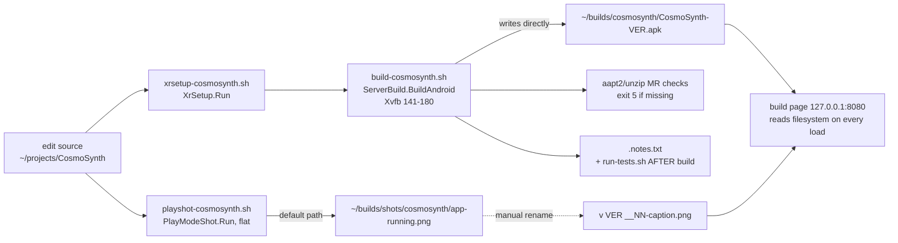

# CosmoSynth build pipeline and the box: how it builds, verifies, captures and publishes today, and what must change

2026-09-11 · read-only research. No builds, no editor launched, nothing under `~/projects` modified
except this file. Slug `build-pipeline-and-box`.

Every claim is tagged **VERIFIED** (I read the file or ran the command; path:line given) or
**INFERRED** (reasoned from verified facts, or general Unity/.NET knowledge not tested here).
Measurements are a snapshot taken 2026-09-11 between 17:30 and 18:00 CEST; the box is shared and
they move by the minute.

Companion report: `docs/research/2026-09-11-render-xr-audit.md` (same day, another agent) owns
the "100 plus Earths on a grid" diagnosis and the render gates V1 to V6. This report owns the
pipeline those gates run inside, and refers to them by that name instead of repeating them.

---

## 0. Verdict (read this if nothing else)

1. **The only CosmoSynth binary left is 1.9.0, and it was renamed.** `~/builds/cosmosynth/` holds
   nothing except `recovered/CosmoSynth-release.apk` (46,520,034 B, 2026-08-01 23:23).
   `aapt2` reads it as `com.triton.cosmosynth` 1.9.0, versionCode 16. Every other APK, every
   `.notes.txt`, `build.log` and the `diagnostics/` folder are gone, and no prune manifest
   mentions them. The build page shows the file as the project's single build with 0
   downloads and a "not tested" bell, and serves it at `/dl/cosmosynth/recovered/CosmoSynth-release.apk`
   (VERIFIED). **Nobody has confirmed on a headset whether 1.9.0 still shows the 1.7.0 grid.**
   That is the cheapest, highest-value test available: it needs no build.
2. **Signing: debug key, and no release keystore exists anywhere.** 1.9.0 is v2-signed by
   `CN=Android Debug`, cert SHA-256 `e39a7703…4a17`. That is exactly `~/.android/debug.keystore`
   on triton, which is the laptop's debug key, synced 2026-07-29. `ServerBuild.cs` sets no
   keystore (`androidUseCustomKeystore: 0`). No `CosmoSynth_secrets` exists on triton, and no
   `cosmosynth/` exists in `D:\Remote\Hetzner\secrets\keystores\` on the laptop (VERIFIED, names only).
   Sideload continuity is fine. A store upload would lock the App ID to the debug cert forever.
3. **The box has no room for Library-carrying lanes.** `/` is 98% full with **12 GB free**,
   down from about 22 GB earlier today. RAM shows 19 GB available with **swap 7/7 GB exhausted**
   and a 1-minute load of 72 on 12 threads. `pgrep -af "Edito[r]/Unity"` counts **13**
   processes: 10 real editors, 7 of them Worldfall lanes, 22.8 GB RSS in total. CosmoSynth's
   `unity/Library` is **7.9 GB**, of which Bee is 5.8 GB. A full clone does not fit safely. A git
   worktree without Library costs about **13 MB**.
4. **Code-only worktree lanes work, but only after a one-line fix.** In a Library-less tree,
   `tests/CosmoSynth.Runtime.Compile` **fails with 16 CS errors** (XR Hands, XR CoreUtils and
   InputSystem types). Its package references are conditional on a *relative*
   `../../unity/Library/ScriptAssemblies`. So `./run-tests.sh` exits 1 before any Core test runs.
   Passing `-p:UnityScriptAssemblies=<main's ScriptAssemblies>` fixes it. Two concurrent builds
   in two trees then both pass in 5 s, and both 142-test suites pass concurrently in 17 s
   (VERIFIED by the probe in Appendix C). obj/ and bin/ are per-tree, so they do not collide.
   What does collide is the fixed log path `/tmp/cosmosynth-runtime-build.log`
   (`run-tests.sh:52`), which is shared by every tree.
5. **Display band:** CosmoSynth's scripts use 141 to 180. That band is shared with IrisHUD,
   Vitraglyph, chemispace, respirasim and verdara. **461 to 490 is claimed by no script on the
   box** (the highest claim is 460). Adopt it.
6. **The tooling to port is Worldfall's**: `common.sh`, `build.sh` (gate, then scene, then APK,
   then verify), `verify-apk.sh` (counting `has()` plus a self-test), `editor-method.sh` and
   `shot.sh`. Do **not** port `lane.sh` or `integrate.sh`: Worldfall's own handover says
   whole-file lane copies "failed at integration" and that git three-way merges were what worked
   (`~/projects/Worldfall/HANDOVER.md:239-250`). Do not port Mechanarium's `reap-xvfb.py` as it
   stands: despite its docstring, it reaps idle Xvfb servers in *every* band.
7. **What the current pipeline gets wrong**, in order of cost:
   - tests run *after* the APK is built, as notes, not as a gate (`build-cosmosynth.sh:166`);
   - nothing stops a version collision beyond a comment (`ServerBuild.cs:36-37` hard-codes
     1.9.0/16, and the output overwrites in place);
   - the build target group is not pinned (Worldfall documents that a fresh Library defaults to
     Standalone and drops the Meta xr-* entries);
   - no timeouts on the build or the XR setup;
   - capture defaults write straight into the published gallery (`playshot-cosmosynth.sh:14`,
     `shot-cosmosynth.sh:12`);
   - every play-mode capture is flat, not stereo, so none of them can see the class of bug the
     user reported.
8. **Next-APK gates** (§11): G0 source gates in any worktree; G1 editor gates in main behind a
   `flock`; G2 IL2CPP build on 461 to 490 with resource guards; G3 artefact gate (ported
   `verify-apk.sh` plus CosmoSynth checks, with an xr-block MD5 baseline); G4 publish with
   version-tagged shots from the same commit; G5 headset. G5 is the only proof for the
   rendering bug.

---

## 1. Evidence base

| Source | What it gave | Status |
|---|---|---|
| `~/README.md` §4, §5, §5a-bis, §5b, §6, §7, §9 (lines 1001-1260, 1682-1800) | Unity install, build conventions, `-nographics` trap, disk policy, apk-shot, Quest signing clash | VERIFIED |
| `~/projects/README.md` | build page conventions: `~/builds/<key>`, notes/feedback sidecars, `v<ver>__` shots, the registry, "one editor per project" | VERIFIED |
| `~/server-setup/{build,playshot,shot,xrsetup}-cosmosynth.sh` | today's pipeline | VERIFIED, read in full |
| `unity/Assets/CosmoSynth/Editor/{ServerBuild,XrSetup,PlayModeShot,SceneBuilder}.cs`, `SceneShot.cs` (skimmed) | editor entry points | VERIFIED |
| `~/control-panel/serve.py` and `triton_common.py` (read only, never edited) | registration, APK scan, shot parser, download tally | VERIFIED |
| `~/projects/Worldfall/tools/*`, `~/projects/Mechanarium/tools/*`, `WorldfallBuild.cs` | reference tooling | VERIFIED |
| `df`, `free`, `pgrep`, `ps`, niced `du` on the one allowed Library, `du --max-depth=0 ~/builds` | capacity | VERIFIED (snapshot) |
| `aapt2` / `apksigner` / `keytool -list` (fingerprints only) on the surviving APK and the debug keystore | version and signing | VERIFIED |
| Concurrency probe on two `git archive` exports in `/tmp` (Appendix C) | worktree feasibility | VERIFIED (1 trial each) |
| Session transcript `~/.claude/projects/-home-triton-projects-CosmoSynth/30b1156c-….jsonl`, grepped for `[ServerBuild] result=` only | historical build times | VERIFIED |
| `CosmoSynth/CLAUDE.md`, `README.md`, memory notes `cosmosynth-*.md` | project conventions and history | VERIFIED |

---

## 2. Today's pipeline, end to end



### 2.1 Scripts and entry points (all VERIFIED)

| Script (`~/server-setup/`) | Unity method | Flags | Display | Output | Exit codes |
|---|---|---|---|---|---|
| `xrsetup-cosmosynth.sh` (24 lines) | `CosmoSynth.EditorTools.XrSetup.Run` | `-batchmode -quit -buildTarget Android` | first free of 141-180 (`:12-16`) | `~/builds/cosmosynth/xrsetup.log` | 4 = editor already open on project; Unity's exit (XrSetup exits 1 on any failure, 2 on exception) |
| `build-cosmosynth.sh` (177 lines) | `CosmoSynth.EditorTools.ServerBuild.BuildAndroid` | same (`:70-71`) | 141-180 (`:46-63`) | APK and `build.log` in `~/builds/cosmosynth/` | 4 editor open (`:28-32`), 1 no display, Unity rc, 3 no APK (`:84-88`), 5 BUILT_BUT_NOT_IMMERSIVE (`:171-175`) |
| `playshot-cosmosynth.sh` (40 lines) | `CosmoSynth.EditorTools.PlayModeShot.Run` | `-batchmode`, **no `-quit`**, **no `-buildTarget`**, `timeout 900` (`:33-35`) | 141-180 (`:25-29`) | default **`~/builds/shots/cosmosynth/app-running.png`** (`:14`) plus `.report.txt`; log `~/builds/cosmosynth/playshot.log` | 4, Unity rc (PlayModeShot: 0 ok, 1 no scene, 2 exception, 3 capture failed), 3 no image |
| `shot-cosmosynth.sh` (52 lines) | `CosmoSynth.EditorTools.SceneShot.Run` (edit mode, builds its **own** scene) | `-batchmode`, no `-quit`, no `-buildTarget`, no timeout | 141-180 | default **`~/builds/shots/cosmosynth/solar-system.png`** (`:12`) | 4, Unity rc, 3 no image |

The guard in all four, `pgrep -f "Editor/Unit[y].*projectPath $PROJECT"`, *refuses* rather than
queues. `build-cosmosynth.sh:37-42` warns but does not refuse under 8 GB `MemAvailable`. There
is no disk check anywhere.

### 2.2 `ServerBuild.cs` (178 lines, VERIFIED)

- Constants at `:30-37`: `ScenePath = Assets/CosmoSynth/Scenes/SolarSystemLab.unity`,
  `PackageName = com.triton.cosmosynth`, `OutputDirectory = "/home/triton/builds/cosmosynth"`
  (absolute; any tree that runs this publishes to the live page), `Version = "1.9.0"`,
  `VersionCode = 16`, both bumped by hand.
- `:49` output `CosmoSynth-{Version}.apk`. `BuildPipeline.BuildPlayer` overwrites in place.
  CLAUDE.md:60-65 records that this destroyed the first 1.6.0.
- `ConfigurePlayerSettings` (`:95-139`) **writes** PlayerSettings: IL2CPP, ARM64 only, minSdk 32,
  target `Auto` (the APK reads **36**), Vulkan only, `NET_Standard`, stripping Low,
  `forceInternetPermission = false`.
- **No signing code at all.** `ProjectSettings.asset:275-288` has `AndroidKeystoreName:` empty
  and `androidUseCustomKeystore: 0`, so Unity signs with `~/.android/debug.keystore`.
- **Does not pin `EditorUserBuildSettings.selectedBuildTargetGroup`.** Worldfall pins it on
  purpose (`WorldfallBuild.cs:104-107`), with the comment that "on a fresh Library it defaults to
  Standalone — which silently drops the Meta Vulkan xr-* entries (black screen)". CosmoSynth
  relies on `-buildTarget Android` alone (INFERRED sufficient while the Library is warm; not
  proven for a cold one).
- `EnsureScene` (`:146-173`) generates the scene only if it is missing. The scene **is
  committed** (`git ls-files` lists `SolarSystemLab.unity` and `.meta`), so the notes line
  "generated by ServerBuild, not committed" (`build-cosmosynth.sh:163`) is stale.
- There is no compile-only or diagnostics entry point. Worldfall has `WorldfallBuild.Diagnostics`
  (`:30-55`), which dumps the player, quality, render-pipeline and XR settings.

### 2.3 `XrSetup.cs` (404 lines, VERIFIED)

- Required Android OpenXR features (`:43-75`): `metaquest`, `arfoundation-meta-camera`,
  `arfoundation-meta-session`, `input.handtrackingsubsystem` (not the colliding
  `input.handtracking`), `metahandtrackingaim`, `oculustouch`, `metaquestplus`,
  `handinteraction`, `handinteractionposes`.
- Optional (`:78-82`): `meta-boundary-visibility` and `compositionlayers`. The first is why the
  1.9.0 manifest declares **`BOUNDARY_VISIBILITY`** (Appendix B), which Worldfall's
  `verify-apk.sh:107-115` would FAIL.
- Forced off (`:90-93`): `foveatedrendering`, because it is a build error on Built-in RP.
- `:215-224` logs the `MetaQuestFeature` asset count and fails unless it is exactly 1.
  Today there is one. `Assets/XR 1`, `XR 2` and `XR 3` exist but hold 0 non-meta files
  (VERIFIED).
- `:276` SinglePassInstanced. `:281` Depth16Bit submission. `:300-329` Active Input "Both".
  `:343-394` writes `CosmoShaders.All` into Always Included Shaders.
- **Worth keeping.** Configuring through the official APIs, with counted diagnostics, is better
  than Worldfall's YAML approach for this project.

### 2.4 Capture: what each harness proves (VERIFIED from source)

- `PlayModeShot` runs the real bootstrap in play mode, waits for the catalogue and texture bakes
  to settle (`:177-200`), sizes the capture viewport *before* settling (`:121`, `:753`), composites
  both `DepthBands` cameras far-then-near (`:778-883`) at **no MSAA** (`:743-747`), writes a
  numeric report (`Inspect`, `:337`) and a destination-alpha probe (`:546`), and honours
  `COSMOSYNTH_HIDE` for bisection (`:155-156`). It exits 0/1/2/3.
  **It never fails on report content.** A report saying "catalogue not loaded" still exits 0 if
  a PNG was written.
- It runs **flat**. `XR active: no (flat fallback)` appears in every surviving report, and the
  camera renders into a `RenderTexture`, not an XR eye buffer. So it cannot exercise single-pass
  instancing, the Vulkan multiview path, MSAA resolve or the compositor. The render-xr-audit
  explains why that class of failure cannot be reproduced on llvmpipe at all.
- `SceneShot` builds its own scene, at 8× MSAA (`SceneShot.cs:87`). CLAUDE.md:54-55 and the
  memory note `cosmosynth-run-it-dont-reconstruct-it.md` already rule it out as evidence about
  the shipped app. It should not appear in release gating.
- `~/tools/apk-shot` cannot exercise an OpenXR passthrough app on the emulator. This is a
  documented box rule (`~/projects/GeoramaXR/CONTRACT-XR.md:35-36`); I did not test it.

### 2.5 Tests (VERIFIED)

- `run-tests.sh` finds Unity's bundled SDK (**dotnet 8.0.318**). It builds
  `tests/CosmoSynth.Runtime.Compile` (`:50-59`, log to the fixed `/tmp/cosmosynth-runtime-build.log`),
  then runs `tests/CosmoSynth.Core.Tests` (`:62-66`). Result today: **142 passed, 0 failed**
  (about 3 s of test time).
- `CosmoSynth.Runtime.Compile.csproj:30` references
  `$(HOME)/Unity/Hub/Editor/6000.5.5f1/Editor/Data/Managed/UnityEngine/*.dll` (absolute through
  HOME, read-only). `:38` sets `UnityScriptAssemblies` to
  `$(MSBuildThisFileDirectory)../../unity/Library/ScriptAssemblies`, which is **relative to the
  tree**. `:101-131` adds InputSystem, XR CoreUtils, Hands, ARFoundation, Management, OpenXR and
  ARSubsystems only if that directory exists.
  The comment at `:32-36`, "on a clean checkout this project still builds", **is false today**.
  Runtime has no `#if` guards at all, and `XrHandInput.cs` and `XrRig.cs` use `UnityEngine.XR.Hands`,
  `Unity.XR.CoreUtils` and `UnityEngine.InputSystem` unconditionally (Appendix C, step 1).
- **Editor scripts (`Assets/CosmoSynth/Editor/*.cs`) are compile-checked by nothing outside
  Unity.** `ServerBuild`, `XrSetup` and `PlayModeShot` only fail at editor start.
  `UnityEditor.CoreModule.dll` exists in `Managed/UnityEngine/`, so a sibling
  `CosmoSynth.Editor.Compile.csproj` is feasible (INFERRED, untested).
- Main's `Library/ScriptAssemblies/CosmoSynth.Runtime.dll` is dated 2026-08-01 23:16 and the
  package DLLs 2026-07-30. **No editor has opened CosmoSynth since the 1.9.0 build.** The Phase-3
  Core `TerrainMesh` (2026-08-19, commit `87ee996`) has never been compiled by Unity, only by
  .NET.
- Main's ScriptAssemblies already contain the URP runtime DLLs
  (`Unity.RenderPipelines.Universal.Runtime.dll`, `…Core.Runtime.dll`). A URP migration's runtime
  code can therefore be compile-checked headlessly by adding two `<Reference>`s.

### 2.6 Publishing: how the build page sees CosmoSynth (VERIFIED, `~/control-panel` read only)

- **Registration**: `triton_common.py:424-426`
  `"cosmosynth": {"hue": 300, "symbol": "wave", "dir": "CosmoSynth", "label": "CosmoSynth", …}`,
  imported by `serve.py:116-117`. Terminal favicon aliases are at `term_favicons.py:28,65`.
  Nothing more needs registering.
- **APK discovery**: `find_apks()` (`serve.py:1863-1873`) `os.walk`s all of `~/builds`.
  `group_by_project()` (`:1951-1960`) keys on the first path component, which is why
  `cosmosynth/recovered/…` still lands on the CosmoSynth card. The in-tree scan (`:1880`) looks
  only at `Build/`, `Builds/`, `build/outputs/apk` and `out/` under `~/projects/CosmoSynth`, so
  `unity/build` is never scanned.
- **Shot versions**: `SHOT_VERSION = ^v(?P<version>[A-Za-z0-9._+-]+)__(?P<rest>.+)$`
  (`serve.py:2252`), applied to the file **stem**. `shot_version()` (`:2255-2266`) strips a
  leading `NN-` or `NN_` from the caption and turns `-` and `_` into spaces. Groups sort by newest
  mtime, and untagged shots go last (`:2269-2286`). An alternative that works: shots under
  `shots/cosmosynth/by-build/<version>/` are rewritten to `v<version>__<stem>` (`:1743-1750`).
- **Download tally**: `~/builds/.meta/downloads.json` (`serve.py:63`), keyed by relative path.
  `cosmosynth/CosmoSynth-1.9.0.apk` shows count 2, but its last timestamp, 2026-08-04 08:10:04,
  is **the same second** as the entries for 1.7.2 and 1.5.0. That is a scripted fetch, not a
  headset. The surviving `recovered/` path shows 0 downloads and the bell (INFERRED: 1.9.0 has
  never been installed on the Quest).
- The inspector fragment, `GET /api/project?k=cosmosynth` (`serve.py:23295`), shows
  `Builds 1 · Shots 13 · Notes 0`, "Get 1.9.0 44.4 MB", "Downloads 0 · never",
  "Meta Quest — VR / passthrough", and a **delete form** (`/api/build/delete`) on the row.

---

## 3. State of the artefacts today (VERIFIED)

| Item | Finding |
|---|---|
| `~/builds/cosmosynth/` | Only `recovered/CosmoSynth-release.apk` (dir created 2026-08-09). No `.notes.txt`, `build.log`, `playshot.log` or `diagnostics/`. `LastBuild.buildreport` records the output as `/home/triton/builds/cosmosynth/CosmoSynth-1.9.0.apk`, so the file was renamed later. Neither prune manifest (`~/tools/prune-manifests/*.json`) mentions CosmoSynth. |
| `~/builds/shots/cosmosynth/` (5.5 MB, 22 files) | Tagged: `v1.7.0__01-…`, `v1.7.2__01-…`, `v1.8.0__01-…`, `v1.9.0__01-…`. **`v1.7.2__…` is byte-identical to `v1.7.0__…`** (md5 `8f347ff3…`), so the "1.7.2" picture is not a capture of 1.7.2. `v1.8.0` = `realsky2.png`, `v1.9.0` = `sirius.png` (same md5s). Nine untagged working captures and five `.report.txt` files sit in the published gallery, although `README.txt` there says diagnostics belong elsewhere. |
| Git | 4 snapshot commits, all titled "Track the source tree in git" (2026-08-01, 08-02, 08-22, 09-06). Branch `master`, remote `git@github.com:ajinkyagorad/CosmoSynth.git`. All 297 files under `unity/Assets` are tracked, so a worktree is a complete source copy. No local `file:` packages in `Packages/manifest.json`. |
| `docs/feedback.md` | Ends at 1.7.0's *requests*. **The user's 1.7.0 headset report ("100 plus instances of earth … repeated on a grid flat") is not recorded there** or in any surviving `.feedback.md`. |
| Doc drift | CLAUDE.md:16 says "87 tests" (now 142). `build-cosmosynth.sh:163` says the scene is not committed (it is). `Runtime.Compile.csproj:32-36` says a clean checkout builds (it does not). |

---

## 4. Signing

- **What 1.9.0 used** (VERIFIED): APK Signature Scheme v2 only. `Signer #1 certificate DN: C=US,
  O=Android, CN=Android Debug`, SHA-256 `e39a770361a88b7647373eda58915f6d9715765031298cc5cd708a7b2f8f4a17`.
  `keytool -list` on `~/.android/debug.keystore` (2618 B, 2026-07-29 17:56, the well-known public
  debug password) gives the identical `E3:9A:77:…:4A:17`. `~/README.md:1939-1943` records that
  this keystore was copied from the laptop so that laptop and server builds share one signature.
  The same fingerprint is the "debug" cert in the HoloVault store incident
  (memory `meta-cert-locked-by-first-upload.md`), so it is a box-wide shared debug identity.
- **Release keystore for CosmoSynth: none** (VERIFIED, names only).
  - On triton, `~/projects/*_secrets` exists for ADFeaXR, DNAmorphogenesis, Fractarium,
    HoloVault, MRI_Viewer, Mechanarium, Muisto, NeuroWeaveXR, Prosa, RespiraXRWeb, ThermSense
    (a Kaggle token only), Trinquest, Verdara, Worldfall and nebulytic-spatial-worlds, plus
    `HorizonStore/{LuminaVale,HandARInterfaces}_secrets` and `~/keystores` (aixr,
    planetaryvitals, iris). A `find ~ -maxdepth 4 -iname '*cosmo*.keystore' -o -iname '*cosmo*.jks'`
    returns nothing.
  - On the laptop, `D:\Remote\Hetzner\secrets\keystores\` has aixr, planetaryvitals, irishud,
    mri_viewer, trinquest, handar, prosa, muisto, mechanarium, worldfall, holovault,
    fractarium, neuroweavexr (top-level files), `README.md` and `SHA256SUMS.txt`. **No cosmosynth.**
    (Its README table lists only 8 of these 13, so that table is itself stale.)
- **Consequences** (INFERRED from box precedent):
  - Any future build signed with a release key will fail `INSTALL_FAILED_UPDATE_INCOMPATIBLE`
    over the installed debug-signed build. The user must uninstall once.
  - A Meta upload locks the App ID to whatever cert goes up first. Prosa is the recorded case of
    "signing late".
- **Recommendation**: keep the **debug** key for the next sideload APK. The user's first job is
  an A/B check of the grid bug, and an uninstall-and-reinstall adds a confounder. Create
  `~/projects/CosmoSynth_secrets/cosmosynth.keystore` plus `keystore.pass` (mode 700), copy both
  to `D:\Remote\Hetzner\secrets\keystores\cosmosynth\`, add a README row and an SHA256SUMS line,
  verify by unlocking, and wire Worldfall's env-driven `ApplySigning()`
  (`WorldfallBuild.cs:176-197`) *before* anything is uploaded to a Meta App ID. **This is the
  user's decision**: flag it, do not do it silently. Never upload a debug-signed CosmoSynth to
  the dashboard.

---

## 5. Box capacity (snapshot, VERIFIED)

| Resource | Measured | Command |
|---|---|---|
| Disk `/` | 460 G, 425 G used, **12 G free, 98%** | `df -h /` |
| RAM | total 62 G, used 43, free 1, buff/cache 18, **available 19 G**; **swap 7/7 G used** | `free -g` |
| Load | 71.97 / 66.18 / 51.43 on 12 threads | `/proc/loadavg` |
| Unity processes | **13** matches: ADFeaXR 3, nebulytic-spatial-worlds 2, Worldfall-lanes 1, 3, 4, 5, 6, 9 and 10 (7), PlanetaryVitals-Quest 1. Real editors are 0.7-3.9 GB RSS each (the 0.0 GB rows are wrappers). **Total 22.8 GB RSS.** No CosmoSynth editor running. | `pgrep -af "Edito[r]/Unity"`, `ps -eo rss` |
| `~/projects/CosmoSynth/unity/Library` | **7.9 G**: Bee 5.8 G, PackageCache 1.8 G, BurstCache 120 M, Artifacts 114 M, ScriptAssemblies 25 M, ShaderCache 17 M | `nice -n 19 ionice -c3 du` on that one directory |
| CosmoSynth source | `unity/Assets` 8.5 M (StreamingAssets 6.7 M), tests 2.4 M, tools 240 K, docs 424 K, `.git` 8.0 M. A `git archive HEAD` export is **13 M** | niced `du` |
| `~/builds` | **19 G** (CosmoSynth 45 M + shots 5.5 M) | `du -sh --max-depth=0` |
| Gradle cache | `~/.gradle/caches/9.1.0/transforms` repopulated (1898 entries) after the 2026-08-20 wipe | `ls` (no `du`) |
| Historical BuildPlayer phase | 23 s, 27 s, 50 s, 54 s and 182 s across 5 successful IL2CPP builds (Unity's `summary.totalTime`, excluding editor start and import) | transcript grep |

**What fits:**

| Lane kind | Disk each | Editor RAM | Verdict |
|---|---|---|---|
| git worktree, no Library, code-only | **~13 MB** plus a few MB of obj/bin | 0 | **Yes, many.** |
| Worldfall-style rsync clone excluding `Library/Bee`, `il2cpp_cache`, `ShaderCache` | ~2.1 GB (INFERRED: 7.9 − 5.8 − 0.02) | 0.7-4 GB | At most one, and only when `df` shows ≥ 20 GB free. Not today. |
| Full clone with Library | 7.9 GB | 0.7-4 GB | **No.** It would take two thirds of the free disk. |

On RAM, Worldfall measured that "62 GB is exhausted at about five concurrent editors and the
failure looks like a package-manager IPC timeout, not a compile error"
(`~/projects/Worldfall/docs/INTEGRATION.md:111-113`). With about 10 editors already running and
swap full, CosmoSynth gets **one** editor at a time. The IL2CPP peak on this box is unmeasured
(INFERRED 4-8 GB for editor, il2cpp and clang together).

A related trap: `~/tools/reclaim-library.py:92` only looks at `~/projects/<name>/Library`, so
CosmoSynth's nested `unity/Library` is invisible to it. It is neither reclaimed nor reported.
`~/tools/never-delete.txt` protects `/home/triton/projects` as a whole.

---

## 6. Xvfb display bands (VERIFIED by grep of every `seq N M` in `~/projects/*/tools`, `~/projects/*/*.sh`, `~/server-setup/*.sh` and `~/tools`)

There is **no central allocation table**. `~/README.md` has none. Bands live in each project's
`common.sh` and CLAUDE.md.

| Band | Claimed by |
|---|---|
| :2, :11-:16, :95, :99-:100 | xrdp/desktop, Blender slots (`:1i`, README:1558), MCP editor (`launch-unity.sh`), `xvfb-run -a` (starts at :99) |
| 101-140 | holo-hud-os, `build-holo-gfx.sh`, `run-editor-method.sh`, `scene-shot.sh` |
| **141-180** | **cosmosynth (all 4 scripts)**, IrisHUD, Vitraglyph, chemispace, respirasim, verdara (server-setup) |
| 181-220 | Microverse, PlanetaryVitals(-Quest), lucida, zanatomy |
| 221-260 / 241-270 | Fractarium, hwagent / GeoramaXR, Pastelia |
| 220-299 / 261-300 / 271-300 | HSLAwareness / aixr / BoltGraphXR, StarHoloXR, NeuroWeaveXR, Tauko |
| 301-330 / 301-340 | Codex (Qodex), Mechanarium / spatial-ai-studio |
| 331-360 · 361-390 · 391-420 · 421-450 | Reverie · OrbisXR · RespiraXR · Worldfall |
| wide sweeps | HoloVault 181-340, Rimewake 200-460, SciProsa 180-460 |
| **461-490** | **nobody** |

Live at measurement: `:99 :100 :191 :421 :422 :424-:432`, with lock files also at 181-191 and
270-275. `:422`, `:424` and `:425` are 89 h old. Those are Worldfall's; do not touch them.

**Adopt 461-490.** Declare it in `tools/common.sh` and CLAUDE.md, the way Reverie, OrbisXR and
the others do. The "take the first free display whose lock file is absent, keep it only if
`kill -0` succeeds after 3 s" loop is already race-tolerant: a loser's Xvfb exits and the loop
moves on (INFERRED from the pattern). So bands are for diagnosability and reaping, not
correctness.

---

## 7. Reference tooling compared (VERIFIED)

| Capability | CosmoSynth today | Worldfall `tools/` | Mechanarium `tools/` | Port? |
|---|---|---|---|---|
| Tools live in the repo, versioned | no (`~/server-setup/`, not in git) | yes | yes | **yes** |
| `common.sh` (paths, band, `start_xvfb`) | copy-pasted 4× | 27 lines | 27 lines | **yes**, band 461-490 |
| Gate before build | tests run *after* (`build-cosmosynth.sh:166`) | `WorldfallGate.RunAllAndExit`, exit 10 (`build.sh:37-40`) | `MechTest`, exit 10 (`:39-42`) | **yes**, exit 10 |
| Scene step | `EnsureScene` inside the build | `SceneBuilder.BuildAllAndExit`, exit 11 | same | not needed (scene committed, built at runtime) |
| Env-driven signing, DN reported | none | `build.sh:13-22`, `:82-90` + `ApplySigning` | same | **yes** (debug fallback) |
| Version handling | hand-bumped constant, silent overwrite | versionCode auto-increments from ProjectSettings, `WORLDFALL_VERSION` pins the name (`WorldfallBuild.cs:124-132`) | — | **gate instead** (§9.3) |
| Target group pinned | no | yes (`:104-107`) | — | **yes** |
| Artefact verifier | inline, 7 grep checks, catalogue check | `verify-apk.sh` 171 lines: counting `has()`, boot.config + offscreen swapchain, Meta lib, signing, VR category via xmltree, permission hygiene, pre-splash, orientation value, targetSdk, ABI purity, **self-test** | older copy using `grep -q`; `verify-store-apk.sh` with **xr-block MD5 baseline** `2e1fc6cc…` | **yes**, Worldfall's plus the MD5 baseline |
| Generic editor-method runner | none | `editor-method.sh`, greps any `[Tag]` | same | **yes** |
| Play-mode shot | `playshot-cosmosynth.sh` | `shot.sh` (note a stray literal `\n` at `shot.sh:18` that passes an `n` argument to Unity; do not copy it) | `shot.sh` | wrap PlayModeShot the same way |
| Lanes | none | `lane.sh`: rsync clone with Library (`:24-28`) | — | **no** (disk; see §10) |
| Integration | — | `integrate.sh`: rsync copy plus a filename/class check (`:53-65`) plus a compile | — | **only the filename/class check**; merge with git |
| Gate runner | — | `gate-all.sh` (discovers namespace, reports ABSENT) | — | later, once ≥ 3 gate classes exist |
| Xvfb reaper | — | — | `reap-xvfb.py`: docstring says "241-270 band", code reaps any unclaimed Xvfb older than 6 h (`:45-49`, no band filter) | no, or restrict to 461-490 first |

Worldfall's own verdict on its lanes (`HANDOVER.md:245`): they "worked for parallelism and
**failed at integration**: lanes edit overlapping files and a whole-file copy makes the last one
merged the only survivor. The reliable method turned out to be git: branch each lane off the
shared base commit … and let `git merge` do a real three-way."

The 1.9.0 APK run through Worldfall-style checks (Appendix B) passes everything that decides
*run and immersive*. Its xr-block MD5 `2e1fc6ccd7f09d6cbe013eb1c74e9e02` is **identical** to
Mechanarium's headset-confirmed baseline (`verify-store-apk.sh:21`). It would fail Worldfall's
*store hygiene* checks on `android.permission.INTERNET`, `BOUNDARY_VISIBILITY` and
targetSdk 36 > 34, and warn on the missing passthrough pre-splash. For sideload, those are
warnings. For a store build, they are blockers.

---

## 8. Can `tests/CosmoSynth.Runtime.Compile` run concurrently from separate worktrees?

Probe: two `git archive HEAD` exports in `/tmp/cosmosynth-bpb.*`, Unity's dotnet 8.0.318,
`nice -n 10`, deleted afterwards. Nothing under `~/projects` was touched. Output is in
Appendix C.

| Question | Answer |
|---|---|
| Absolute paths to main's Library or package DLLs? | **No.** UnityEngine modules come from `$(HOME)/Unity/Hub/Editor/6000.5.5f1/…` (absolute, read-only, fine). Package DLLs come from a **tree-relative** `../../unity/Library/ScriptAssemblies`, and only if it exists. |
| Does it build in a Library-less worktree? | **No.** rc=1 in 4 s with 16 `error CS` lines: `XRHandSubsystem` ×4, `UnityEngine.InputSystem` ×4, `XROrigin` ×2, `XRHand` ×2, `Unity.XR` ×2, `UnityEngine.XR.Hands` ×2. So `run-tests.sh` exits before the Core suite runs. |
| Fix? | `-p:UnityScriptAssemblies=/home/triton/projects/CosmoSynth/unity/Library/ScriptAssemblies`. MSBuild global properties override the project property. **Both trees rc=0, concurrently, in 5 s.** |
| Do concurrent builds collide on obj/? | **Not across trees.** obj/ and bin/ sit beside each csproj, so they are per tree (both built cleanly in parallel). Within **one** tree, two parallel builds passed in one trial. That is a race in principle (INFERRED); serialise per tree. |
| Core suite concurrently? | **Both trees: 142 passed, 0 failed** (3.0 s and 3.1 s of test time, 17 s wall including build). |
| Other shared state? | `run-tests.sh:52` writes **`/tmp/cosmosynth-runtime-build.log`** for every tree. It was last written 2026-09-11 16:54 by someone else. Concurrent runs clobber each other's log, and the error `grep` at `:56` can print another tree's errors. The dotnet build server and `~/.nuget` are shared per user and designed for concurrency (INFERRED); there are no PackageReferences to restore. |
| Caveat | Main's ScriptAssemblies are frozen at the 2026-08-01 state. A lane that adds a package, or needs an assembly the csproj does not list (URP, XRI), must add the `<Reference>`, and must wait for main's editor to have imported that package. Reading main's DLLs while main's editor rewrites them could fail transiently (INFERRED, low risk: package DLLs only change when packages change). |

---

## 9. Recommended tooling (to build in the implementation phase)

Put everything in `~/projects/CosmoSynth/tools/` (versioned, in git). Leave the
`~/server-setup/*-cosmosynth.sh` files in place, with a first-line pointer to the new tools.
Do not delete them from a project session: `never-delete.txt` protects `~/server-setup`.

### 9.1 Files

| File | Source | CosmoSynth changes |
|---|---|---|
| `tools/common.sh` | Worldfall `common.sh` | `REPO=/home/triton/projects/CosmoSynth`, `PROJECT=$REPO/unity`, `OUTDIR=/home/triton/builds/cosmosynth`, band **461-490**, plus `editor_lock` and `guard_resources` (below) |
| `tools/editor-method.sh` | Worldfall, verbatim logic | `timeout ${METHOD_TIMEOUT:-1200}`; always `-buildTarget Android` |
| `tools/build.sh` | Worldfall `build.sh` | order: G0 gates → XrSetup.Run → (optional) Diagnostics → BuildAndroid under `timeout 3600` → `verify-apk.sh` → notes. Exit codes 10 gate, 12 XR setup, 3 no artefact, 13 verify. **Refuse a dirty `unity/` tree** so the commit printed in the notes is the tree that built the APK. **Refuse unless `$PROJECT` is main.** |
| `tools/verify-apk.sh` | Worldfall `verify-apk.sh` | package `com.triton.cosmosynth`; filename `CosmoSynth-<ver>.apk`; plus the catalogue checks (`assets/CosmoSynth/catalog/{solar_system,spacecraft,exoplanets}.json`, `assets/CosmoSynth/sky/stars.csstars` sized 2,870,728 B, which is 119,613 × 24 + 16, layout INFERRED), the xr-block MD5 baseline, the baked-QualitySettings MSAA scan (render-xr-audit V5 / Appendix B), and `STORE=1` mode turning the hygiene warnings into failures; keep the self-test |
| `tools/shot.sh` | Worldfall `shot.sh` | wraps `PlayModeShot.Run`; default output `/tmp/cosmosynth-<ts>.png`, never the gallery; `--rev <commit>` capture mode (§10.3) |
| `run-tests.sh` (edit) | — | ScriptAssemblies fallback plus a unique log (§9.2) |
| `ServerBuild.cs` (edit) | Worldfall | pin `selectedBuildTargetGroup`; `ApplySigning()` with debug fallback, exactly like `WorldfallBuild.cs:176-197`; a `Diagnostics()` entry that prints `DIAGNOSTICS_OK` plus the settings dump |
| `PlayModeShot.cs` (edit) | — | exit non-zero on report assertions (G1c), and print `git rev-parse HEAD` in the report so a shot names its commit |

Skipped: `lane.sh`, `integrate.sh`'s copy step, `gate-all.sh` and `merge-manifest.sh`. Add a gate
runner when there are three or more gate classes, and a manifest merger when third-party assets
arrive.

### 9.2 The pieces worth writing out (sketches, untested)

```bash
# tools/common.sh (additions)
BAND_LO=461; BAND_HI=490
editor_lock() {           # queue behind other CosmoSynth editor jobs instead of exiting 4
  exec 9>/tmp/cosmosynth-editor.lock
  flock -w "${LOCK_WAIT:-3600}" 9 || { echo "### editor lock busy >${LOCK_WAIT:-3600}s"; exit 4; }
  # keep the pgrep guard too: it catches editors started outside these tools (MCP, by hand)
  pgrep -f "Editor/Unit[y].*projectPath $PROJECT( |$)" >/dev/null && { echo "### foreign editor on $PROJECT"; exit 4; }
}
guard_resources() {       # $1 = min free disk GB, $2 = min MemAvailable GB
  local d m
  d=$(df --output=avail -BG / | tail -1 | tr -dc 0-9)
  m=$(awk '/MemAvailable/ {print int($2/1048576)}' /proc/meminfo)
  echo "### disk ${d} GB free, ${m} GB MemAvailable"
  [ "$d" -ge "$1" ] || { echo "### REFUSED: under $1 GB free disk"; exit 6; }
  [ "$m" -ge "$2" ] || { echo "### REFUSED: under $2 GB MemAvailable"; exit 6; }
}
# ponytail: thresholds are guesses (method 5/6 GB, IL2CPP 8/10 GB); tune from the first measured peak.
```

```bash
# run-tests.sh, replacing :50-59
SA="$REPO_ROOT/unity/Library/ScriptAssemblies"
[ -d "$SA" ] || SA=/home/triton/projects/CosmoSynth/unity/Library/ScriptAssemblies   # worktree: use main's, read-only
LOG=$(mktemp /tmp/cosmosynth-runtime-build.XXXXXX.log)
echo "Unity package assemblies: $SA ($(date -r "$SA/Unity.XR.Hands.dll" +%F 2>/dev/null || echo missing))"
"$DOTNET" build "$RUNTIME_PROJECT" -c Release -v quiet --nologo -p:UnityScriptAssemblies="$SA" > "$LOG" 2>&1 \
  && echo "Unity runtime layer: compiles" \
  || { echo "Unity runtime layer: COMPILE ERRORS" >&2; grep -E "error" "$LOG" | head -20 >&2; exit 1; }
```

### 9.3 Version gate (fail closed, reads artefacts rather than names)

```bash
SB="$PROJECT/Assets/CosmoSynth/Editor/ServerBuild.cs"
VER=$(sed -n 's/.*string Version = "\([^"]*\)".*/\1/p' "$SB")
CODE=$(sed -n 's/.*int VersionCode = \([0-9]*\);.*/\1/p' "$SB")
MAX=0
while IFS= read -r a; do
  c=$("$BT/aapt2" dump badging "$a" 2>/dev/null | sed -n "s/.*versionCode='\([0-9]*\)'.*/\1/p")
  [ "${c:-0}" -gt "$MAX" ] && MAX=$c
done < <(find "$OUTDIR" -name '*.apk')
[ "$CODE" -gt "$MAX" ] || { echo "### REFUSED: VersionCode $CODE <= newest published $MAX"; exit 7; }
[ ! -e "$OUTDIR/CosmoSynth-$VER.apk" ] || { echo "### REFUSED: would overwrite CosmoSynth-$VER.apk"; exit 7; }
```

Today `MAX` is 16, from the recovered file, so the next APK needs **code ≥ 17** and a new name
(for example 2.0.0). It must be greater than 16 to install as an upgrade over 1.9.0.

---

## 10. Lane strategy for parallel agents

### 10.1 Shape

- **Main** = `~/projects/CosmoSynth` on `master`, the only tree with a Library (7.9 GB, warm), the
  only tree that opens Unity, and the only tree that builds APKs. It is run by **one integrator**.
- **Lanes** are `git worktree`s at `~/projects/CosmoSynth-wt/<lane>`, each on branch
  `lane/<lane>` cut from the current `master`, **with no Library**:
  ```bash
  git -C ~/projects/CosmoSynth worktree add -b lane/<name> ~/projects/CosmoSynth-wt/<name> master
  git -C ~/projects/CosmoSynth worktree list
  git -C ~/projects/CosmoSynth worktree remove ~/projects/CosmoSynth-wt/<name>   # after merge
  ```
  Three git commands, so no wrapper script. About 13 MB each: ten lanes cost about 150 MB.
- A lane can: edit `Core/`, `Runtime/`, `Editor/`, `tools/`, `docs/` and the Python importers;
  run `./run-tests.sh` (after the §9.2 fix) and the static gates (render-xr-audit V1 stereo
  shader, V2 settings, V3 code, plus the filename/class check); and commit to its branch.
- A lane cannot: open Unity, build, run `XrSetup`, or write to `~/builds`. It must not edit
  `ProjectSettings/*.asset` or `Assets/XR/**` (YAML that only `XrSetup` should write) unless it
  is the lane that owns XR configuration.

### 10.2 Integration (in main, serialised by `editor_lock`)

1. `git -C main merge --no-ff lane/<name>`. The real three-way merge is what Worldfall found
   worked.
2. `./run-tests.sh`, then the static gates, then `tools/editor-method.sh CosmoSynth.EditorTools.XrSetup.Run`,
   then `tools/editor-method.sh CosmoSynth.EditorTools.ServerBuild.Diagnostics` (the compile
   check), then `tools/shot.sh` with the report assertions (G1c).
3. Commit. Delete the worktree when the lane is done.

CosmoSynth's Assets are small (8.5 MB, 297 files) and the scene is built at runtime. Switching
main between commits therefore costs a script recompile plus a handful of reimports, not hours
(INFERRED).

### 10.3 Captures for lane agents without an editor

`tools/shot.sh --rev <commit>`:
1. Take `editor_lock`, and refuse if main has uncommitted changes.
2. `git -C main switch --detach <commit>` with a `trap` that switches back.
3. Run PlayModeShot to `/tmp/cosmosynth-<lane>-<name>.png`.
4. Release the lock.

The lane agent then `scp`s the PNG and **reads it**. One editor at a time, queued, never a
second Library.

### 10.4 Resource rules

- ≤ 1 CosmoSynth editor at any moment.
- `guard_resources 5 6` for editor methods and shots, `guard_resources 8 10` for IL2CPP.
- Never `du` any Library. Use the one niced `du -sh` on `unity/Library` when a number is needed.
- A Library-carrying capture lane (a Worldfall-style rsync excluding Bee, about 2.1 GB) only when
  `df` shows ≥ 20 GB free, and deleted the same day.

---

## 11. Verification gates for the next APK (in order; any red stops the pipeline)

| # | Gate | Where | Command / check | Pass criterion | Today |
|---|---|---|---|---|---|
| **P** | **Headset check of the existing 1.9.0** | user | install `/dl/cosmosynth/recovered/CosmoSynth-release.apk`; read the status card's `render:` line (render-xr-audit V6) | the user says whether the grid is gone; answer written to `docs/feedback.md` and `recovered/CosmoSynth-release.apk.feedback.md` | not done; the 1.7.0 report is not even recorded |
| G0a | .NET suite plus runtime compile | any tree | `./run-tests.sh` (after the §9.2 fix) | exit 0; ≥ 142 passed, 0 failed; "Unity runtime layer: compiles" | 142/142 in main; **fails in a Library-less tree without the fix** |
| G0b | Stereo shader gate | any tree | render-xr-audit V1 (`CosmoAtmosphere.shader`, `CosmoRim.shader`), with its self-test | every vertex program has the five stereo macros | passes (per render-xr-audit) |
| G0c | Settings gate | any tree | render-xr-audit V2 over `ProjectSettings/*.asset` and `Assets/XR/**` | SPI; one `MetaQuestFeature`; no `input.handtracking`; foveated off on Built-in; Android quality level 2 (`QualitySettings.asset:328-329`) MSAA consistent with the camera count (today `antiAliasing: 0` at level 2, `:131`) | not written |
| G0d | Code gate | any tree | render-xr-audit V3 (camera count, `targetTexture`, `CopyFrom`, …) | 0 unjustified hits | would flag `DepthBands.cs` |
| G0e | Filename/class gate | any tree | the loop from `Worldfall/tools/integrate.sh:53-65` over `Assets/CosmoSynth/**/*.cs` | 0 warnings | **38/38 Runtime files pass** (VERIFIED) |
| G0f | Version gate | main | §9.3 | `VersionCode` > max published (16), no filename collision | ServerBuild still says 1.9.0/16, so it would refuse (correctly) |
| G0g | Clean tree | main | `git status --porcelain -- unity tools tests` empty | the commit is recorded in the notes | — |
| G1a | XR setup | main, editor | `tools/editor-method.sh CosmoSynth.EditorTools.XrSetup.Run` | exit 0; log shows the required features enabled and "exactly 1 MetaQuestFeature" | last run 2026-08-01 |
| G1b | Editor compile plus settings dump | main, editor | `ServerBuild.Diagnostics` (new) | `DIAGNOSTICS_OK`; dump shows IL2CPP/ARM64/Vulkan, target group Android, bundle id, version/code | does not exist yet |
| G1c | Play-mode report gate | main, editor | `tools/shot.sh` (PlayModeShot) with assertions made fatal | catalogue loaded; views ≥ 235 (the 1.8.0 report shows 235, sirius 243); star budget "9000 loaded" and the file carries 119,613; anchor 0.3-1.5 m from camera; no FAIL lines; clear alpha 0 with passthrough; render-xr-audit V4 camera/clear/angular-size assertions; alpha-probe attribution with `COSMOSYNTH_HIDE` when coverage moves; report names the commit | today it only prints; exit 0 on any report |
| G1d | Captures looked at | main | fixed views: `default`, `wide`, `rung<N>`, `star0` → `/tmp`, then read | the agent states what each shows | — |
| G2 | IL2CPP build | main | `tools/build.sh` on band 461-490, `guard_resources 8 10`, `timeout 3600` | `BUILD_OK`, exit 0, one new APK | — |
| G3 | Artefact gate | main | `tools/verify-apk.sh <apk>` | `xrsdk-pre-init-library=UnityOpenXR`; ≥ 10 `xr-*`; `xr-use-vulkan-offscreen-swapchain`; xr-block MD5 = `2e1fc6ccd7f09d6cbe013eb1c74e9e02`, unless a render change moves it deliberately (then record the new baseline with the reason); VR category via xmltree; PASSTHROUGH, headtracking, HAND_TRACKING, OPENXR; the four libs (`libUnityARFoundationMeta.so`, `libUnityOpenXR.so`, `libopenxr_loader.so`, `libUnityOpenXRHands.so`); arm64 only, 0 v7a; package and version match filename; catalogue files present; baked-MSAA scan (render-xr-audit V5); signing DN printed (debug = warn); self-test ok. `STORE=1` also fails INTERNET, BOUNDARY_VISIBILITY, targetSdk > 34, missing pre-splash and a debug signature | 1.9.0 passes every run/immersive check (Appendix B) |
| G4 | Publish | main | APK to `~/builds/cosmosynth/CosmoSynth-<ver>.apk`; `.notes.txt` embedding the G0 to G3 outputs and the commit; shot copied to `~/builds/shots/cosmosynth/v<ver>__01-<caption>.png` **only after VERIFY OK**, from the G1c capture of the same commit; `git tag v<ver>`; consider `<apk>.KEEP` | the page shows the row with notes and the version group | — |
| G5 | Headset | user | install; the `render:` line; write `<apk>.feedback.md` and `docs/feedback.md` | user confirms no grid, passthrough, hands | — |

**Housekeeping before G4** (each is small; do them in the implementation phase):
- `~/builds/cosmosynth/recovered/CosmoSynth-release.apk.KEEP`: it is the only binary of 1.9.0,
  it is the A/B baseline for P, and the page carries a delete button.
- Record the 1.7.0 grid report verbatim in `docs/feedback.md`.
- Correct the gallery: `v1.7.2__01-…` is a copy of the 1.7.0 image. Rename or remove it, and
  record why. Move the untagged working captures out of `~/builds/shots/cosmosynth/`
  (`README.txt` there already asks for this).
- Fix the three doc drifts in §3.

---

## 12. Risks and open questions

- **The rendering bug cannot be proven fixed on this box.** Every gate above is structural or
  flat. P and G5 are the proof (render-xr-audit §7).
- **Disk is the binding constraint and it is moving.** 22 GB free this morning, 12 GB this
  evening. An IL2CPP build with Bee warm is INFERRED to need 1-3 GB transient. If free space
  drops below the G2 guard, nothing builds, by design.
- The IL2CPP memory peak here is unmeasured. The first `tools/build.sh` run should log
  `MemAvailable` before and after, and the peak (for example
  `/usr/bin/time -v … | grep Maximum`), and set the guard from that.
- `-p:UnityScriptAssemblies=<main>` couples lanes to main's package set, frozen 2026-07-30 to
  08-01. A package upgrade (URP migration) must land in main first, with one editor import,
  before lanes can compile against it.
- Main being switched by `shot.sh --rev` is a shared-state hazard if any other agent edits main
  directly. Rule: only the integrator touches main.
- Release keystore creation, and whether CosmoSynth is ever headed for the Meta store: the
  user's call (§4).
- Not verified here: whether a cold Library (fresh clone) still yields the 15 `xr-*` entries
  without the target-group pin. Pinning costs one line, so do not test it, pin it.

---

## Appendix A: commands run (all read-only; outputs summarised in the body)

```
ssh triton@100.127.10.14 'sed -n 1001,1260p ~/README.md; sed -n 1682,1800p ~/README.md'
cat ~/projects/README.md; cat -n ~/server-setup/{build,playshot,shot,xrsetup}-cosmosynth.sh
cat -n unity/Assets/CosmoSynth/Editor/{ServerBuild,XrSetup,PlayModeShot,SceneBuilder}.cs
grep -n cosmosynth ~/control-panel/{serve,triton_common,term_favicons}.py; sed -n 1696,1760p;1855,1900p;1951,1975p;2252,2295p;23295,23317p serve.py
curl -s http://127.0.0.1:8080/api/project?k=cosmosynth
ls -la ~/builds/cosmosynth ~/builds/shots/cosmosynth; md5sum ~/builds/shots/cosmosynth/*.png
aapt2 dump badging|xmltree; apksigner verify --print-certs -v   (recovered 1.9.0)
keytool -list -v -keystore ~/.android/debug.keystore -storepass android | grep SHA256   (fingerprint only)
ls ~/projects/*_secrets ~/keystores; Glob D:\Remote\Hetzner\secrets\keystores\**   (names only)
cat ~/projects/Worldfall/tools/{common,build,editor-method,shot,verify-apk,lane,integrate,gate-all,merge-manifest}.sh
cat ~/projects/Mechanarium/tools/{common,build}.sh reap-xvfb.py; head verify-store-apk.sh
grep -rnoE "seq [0-9]{2,3} [0-9]{2,3}" ~/projects/*/tools ~/projects/*/*.sh ~/server-setup ~/tools
ps -eo pid,etimes,args | grep "[X]vfb"; ls /tmp/.X*-lock
df -h /; free -g; pgrep -af "Edito[r]/Unity"; ps -eo rss,args | grep "Edito[r]/Unity"
nice -n 19 ionice -c3 du -h --max-depth=1 ~/projects/CosmoSynth/unity/Library
nice -n 19 ionice -c3 du -sh --max-depth=0 ~/builds
python3 (read ~/builds/.meta/downloads.json, cosmosynth rows only)
grep -ohE "result=Succeeded size=[0-9]+ MB time=[0-9]+s" <CosmoSynth session transcript>
bash /tmp/bpb-concurrency.sh     (Appendix C)
bash /tmp/bpb-apkprobe.sh        (Appendix B)
```

## Appendix B: the surviving 1.9.0 APK under Worldfall-style checks (VERIFIED)

```
apk: /home/triton/builds/cosmosynth/recovered/CosmoSynth-release.apk (46520034 bytes)
package: name='com.triton.cosmosynth' versionCode='16' versionName='1.9.0' compileSdkVersion='36'
signer: C=US, O=Android, CN=Android Debug  SHA-256 e39a7703…4a17  (v2 only) = ~/.android/debug.keystore
boot.config xr-* entries: 15
  xrsdk-pre-init-library=UnityOpenXR, xr-meta-enabled=0, xr-request-additional-vulkan-graphics-queue=0,
  xr-use-vulkan-offscreen-swapchain-no-main-display-buffer=1, xr-latelatching-enabled=0,
  xr-latelatchingdebug-enabled=0, xr-vulkan-extension-fragment-density-map-enabled=1,
  xr-low-latency-audio-enabled=1, xr-require-backbuffer-textures=0, xr-keyboard-overlay-enabled=1,
  xr-pipeline-cache-enabled=1, xr-skip-B10G11R11-special-casing=1, xr-hide-memoryless-render-texture=1,
  xr-skip-audio-buffer-size-check=1, xr-usable-core-mask-enabled=1, xr-mvpvv-enabled=0
  xr block md5: 2e1fc6ccd7f09d6cbe013eb1c74e9e02   (= Mechanarium-1.0.1 known-good baseline)
libs present: libUnityARFoundationMeta.so libUnityOpenXR.so libopenxr_loader.so libUnityOpenXRHands.so
              libil2cpp.so libswappywrapper.so ; armeabi-v7a entries: 0
ok   VR intent category (xmltree)           warn no passthrough pre-splash meta-data
perm declared: HAND_TRACKING, org.khronos.openxr.permission.OPENXR, android.permission.INTERNET, BOUNDARY_VISIBILITY
perm absent:   EYE_TRACKING USE_SCENE USE_ANCHOR_API RECORD_AUDIO android.permission.CAMERA IOT_MAP_DATA
not debuggable; targetSdk 36; minSdk 32; screenOrientation 0 (landscape)
solar_system.json in APK: 1; assets/CosmoSynth/ entries: 32
```

INFERRED: INTERNET comes from Unity's auto-permission for `UnityWebRequest`, which the app uses
to read StreamingAssets (CLAUDE.md:228-231), not from real network use. BOUNDARY_VISIBILITY
comes from the optional `meta-boundary-visibility` feature (`XrSetup.cs:80`).

## Appendix C: concurrency probe output (VERIFIED, `/tmp/bpb-concurrency.sh`, one run)

```
dotnet: /home/triton/Unity/Hub/Editor/6000.5.5f1/Editor/Data/DotNetSdk/dotnet (8.0.318)
/tmp/cosmosynth-runtime-build.log   2026-09-11 16:54   (shared fixed path, written by another run)
main ScriptAssemblies: CosmoSynth.Runtime.dll 2026-08-01 23:16, Unity.XR.Hands.dll 2026-07-30 17:11
export has Library? no   size 13M
--- 1. Runtime.Compile in a Library-less tree:  rc=1 in 4s, 16 x "error CS"
      4 CS0246 'XRHandSubsystem'   4 CS0234 'InputSystem' in 'UnityEngine'   2 CS0246 'XROrigin'
      2 CS0246 'XRHand'            2 CS0234 'XR' in 'Unity'               2 CS0234 'Hands' in 'UnityEngine.XR'
--- 2. two trees concurrently, -p:UnityScriptAssemblies=<main>:  a rc=0, b rc=0, both done in 5s
      (only CS0649/CS0414 warnings: UniverseSimulation._loadOnAwake, CosmoSynthBootstrap._proceduralSeed,
       UniverseNavigator._invertPitch, SpacecraftModelLoader._loadsPerFrame)
--- 3. Core suite, both trees concurrently: a 142 passed 0 failed (3030 ms); b 142 passed 0 failed (3104 ms); 17s wall
--- 4. same tree, two concurrent Runtime.Compile builds: s1 rc=0, s2 rc=0 (one trial; not a proof of safety)
cleaned /tmp/cosmosynth-bpb.Q7H7
```
